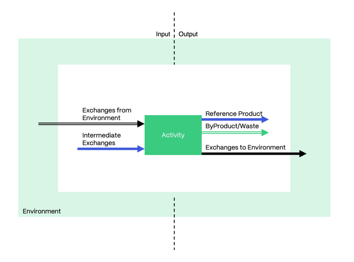
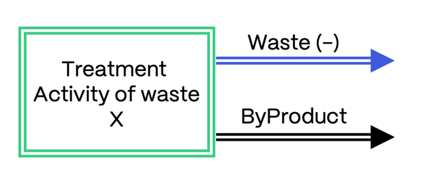
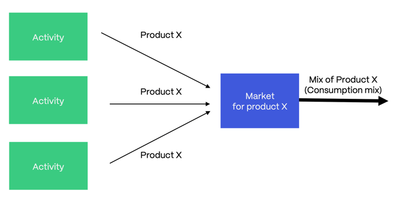

# 活动与产品

英文原题：Activities and Products  
来源：[ecoinvent 官方原文](https://support.ecoinvent.org/activities-products)  
原文快照：2026-10-13  
审核状态：AI 交叉审校通过，含审校注记

原站修改日期：2025-09-26





## ecoinvent 数据库中的每个数据集都表示一项人类活动（过程），以及该活动与环境和其他人类活动之间的交换。 

2023 年 10 月 24 日

[活动](#zh-b0020)

[活动类型](#zh-b0020)

[产品](#zh-b0046)

[产品类型](#zh-b0055)

每个数据集均包含以下信息：

<strong>[地理区域](geographies.md)</strong>  
例如，某项活动可能代表欧洲地区（RER）的情况。

<strong>时间段</strong>  
时间段以具有开始日期和结束日期的区间描述。例如，数据集“nitric acid production, product in 50% solution state”的时间段为 2011–2021 年。

时间段并不表示有效期截止日期，而是原始数据收集的时期或数据集所外推到的时期。某个数据集的结束日期可能已过去，但由于生产过程或技术未发生变化，或供应链已经更新，该数据集仍被视为现今有效。

<strong>文档说明</strong>  
文档描述该活动所代表的内容、边界等。

<strong>自然资源消耗</strong>  
例如，种植 1kg 棉花所需的水量。

<strong>排放情况</strong>  
例如，燃煤电厂燃烧 1kg 煤时排放到大气中的各种物质数量。

<strong>过程的物质输入流和输出流，即物料清单</strong>  
例如，生产 1kg 报纸所需的木材、纸浆和各种添加剂的数量。

<strong>能源和燃料消耗</strong>  
例如，生产 1kg 铝所用电力的数量和技术组合。

<strong>质量、水、生物源碳和化石碳核算</strong>  
例如，在造纸过程中，通过木材投入进入过程的生物源碳有多少最终进入纸产品，又有多少被燃烧用于能源生产并以 CO2 排放的形式释放到大气中。

<strong>年产量</strong>  
例如，澳大利亚硬煤矿的硬煤年产量。

每项活动根据名称、地理区域和时间段唯一标识：地理区域是理解数据集如何相互作用的关键因素。名称、地理区域和时间段这一唯一组合，使每个未指定系统模型的数据集都能通过一个标识编号，即所谓的通用唯一标识符（UUID），进行识别。

### 活动类型 

可以区分若干种活动类型，下文将更详细介绍。所有活动在输入端和输出端均具有交换。

来自<strong>环境</strong>和流向环境的交换也称<strong>基本流交换</strong>。当过程消耗自然资源时，例如从地下获取铁矿石、从河流取水或树木从空气中吸收 CO2，基本流交换放在输入端。当过程向土壤、水或空气释放排放时，基本流交换放在输出端。

所有其他交换都是<strong>中间交换</strong>，即某个过程消耗或生产、并与其他过程交换的产品。在输出端，我们区分以下产品类型：参考产品，以及副产品或废物。

#### 普通转化活动 

不属于下文介绍的特殊类型的所有活动，都是“普通”转化活动。转化活动是对投入进行转化、使活动输出与投入不同的人类活动，例如硬煤矿从地下开采硬煤，以提供可在市场销售的硬煤产品。

#### 处理活动 

ecoinvent 数据库中的废物没有经济价值，也不在市场出售。由于废物属于中间交换，因此不能释放到环境中，而是需要处理过程。处理过程（处理活动）将：

- 废物转化为有价值的产品，例如废食用油需要经过净化，才能成为生物燃料生产的有价值投入。这一过程可视为回收利用。
- 废物转化为向环境的排放，即基本流交换。例如，处理受污染的废水以获得未受污染的水，再将其排入河流。这一过程可视为最终处置。

处理活动的参考产品为负值，例如在填埋场处理惰性废物，其参考产品为 -1kg 惰性废物。

负号表示处理活动提供处理或处置其参考产品的服务。例如，通过分选处理未分选废纸的活动，将未分选废纸作为负值参考产品。从物理角度看，参考产品是处理活动的投入，例如未分选废纸是分选过程的投入。不过，ecoinvent 数据集中的参考产品放在输出端，并以负号保持过程的质量平衡。处理活动的副产品为正值，表示处理后获得的有价值产品，例如离开分选过程的已分选废纸。

专门的处理活动通常命名为“treatment of … [待处理产品的名称]”。处理或处置某种材料是其主要目的。  
一般而言，每项处理活动仅以一种废物作为投入（负值参考产品）。  
此外，如果某项转化活动的一项投入是待处理材料，它也可以作为处理活动。在 ecoinvent 数据库中，这种情况称为特殊生产（speciality production）。

#### 市场活动 

市场活动也称市场数据集，或简称市场。市场数据集将一个或多个生产（转化）活动的产品输出传递给将其作为投入消耗的活动，例如将供应商处的硬煤转移至消费者处的硬煤。市场地理边界的选择旨在反映现实世界的贸易条件。例如，澳大利亚硬煤消费者主要由澳大利亚硬煤生产商供应，因此设立澳大利亚硬煤市场具有合理性。

市场活动核算产品运输及损失。它们还提供某产品在给定地区的平均消费组合，以及后果型系统模型中的边际消费组合。了解[市场](market-activities.md)的更多信息。

#### 建设活动 

ecoinvent 数据库中的基础设施（即资本品）定义为寿命超过一年且不用于消费的产品。这一定义包括建筑、电网或燃气管网、道路、铁路、矿山和生产设施等固定基础设施，以及机械、工具和车辆等移动基础设施。

生产不可移动基础设施产品的活动，名称中通常包含“construction”（建设）。因此，这些活动也称建设活动。数据库中基础设施产品的参考单位通常为“unit”（单位），例如 1 单位发电厂。建设活动通常涵盖初始建设、基础设施全寿命期间的维护、土地占用和土地转化（如适用），以及寿命结束时为废物处理而实施的退役。退役基础设施产生的废物流以副产品/废物输出的形式离开活动。因此，基础设施的质量随废物流离开建设活动；所以基础设施产品是例外，不附带质量和碳含量属性。

基础设施产品不具有质量属性，而是具有“寿命”和“全寿命产能”属性。关于这些及其他产品属性的更多信息，请参阅[此处](properties.md)。

#### 服务活动 

服务活动具有为另一产品提供服务所需的投入和输出，但不包含接受服务的产品本身的实际投入和输出。因此，服务被定义为非物质交换，即不存在实物商品所有权的转移。

例如，使用动力锯进行锯切的服务，不以林中立木为投入。相反，林业过程具有林中立木的投入、动力锯切服务的投入（以小时计），以及伐倒树木的输出。锯的用量、运行所需燃料、维护所需润滑油和运行期间的排放，通过服务活动间接进入林业过程。

#### 运行活动 

名称中包含“operation”（运行）的过程表示使用某一特定基础设施产品，例如“mine operation”（矿山运行），与“mine construction”（矿山建设）相对。因此，运行数据集始终具有基础设施投入。“operation”与“use”（使用）同义。该术语既用于工业活动，例如“gold refinery operation”，也用于家庭活动，例如“operation, computer, desktop”。运行活动也可能满足服务活动的判定条件。

运行活动的参考产品并非特殊类型，而是普通产品，例如黄金精炼厂运行所产生的精炼金。

### 产品 

ecoinvent 数据库中表示的每项人类活动，都具有一种或多种产品输出。这些产品包括供其他人类活动使用的材料、商品和服务。其他活动将它们作为投入，进一步转化为其他产品、转移至另一位置，或进行处置。

ecoinvent 数据库使我们能够在联系紧密的全球供应链网络中追踪产品流。

此外，对于每种产品，数据库包含以下信息：

- 与其生产、运输、贸易或处置有关的环境影响。
- 产品的平均价格。
- 产品的平均物理[属性](properties.md)（对于具有质量的产品）
  - 干质量
  - 湿质量
  - 生物源碳和化石碳含量
- 产品在市场中的平均消费组合，即采用不同技术生产同一产品、供应同一最终市场的贡献。例如，某国水力、核能、煤、天然气和风力发电的份额。
- 贸易信息：生产者与消费者之间的平均运输方式和运输距离在产品模型中体现。

### 产品类型 

#### <strong>参考产品</strong> 

参考产品是过程的驱动因素。它是需求变化会影响该过程生产量的产品，也称决定性产品。参考产品可以是商品，也可以是服务。

#### <strong>副产品/废物</strong> 

副产品和废物与参考产品共同产生，但仅为生产副产品或废物本身而开展该过程并不合理。例如，秸秆与作为参考产品的小麦籽粒共同产生。

在大多数情况下，副产品易于与参考产品区分。副产品往往类似于废物，因此甚至未得到充分利用，例如秸秆。  
在副产品/废物类别中，废物没有经济价值，而副产品具有市场价值。  
参考产品与副产品/废物之间的区别取决于具体过程，即同一产品可以在一个过程中作为参考产品，而在另一个过程中作为副产品/废物。

每项中间交换还具有两种副产品分类，在该交换出现的所有过程中均保持一致。中间交换被分类为废物、可回收产品或可分配产品，并同时被分类为待处理材料（mft）或非待处理材料（non-mft）。这些分类根据不同系统模型的规则决定副产品的去向。关于系统模型的更多信息，请参阅[此处](system-models.md)。





## Each dataset in the ecoinvent database represents a human activity (process) and its exchanges with the environment and other human activities. 

Oct 24th, 2023

[Activities](#en-b0020)

[Types of Activities](#en-b0020)

[Products](#en-b0046)

[Types of Products](#en-b0055)

Each dataset contains information about:

<strong>[Its Geography](geographies.md)</strong>  
For example, an activity might be representative of the region of Europe (RER).

<strong>Its Time Period </strong>  
The time period is described as an interval with a start date and an end date. For example, the dataset ‘nitric acid production, product in 50% solution state’ has a time period of 2011-2021.

The time period does not represent an expiring date but the period of original data collection or the period to which the dataset has been extrapolated. A dataset might have an end date that is in the past but is still considered valid today since production processes or technologies did not change or the supply chain was updated.

<strong>Its Documentation </strong>  
The documentation provides a description of what the activity represents, its boundaries, etc.

<strong>Its Natural Resource Consumption </strong>  
For example, the amount of water required to grow 1kg of cotton.

<strong>Its Emission Profile </strong>  
For example, the amounts of substances emitted to the atmosphere when combusting 1kg of coal in a coal power plant.

<strong>Its Material Flows in and out of the Process, in other Words, its Bill of Materials </strong>  
For example, the amounts of wood, pulp and various additives needed to produce 1kg of newspaper.

<strong>Its Energy and Fuel Consumption </strong>  
For example, the amounts and technology mix of electricity used to produce 1kg of aluminum.

<strong>Its Mass, Water, Biogenic and Fossil Carbon Accounts </strong>  
For example, in a paper production process, how much of the biogenic carbon entering the process in wood inputs ends up in the paper product versus how much is combusted for energy generation and released as CO2 emissions to the atmosphere.

<strong>Its Annual Production Volume </strong>  
For example, the annual production of hard coal in Australian hard coal mines.

Each activity is uniquely identified based on name, geography and time period: geography is a key factor in understanding how datasets interact with each other. This unique combination of name, geography, and time period allows the identification of each undefined dataset by an id number, the so called universal unique identifiers (UUID) number.

### Types of Activities 

Several types of activities can be distinguished and will be described in more detail below. All activities have exchanges on the input side and on the output side.

Exchanges from and to the <strong>environment</strong>, also called <strong>elementary exchanges</strong>, are placed on the input side when a process consumes natural resources, such as iron ore from the ground, water from a river or CO2 taken up from the air into a tree. Elementary exchanges are placed on the output side when a process releases emissions into soil, water, or air.

All other exchanges are<strong> intermediate exchanges</strong>, i.e., the products consumed or produced by a process and exchanged with other processes. On the output side, we distinguish between types of products: reference products and by-products or waste.

#### Ordinary Transforming Activities 

All activities that are not of the special types described below are “ordinary” transforming activities. Transforming activities are human activities that transform inputs so that the output of the activity is different from the inputs, e.g., a hard coal mine that extracts hard coal in the ground to deliver the marketable product hard coal.

#### Treatment Activities 

Waste in the ecoinvent database has no economic value and is not sold on the market. Since waste are intermediate exchanges, they cannot be released into the environment; but require treatment processes. Treatment processes (treatment activities) convert:

- a waste into a valuable product, e.g., used cooking oil needs to be purified to become a valuable input to biofuel production. This process can be seen as recycling.
- a waste into emissions to the environment, i.e., elementary exchanges. An example would be the treatment of polluted wastewater to obtain unpolluted water, which is released into a river. This process can be seen as final disposal.

Treatment activities have a negative reference product, e.g., treatment of inert waste in a landfill has a reference product of -1kg of inert waste.

The negative sign indicates that the treatment activity supplies the service of treating or disposing of its reference product. For example, the treatment of unsorted waste paper by sorting has unsorted waste paper as a negative reference product. Physically, the reference product is an input to the treatment activity, e.g., the unsorted waste paper is an input to the sorting process. However, reference products in ecoinvent datasets are placed on the output side, and they have a negative sign to maintain the mass balance of the process. The by-products of the treatment activity have a positive sign; they represent valuable products obtained after treatment, e.g., the sorted paper leaving the sorting process.

Dedicated treatment activities often carry the name “treatment of … [name of the product to be treated].” Treatment or disposal of a material is their main purpose.   
In general, each treatment activity has only one waste as input (negative reference product).   
Furthermore, any transforming activity can function as a treatment activity if one of its inputs is a material for treatment. This case is called speciality production in the ecoinvent database.

#### Market Activities 

Market activities are also called market datasets or simply markets. Market datasets transfer the product output of one or more producing (transforming) activities to activities that consume it as an input, e.g., from hard coal at the supplier to hard coal at the consumer. The geographical boundaries of a market are chosen to reflect real-world trade conditions. For example, hard coal consumers in Australia are primarily supplied by hard coal producers in Australia, justifying an Australian market for hard coal.

Market activities account for transport and losses of the product. They further provide the average consumption mix of a product for a given region and the marginal consumption mix in the consequential system model. Learn more about the [markets](market-activities.md).

#### Construction Activities 

Infrastructure (i.e., capital goods) in the ecoinvent database is defined as products that have a lifetime that exceeds one year and that are not meant for consumption. This definition includes both stationary infrastructure, such as buildings, electricity or gas grids, roads, rails, mines and production facilities, and mobile infrastructure, such as machinery, tools and vehicles.

An activity producing an immobile infrastructure product often carries the term “construction” in its name. Therefore, these activities are also referred to as construction activities. The reference unit of infrastructure products in the database is most commonly “unit”, e.g., 1 unit of power plant. A construction activity usually covers the initial construction, the maintenance of the infrastructure during its lifetime, the land occupation and land transformation (if applicable) and the decommissioning for waste treatment at the end of the lifetime. The waste streams from decommissioned infrastructure leave the activity as by-product/waste outputs. The mass of the infrastructure thus leaves the construction activity with the waste streams; therefore, infrastructure products are an exception in that they do not come with properties of mass and carbon content.

Instead of mass properties, infrastructure products have properties of “lifetime” and “lifetime capacity.” Read more about these and other product properties [here](properties.md).

#### Service Activities 

Service activities have inputs and outputs required to perform a service on another product, without the actual input and output of the product receiving the service. Services are therefore defined as immaterial exchanges, i.e., without a physical good changing ownership.

For example, the service of sawing with a power saw does not have an input of the tree standing in the forest. Instead, the forestry process has an input of the tree standing in the forest, an input of power sawing (in hours) and an output of the felled tree. The amount of the saw, the fuel to operate it, the lubricating oil to maintain it and the emissions released during operation enter the forestry process indirectly through the service activity.

#### Operation Activities 

Processes with the term “operation” as part of their name represent the use of a specific infrastructure product, e.g., “mine operation” as opposed to “mine construction”. Operation datasets thus always have inputs of infrastructure. The term “operation” is used as a synonym for “use”. The term is applied to both industrial activities, e.g., “gold refinery operation”, and household activities, e.g., “operation, computer, desktop”. Operation activities may also fulfil the criteria to be a service activity.

The reference products of operation activities are not of any special type; they are normal products, such as refined gold resulting from gold refinery operation.

### Products 

Every human activity represented in the ecoinvent database has an output of one or more products. These products comprise materials, goods and services that become available to other human activities, which use them as inputs and then transform them into yet other products, transfer them to another location, or dispose of them.

The ecoinvent database allows us to follow flows of products within a highly connected network of global supply chains.

Moreover, for every product, the database contains information on:

- the environmental impacts associated with its production, transport, trade or disposal.
- the average price of the product.
- the average physical product [properties](properties.md) (for products with mass)
  - Dry mass
  - Wet mass
  - Biogenic and fossil carbon content
- the average consumption mix of a product in a market, i.e., the contribution of different technologies producing the same product for a common end market. For example, the shares of electricity produced from hydro, nuclear, coal, natural gas and wind in a country.
- trade information: the average transport modes and distances between the producers and consumers of the product are modeled within the products.

### Types of Products 

#### <strong>Reference Products </strong> 

The reference product is the driver of a process. It is the product for which a change in demand will affect the production volume of the process (also known as the determining product). The reference product can be a good or a service.

#### <strong>By-Products/Waste</strong> 

By-products and waste are co-produced together with the reference product but would not justify performing a process for their own sake. For example, straw is produced together with wheat grain, which is the reference product.

In most situations, by-products can easily be distinguished from reference products. Often, by-products are similar to waste and are therefore not even fully utilized, such as straw.   
Within the category of by-products/waste, waste does not have an economic value, whereas by-products do have a value on the market.   
The distinction between reference products and by-products/waste is process-specific, i.e., the same product can appear as a reference product in one process and as a by-product/waste of another process.

Every intermediate exchange also carries two by-product classifications that are consistent across all the processes in which the exchange appears. The intermediate exchanges are classified as either waste, recyclable, or allocatable product, and as a material for treatment (mft) or not a material for treatment (non-mft). These classifications determine the fate of a by-product within the rules of different system models. You can read more about system models [here](system-models.md).





## 翻译与审校注记 

- **已处理／已说明 · b0017**：原译“用于发电”将 energy generation 缩窄为电力，遗漏可能的供热。 已改为“用于能源生产”。 [查看完整记录](../review/issues.md#issue-001)
- **已处理／已说明 · b0031**：该段明确讨论 sorting 分选过程，以“分选”表示物理工艺，避免与模型中的 classification 分类混淆。 已将“未分类／已分类”改为“未分选／已分选”。 [查看完整记录](../review/issues.md#issue-002)
