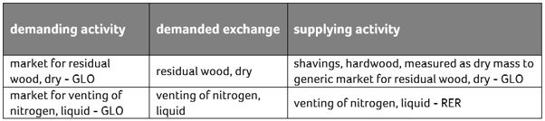

# ecoinvent 第 3.4 版

英文原题：ecoinvent Version 3.4  
来源：[ecoinvent 官方原文](https://support.ecoinvent.org/ecoinvent-version-3.4)  
原文快照：2026-10-13  
审核状态：AI 交叉审校通过，含审校注记

原站修改日期：2025-09-26





## ecoinvent v3.4 于 2017 年 10 月发布，在塑料回收、化学品、天然气和电力四个部门提供了 1,000 多个新增及更新数据集。 

<strong>ecoinvent v3.4 于 2017 年 10 月 4 日发布</strong>。了解如何[升级至我们的最新版本](licensing.md)。

2023 年 10 月 24 日

ecoinvent v3.4 更新了归因型和后果型系统模型的电力市场，并按邦和电网划分印度电力部门。此外，还新增和更新了欧洲天然气供应、化学产品及 PE 和 PET 回收数据。

为确保清晰透明，我们公开记录数据库最新更新与上一版本之间的变更。因此，每个数据库版本均提供多种文件，记录并解释所作变更，包括详细的变更报告、对应关系文件，以及列出各版本全部活动的文件。此外，我们记录各版本的所有已知问题，提醒数据库用户，并支持其理解和使用数据库。

### 新增及更新数据 

#### 电力市场数据的更新与扩展 

归因型系统模型为 IEA 统计涵盖的全部 142 个国家提供市场组成：以国家特定市场数据覆盖 100% 的全球电力生产（统计所代表的范围）。后果型系统模型依据欧盟和 IEA 的预测，为 40 个国家提供新的电力市场组成。这些新数据消除了后果型系统模型的重要不足，为后果型 LCA 的电力供应提供一致基础。

#### 按邦和电网划分的印度电力 

数据库中的电力生产不仅定期更新，还增加新地理区域，并将已有区域划分为较小区域，以提供更多细节。

印度按面积为世界第七大国，经济蓬勃发展。因此，评价许多产品供应链的环境影响时，印度的作用日益重要。为此，ecoinvent v3.4 为印度 29 个邦及 5 个电网引入了 160 多个新的电力生产数据集和市场。

#### 天然气 

更新了构成欧洲供应链（所有欧洲国家的天然气进口）的 100 多个数据集。该版本使数据库一致地反映所有欧洲国家及其主要供应国最新的技术和供应组合。

#### 化学产品 

通过更新 120 多个数据集和引入 50 种新产品，ecoinvent 显著扩展化学品部门覆盖范围。第 3.4 版为热和电力等主要交换，以及产量、CAS 号、化学式等提供更新数据。

#### PE 和 PET 回收利用 

第 3.4 版纳入覆盖消费后聚乙烯（PE）及聚对苯二甲酸乙二醇酯（PET）包装材料分选和回收利用的新数据集，拓宽数据库覆盖的废物组分及回收活动范围。

### 相关文档与文件 

#### <strong>变更报告 </strong> 

该报告涵盖 ecoinvent 数据库从第 3.3 版（2016）到第 3.4 版（2017）的全部变更，既反映全数据库变更，也反映各部门的特定变更。

 查看[变更报告](../assets/f13bc31a7ff7-change_report_v3_4_20171004_1-1.pdf)

#### 变更报告 

这份自动生成的 Excel 文件概述 ecoinvent 数据库第 3.3 版与第 3.4 版之间未指定系统模型的单元过程数据集变更。变更报告 XLS 文件可在 ecoinvent 数据库第 3 版在线平台 ecoQuery 的“文件”（Files）栏目中找到，供数据库许可证持有者使用。

#### 对应关系文件 

对应关系文件是一份电子表格，列出第 3.3 版和第 3.4 版的全部数据集，并匹配版本间的对应数据集。

 查看[对应关系文件](../assets/282c4157bb71-correspondence_file_eiv3.3_to_eiv3.4_20170921_final-1.xlsx)

#### ecoinvent 第 3.4 版活动概览：未指定系统模型 

一份 Excel 文件，列出 ecoinvent 第 3.4 版数据库的所有活动和产品，以及大部分元数据（地理区域、ISIC 分类、活动类型、技术水平、产品类型、单位等）。文件还包含数据库内所有地理区域、基本流交换和中间交换的清单。

 查看[ecoinvent v3.4 活动概览：未指定系统模型](../assets/1f538fb556ac-activity_overview_3.4_undefined_public-2.xlsx)

#### ecoinvent 第 3.4 版活动概览：APOS 

一份 Excel 文件，列出 ecoinvent 第 3.4 版数据库的所有活动，以及替代点分配模型特有的相关元数据。

 查看[ecoinvent v3.4 活动概览：APOS](../assets/702e9a054aad-activity_overview_3.4_allocation__apos_public-1.xlsx)

#### ecoinvent 第 3.4 版活动概览：Consequential 

一份 Excel 文件，列出数据库的所有活动，以及长期后果型替代系统模型特有的相关元数据。

 查看[ecoinvent v3.4 活动概览：Consequential](../assets/f76e0d10e188-activity_overview_3.4_consequential_public-1.xlsx)

#### ecoinvent 第 3.4 版活动概览：Cut-Off 

一份 Excel 文件，列出数据库的所有活动，以及按分类截断的分配系统模型特有的相关元数据。

 查看[ecoinvent v3.4 活动概览：Cut-Off](../assets/3208bc7e7cf6-activity_overview_3.4_allocation__cut-off_public-1.xlsx)

#### ecoinvent 第 3.4 版的 LCIA 方法 

列出所有 LCIA 方法及其全部影响类别，以及 ecoinvent 提供的部分累积 LCI 结果清单。

 查看[ecoinvent v3.4 的 LCIA 方法](../assets/ddf5f61b24e3-list_of_methods_and_indicators_ecoinvent_v3.4-1.xlsx)

### 已知问题 

本栏目列出 ecoinvent 数据库第 3.4 版所有已知数据错误。

#### 数据问题 

- 中压电力市场缺少来自城市废物焚烧的电力输入。这些输入将在下一数据库版本重新引入。
- 归因型系统模型中，大不列颠地理区域的电力市场不正确，缺少风电、光伏、水电、核电和废物等供应技术的输入。
- “market for natural gas, high pressure, PL”缺失；这意味着该市场的供应商（进口）目前以很小的份额供应 RoW 的“market for natural gas, high pressure”。对 RoW 市场的影响较小。
- 产品 MDD 目前在两条供应链中建模：“methylene diphenyl diisocyanate”（较旧数据）和“methylene diphenyldiisocyanate”（较新数据）。消费者仅使用较旧供应链，因此不存在重复计算。
- 环氧树脂产品目前在两条供应链中建模：“epoxy resin, liquid”（较旧数据）和“epoxy resin”（较新数据）。消费者仅使用较旧供应链，因此不存在重复计算。
- GLO 和 US 的“ground granulated blast furnace slag production”活动高估 CO2 排放；数值应为每 kg GGBFS 排放 0.020 kg CO2，而非 0.2 kg CO2。两个活动的修订版本可在 ecoEditor 中找到。
- “maize grain production, US, 2006”和“maize grain production, GLO, 2006”数据集中，“maize seed, for sowing”交换数值不正确，应为每 kg 玉米粒 0.003220612 kg，对应 30 kg/ha。两个活动的修订版本可在 ecoEditor 中找到。
- “styrene production”数据集向水体和大气排放的苯过高。在 PlasticsEurope 支持下，确认可从数据集中完全删除苯的水排放，并将其大气排放降至 2.0E-07 kg。修正后的清单已于第 3.8 版引入。

#### 后果型系统模型问题 

- “social”环境区室中存在三个基本流交换。由于 ecoinvent 尚未核算社会影响，在单元过程和清单层级均可忽略这些交换。
- 下表展示了某些数据集对指定供应活动并未提供的产品提出需求的情况。可忽略这两项交换。

#### LCIA 方法实施问题 

“ecological scarcity 2013”方法的“main air pollutants and PM”和“total”类别，在从 3.3 更新至 3.4 时未加入 3 种物质的表征因子。这些物质为乙烯、三氯乙烯和碳酸二甲酯，三者的表征因子均为 140000。在“main air pollutants and PM”类别中，33 个数据集的得分将增加超过 5%；最大差异出现在直接排放其中一种物质的数据集，变化为 179%。对于“total”类别，只有 7 个数据集的得分变化超过 5%，最大为 38%。

在“IMPACT 2002+ (Endpoint)”方法中，以 kBq 量化的交换被赋予陆地和水生生态毒性的表征因子，但这些因子不应适用于放射性排放。电离辐射表征因子也被错误赋予人体毒性指标。这两项错误极大地改变许多数据集的得分。

可按需索取有关表征因子错误及其对数据集得分影响的完整报告。更多细节请[联系我们](https://ecoinvent.org/contact-us/)。





## ecoinvent v3.4 was released in October 2017 featuring over 1,000 new and updated datasets in four different sectors: plastics recycling, chemicals, natural gas and electricity. 

<strong>ecoinvent v3.4 was released on October 4th, 2017</strong>. Discover how to [upgrade to our latest version](licensing.md).

Oct 24th, 2023

ecoinvent v3.4 updated the electricity markets for both attributional and consequential system models, partitioning the Indian electricity sector by states and grids. Further, data for the European natural gas supply, for chemical products, and for the recycling of PE and PET were added and updated.

As we wish to ensure clarity and transparency, we openly document the changes made between the latest update and the previous version of the database. Therefore, we offer various files that document and clarify the changes that have been made with each version of the database. These include detailed the report of changes, correspondence files, as well as files that include all activities of each version. Further, we document all known issues of each version to alert database users and to support their understanding and use of the database.

### New and Updated Data 

#### Updates and Extensions of Electricity Market Data 

In the attributional system models, market compositions are available for all 142 countries which are part of the IEA statistics: 100% of (statistically represented) global electricity generation is covered by country-specific market data. The consequential system model contains new electricity market compositions for 40 countries, based on projections from the EU and the IEA. These new data eliminate important shortcomings of the consequential system model and provide a consistent basis for electricity supply in consequential LCA.

#### Indian Electricity by State and Grid 

The electricity production in the ecoinvent database is not just updated on a regular basis, but new geographies are added and existing geographies are divided into smaller geographical regions to provide more detail.

India is the seventh biggest country in the world (by area), with a booming economy. As such, the role of India is becoming increasingly important when assessing the environmental impacts of the supply chains of many products. That is why more than 160 new electricity production datasets and markets for the 29 states and 5 electricity grids in India were introduced in ecoinvent v3.4.

#### Natural Gas 

More than 100 datasets composing the European supply chains (all imports of natural gas to European countries) were updated. With this version, the database consistently reflects the most current technology and supply mixes in all the European countries and their major suppliers.

#### Chemical Products 

With the update of more than 120 datasets and the introduction of 50 new products, ecoinvent significantly extended the coverage of the chemical sector. Version 3.4 includes more recent data for main exchanges, such as heat and electricity, as well as production volumes, CAS numbers, formulas, etc.

#### Recycling of PE and PET 

New datasets covering the sorting and recycling of post-consumer polyethylene (PE) and polyethylene terephthalate (PET) packaging materials are now included in version 3.4. These new datasets broaden the range of waste fractions and recycling activities covered by the database.

### Relevant Documents and Files 

#### <strong>Report of Changes </strong> 

This report covers all changes made in the ecoinvent database between version 3.3 (2016) and version 3.4 (2017). It reflects both the database-wide changes, as well as the sector-specific changes.

  See [Report of Changes](../assets/f13bc31a7ff7-change_report_v3_4_20171004_1-1.pdf)

#### Report of Changes 

This automatically generated excel file provides an overview of changes made on the undefined unit process datasets between versions 3.3 and 3.4 of the ecoinvent database. The Report of Changes XLS can be found in the «Files» section of ecoQuery, the online version of the ecoinvent database version 3. It is available to licensees of the ecoinvent database.

#### Correspondence File 

The correspondence file is a spreadsheet that lists all datasets in versions 3.3 and 3.4 and matches corresponding datasets between versions.

  See [Correspondence File](../assets/282c4157bb71-correspondence_file_eiv3.3_to_eiv3.4_20170921_final-1.xlsx)

#### Activity Overview for ecoinvent Version 3.4, Undefined 

An excel file listing all the activities and products present in the ecoinvent version 3.4 database including most of the metadata (geography, ISIC classification, activity type, technology level, product type, unit, etc.). This file also includes a list of all geographies, elementary and intermediate exchanges present in the database.

  See [Activity Overview for ecoinvent v3.4, Undefined](../assets/1f538fb556ac-activity_overview_3.4_undefined_public-2.xlsx)

#### Activity Overview for ecoinvent Version 3.4, APOS 

An excel file listing all the activities present in the ecoinvent version 3.4 database including metadata related specifically to the Allocation at the point of substitution.

  See [Activity Overview for ecoinvent v3.4, APOS](../assets/702e9a054aad-activity_overview_3.4_allocation__apos_public-1.xlsx)

#### Activity Overview for ecoinvent Version 3.4, Consequential 

An excel file listing all the activities present in the database including metadata related specifically to the Substitution, consequential, long-term system model.

  See [Activity Overview for ecoinvent v3.4, Consequential](../assets/f76e0d10e188-activity_overview_3.4_consequential_public-1.xlsx)

#### Activity Overview for ecoinvent Version 3.4, Cut-Off 

An excel file which lists all the activities present in the database including metadata related specifically to the Allocation, cut-off by classification system model.

 See A[ctivity Overview for ecoinvent v3.4, Cut-Off](../assets/3208bc7e7cf6-activity_overview_3.4_allocation__cut-off_public-1.xlsx)

#### LCIA Methods in ecoinvent Version 3.4 

List of all LCIA methods including all the impact categories as well as list of selected LCI cumulative results provided by ecoinvent.

  See [LCIA Methods in ecoinvent v3.4](../assets/ddf5f61b24e3-list_of_methods_and_indicators_ecoinvent_v3.4-1.xlsx)

### Known Issues 

This section lists all known data errors in version 3.4 of the ecoinvent database.

#### Data Issues 

- The markets for electricity, medium voltage are missing inputs of electricity from municipal waste incineration. These will be reintroduced with the next database release.
- The markets for electricity in the geography Great Britain in the attributional system models are incorrect. Inputs from the following supplying technolgies are missing: wind, photovoltaic, hydropower, nuclear, waste.
- The “market for natural gas, high pressure, PL” is missing; that means that suppliers to that market (imports) are currently supplying (with very little shares) the RoW “market for natural gas, high pressure” . The distortion on the RoW market is minor.
- The product MDD is currently modeled in two supply chains: “methylene diphenyl diisocyanate” (older data) and “methylene diphenyldiisocyanate” (more recent data). Only the older supply chain is used by consumers, so there is no double counting.
- The product epoxy resin is currently modeled in two supply chains: “epoxy resin, liquid” (older data) and “epoxy resin” (more recent data). Only the older supply chain is used by consumers, so there is no double counting.
- The activities “ground granulated blast furnace slag production”, GLO and US have overestimated CO2 emissions, the value should be 0.020 kg CO2 per kg GGBFS rather than 0.2 kg CO2 per kg GGBFS. Corrected versions of both activities can be found in the ecoEditor.
- The value of the exchange “maize seed, for sowing” is incorrect in the datasets “maize grain production, US, 2006” and “maize grain production, GLO, 2006”. The value should be 0.003220612 kg/kg of maize grain, which corresponds to 30 kg/ha. Corrected versions of both activities can be found in the ecoEditor.
- In the dataset “styrene production”, the benzene emissions to water and to air are too high. With support of PlasticsEurope, it could be established that the benzene emissions to water can be removed completely from the dataset and the benzene emissions to air were decreased to 2.0E-07 kg. A corrected inventory was introduced in version 3.8

#### Consequential System Model Issues 

- Three elementary exchanges are found in the compartment “social”. These exchanges can be ignored, both at the unit process and the inventory level, as ecoinvent does not yet account for social impacts.
- The table below shows dataset making a demand of a product that is not supplied by the specified supplying activity. These two exchanges can be ignored.

#### LCIA Method Implementation Issues 

In the method “ecological scarcity 2013”, categories “main air pollutants and PM” and “total”, the characterization factors for 3 substances were not added when updating from 3.3. to 3.4. The substances are: Ethylene, Trichloroethylene and Dimethyl carbonate. The CF for all 3 substances is 140000. In the category “main air pollutants and PM”, the score of 33 datasets would increase more than 5%. The largest differences are for datasets directly emitting one of the substances, with a change of 179%. For the “total category”, only 7 datasets see their score change more than 5%, with a maximum of 38%.

In the method “IMPACT 2002+ (Endpoint)”, exchanges quantified in kBq received CFs from terrestrial and aquatic ecotoxicity, even if those should not apply to radioactive emissions. Ionising radiation CFs were also accidentally attributed to the human toxicity indicator. These two mistakes drastically change the score of many datasets.

A full report of the CF mistakes and their effect on dataset scores is available upon request. For more details, please [contact us](https://ecoinvent.org/contact-us/).





## 翻译与审校注记 

- **已处理／已说明 · b0016**：统一指南规定的产量术语。 已将生产量改为产量。 [查看完整记录](../review/issues.md#issue-054)
