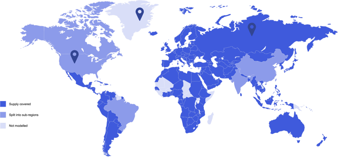
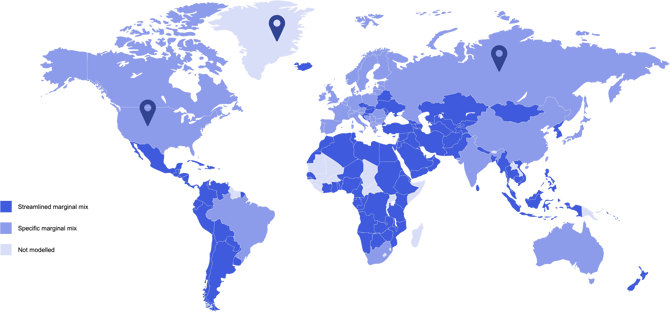
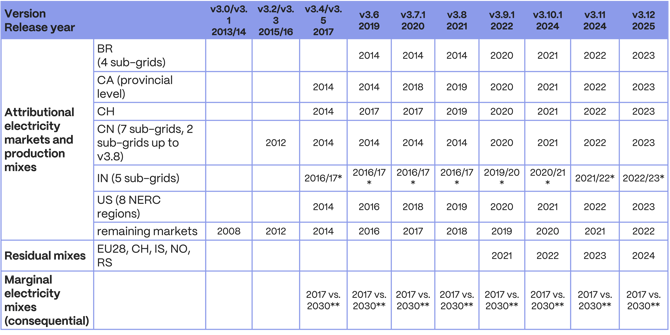
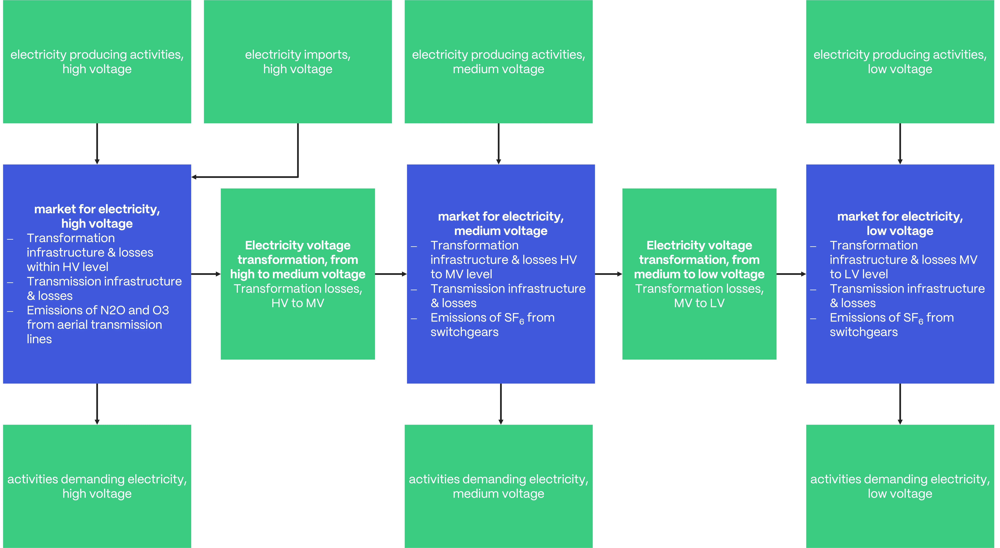

# 能源

英文原题：Energy  
来源：[ecoinvent 官方原文](https://support.ecoinvent.org/energy)  
原文快照：2026-10-13  
审核状态：AI 交叉审校通过，含审校注记

原站修改日期：2025-12-09


本页含原文疑点，需领域专家核实。请同时阅读文末审校注记。






## ecoinvent 数据库的能源部门包含电力和热力数据。两类数据均纳入数据库，并定期更新。 

2025年11月14日

[电力](#zh-b0008)

[电力参考年份](#zh-b0016)

[热力](#zh-b0098)

电力和热力都是广泛使用的能源形式，支持众多不同活动，以及日常生活的不同领域和方面。它们用于并消耗于家庭、办公室和各种设施运行、制造、运输，以及机器的使用和运行等，因此会显著影响无数产品和服务的生命周期。同时，量化其生产、输送和消费的影响至关重要。认识到这一需求，ecoinvent 数据库纳入最新数据，以提供尽可能贴近实际的信息。

### 电力 

#### 概览 

图 1：ecoinvent 数据库中归因型 Cut-off 和 APOS 系统模型的电力市场地理覆盖范围地图。

图 2：ecoinvent 后果型电力市场地理覆盖范围地图。不同颜色表示采用特定（蓝色）或简化（橙色）边际电力组合的市场。简化组合根据蓝色国家的可用数据生成。

数据库电力部门持续更新。目前，250 多个地理区域的 3,500 多个数据集对电力供给和消费建模，涵盖发电及发电厂、变压、输电、配电和用电。发电数据集覆盖广泛的化石和可再生能源及生产技术，包括各工业过程的次生电力生产数据集。

归因型和后果型系统模型计算结果时假设不同电力组合。归因型 Cut-off 和 APOS 系统模型采用各来源的最新汇总数据，以覆盖统计所表示全球发电量的 100%，从而为 142 个国家提供最新的专属电力组合。巴西、加拿大、中国、印度和美国等大国根据国家统计分为子区域。

后果型系统模型的电力组合则基于四十个国家未来电力市场组成的预测。这些国家合计占全球能源产出的 76.5%。组合依据欧盟委员会（2016）和国际能源署（2016）等国际机构的预测。

考虑到电力通常在不同电压等级生产、输送和消费，数据库按电压等级区分电力相关数据：高压（高于 24kV）、中压（1 kV 至 24 kV）和低压（低于 1 kV）。

#### <strong>电力参考</strong> <strong>年份</strong> 

下表汇总数据库不同版本的不同电力市场和组合所适用的参考年份。归因型系统模型中，巴西（BR）、加拿大（CA）、瑞士（CH）、中国（CN）、印度（IN）和美国（US）的电力组合基于国家统计，通常可获取发布年前两年的数据；其余国家基于[Enerdata](https://www.enerdata.net/) 和[Eurostat](https://ec.europa.eu/eurostat/databrowser/view/nrg_bal_peh__custom_14425791/default/table?lang=en)的最终完整统计，可获取发布年前三年的数据。截至 v3.8，中国划分为 CN-SGCC 和 CN-CSG 两个子电网；自 v3.9 起，CN-SGCC 进一步分为六个子电网，使中国合计具有七个子电网。

图 3：图 3：电力市场和组合参考年份汇总。不同电力组合的数据来源不同，因此某些国家的电力市场和组合适用年份也不同。所列国家缩写遵循 ISO 3166-1 alpha-2 标准。\* 印度财政年度从 x 年 4 月 1 日至 x+1 年 3 月 31 日，记为 x/x+1。\*\* 参阅文献：[The integration of long-term marginal electricity supply mixes in the ecoinvent consequential database version 3.4 and examination of modeling choices（在 ecoinvent 后果型数据库 3.4 版中整合长期边际电力供应组合并考察建模选择）](https://www.dora.lib4ri.ch/psi/islandora/object/psi:24716)。

### <strong>部门亮点</strong> 

#### <strong>可再生</strong><strong>电</strong><strong>力</strong> 

数据库中的可再生电力通过多种方式生产，其中多数方式又由不同发电技术表示。

太阳能通过聚光太阳能发电（CSP）和光伏利用。CSP 包含抛物槽式太阳能热系统和太阳能塔电厂数据集。光伏系统表示为外立面、平屋顶、斜屋顶和露天地面安装；光伏面板生产分为单晶硅、多晶硅、非晶硅（a-SI）、CdTe 和 CIS 面板。

水电由径流式、水库式和抽水蓄能电厂生产。水库大坝进一步区分高山、非高山和热带地区；这些地区建坝类型及水电厂所转化的土地不同。风电由不同类别风力机的发电表示，区分 &lt;1MW、1-3MW 和 &gt;3MW 三个功率等级，并区分海上和陆上发电。

最后，电力部门还包含深层地热发电形式的地热电力。

#### <strong>化石能源</strong><strong>电</strong><strong>力</strong> 

电力部门包含最常见化石能源发电方式的发电和基础设施数据集。

[煤炭](fuels.md)发电通过以硬煤或褐煤为燃料燃烧表示；硬煤发电提供常规和超临界两类燃煤电厂。

天然气燃烧发电通过常规燃气电厂、热电联产（CHP）电厂、联合循环（CC）电厂及不同规格的燃气轮机数据集表示。此外，ecoinvent 还包含石油和泥炭发电。

#### 沼气与废物焚烧 

数据库中也通过燃烧生物材料发电，包括燃气轮机和燃料电池使用生物甲烷、热电联产机组燃烧沼气，以及焚烧处理生物废物等活动。

此外，电力还作为多种过程的副产品产生，例如煅烧页岩生产、钴生产、甜高粱和木材制乙醇、石油生产、甘蔗加工、纸浆生产及各类废物焚烧处理。

#### 输电与配电 

电力在不同电压等级生产、输送和消费。数据库电力部门的结构示意如下：

来源：Treyer, K., & Bauer, C. (2016). Life cycle inventories of electricity generation and power supply in version 3 of the ecoinvent database—part II: electricity markets（ecoinvent 第 3 版数据库的发电与供电生命周期清单——第二部分：电力市场）. <em>International Journal of Life Cycle Assessment</em>, <em>21</em>(9), 1255–1268. <https://doi.org/10.1007/s11367-013-0694-x>

图 4：ecoinvent v3.6 电力相关活动与市场（高、中、低压）的结构和链接。N2O、O3 和 SF6 排放是市场活动的直接排放。部分发电活动和进口在 Consequential 系统模型中被分类为受约束活动，因此不向市场供货。

通常区分高、中、低电压等级，数据库中的定义如下：

- 多数大型电厂向高压电网供电。
- 长距离输电在高压等级进行，通过直流（DC）或交流（AC）输电线路或地下电缆完成。  
  变压和输电过程会产生损失。

中压电力：1 kV 至 24 kV。

- 高压电力在变电站转换为中压电力，用于地区配电。变压和配电过程会产生损失。
- 部分电厂向中压电网供电。在 ecoinvent 中，这些是以电力为副产品的废物焚烧厂。
- 造纸厂等大型工业企业通常消费中压电力。

低压电力：低于 1 kV。

- 中压电力在变电站转换为低压电力，用于当地配电。变压和配电过程会产生损失。
- ecoinvent 中光伏组件产生的电力输入低压电网。
- 家庭消费低压电力。

变压损失计入变压数据集，输电和配电损失计入各电压等级的电力市场数据集。

#### 剩余电力组合 

自 v3.9 起，数据库包含欧洲剩余电力组合数据集。剩余组合是一种虚拟组合，表示未追踪消费的能源组合，即未通过来源保证（GO）等机制明确追踪的电力消费。数据库实施的剩余组合份额采用发证机构协会（AIB）统计，按 Grexel（2020）方法计算。计算区域覆盖 EU28 全部成员国，以及冰岛、挪威、塞尔维亚和瑞士。

剩余组合按照数据库电力市场相同结构建模，供应高、中、低压电力，通过转化活动相互连接。为更清晰地表示，欧洲属性组合（EAM）采用单独数据集建模，并与所有属性赤字国家的剩余组合链接。对于从计算区域外进口电力的国家（这些进口未被追踪机制覆盖），进口通过活动链接直接在剩余组合数据集中表示。剩余组合及其计算的方法详情，请参阅[Grexel（2020），Issuance Based Residual Mix Calculation Methodology（基于签发的剩余组合计算方法）](https://www.aib-net.org/sites/default/files/assets/facts/residual-mix/2022/RM%20EAM%20IB%20Calculation%20Methodology%20V1_2.pdf)。

### <strong>数</strong><strong>据提供者</strong> 

电力部门数据基于不同数据提供者的贡献，包括但不限于：

- [瑞士联邦理工学院](https://ethz.ch/en.html)（ETH）
- [保罗谢勒研究所](https://www.psi.ch/en)（PSI）
- [CADIS，生命周期评价与可持续设计中心](http://www.centroacv.mx/servicios_en.php)
- [CONICET CCT Mendoza](https://www.mendoza.conicet.gov.ar/)
- [EnCiclo Soluções Sustentáveis Ltda.](https://www.enciclo.com.br/)
- [GAIA Environmental Services](https://www.gaiaenvironmental.org/)
- [Südesco energy](http://sudesco.com/)，秘鲁
- 巴西圣卡塔琳娜联邦大学生命周期评价研究组
- [Quantis](https://quantis-intl.com/)，瑞士
- [产品、服务和系统生命周期国际参考中心（CIRAIG）](https://ciraig.org/)
- [发证机构协会（AIB）](https://www.aib-net.org/)
- [Grexel](https://grexel.com/)，芬兰

### <strong>数据</strong> <strong>来源</strong> 

- [Eurostat](https://ec.europa.eu/eurostat/databrowser/view/nrg_bal_peh__custom_14425791/default/table?lang=en)
- [Enerdata](https://www.enerdata.net/)
- [国际能源署](https://www.iea.org/)（IEA）
- [欧洲输电系统运营商网络](https://www.entsoe.eu/)（ENTSO-E）
- [排放与发电资源综合数据库](https://www.epa.gov/egrid)（eGRID）
- [Enerdata](https://www.enerdata.net/)
- [加拿大国家统计机构](https://www.statcan.gc.ca/eng/start)（statCAN）
- [发证机构协会（AIB）](https://www.aib-net.org/)

### 编辑 

- <strong>Christian Bauer</strong>，保罗谢勒研究所，瑞士
- <strong>Diego Iribarren</strong>，IMDEA Energy，西班牙
- <strong>Christopher Oberschelp</strong>，苏黎世联邦理工学院，瑞士
- <strong>Malte Schäfer</strong>，伍珀塔尔大学，德国

### 相关文献 

数据库包含理解其内容背后的建模和计算所需的全部信息，以下报告提供更多信息，帮助进一步理解本部门的活动。

AIB，发证机构协会。European Residual Mixes（欧洲剩余电力组合）。剩余组合计算结果。获取地址：[https://www.aib-net.org/facts/european-residual-mixdata](https://www.aib-net.org/facts/european-residual-mix)

瑞士热能发电（包括热电联产）。可获取于：[瑞士部门统计](https://www.bfe.admin.ch/bfe/de/home/versorgung/statistik-und-geodaten/energiestatistiken/teilstatistiken.html#kw-86966)

Grexel（2020）。[Issuance Based Residual Mix Calculation Methodology（基于签发的剩余组合计算方法）](https://www.aib-net.org/sites/default/files/assets/facts/residual-mix/2022/RM%20EAM%20IB%20Calculation%20Methodology%20V1_2.pdf)，1.1 版。

瑞士水电设施统计。可获取于：[瑞士部门统计](https://www.bfe.admin.ch/bfe/de/home/versorgung/statistik-und-geodaten/energiestatistiken/teilstatistiken.html#kw-86966)

瑞士电力统计，表 6b。可获取于：[瑞士电力统计](https://www.bfe.admin.ch/bfe/de/home/versorgung/statistik-und-geodaten/energiestatistiken/elektrizitaetsstatistik.html)

瑞士能源总体统计，表格。可获取于：[瑞士能源总体统计](https://www.bfe.admin.ch/bfe/de/home/versorgung/statistik-und-geodaten/energiestatistiken/gesamtenergiestatistik.html/)

瑞士可再生能源统计，详细数据，附录 B。可获取于：[瑞士部门统计](https://www.bfe.admin.ch/bfe/de/home/versorgung/statistik-und-geodaten/energiestatistiken/teilstatistiken.html#kw-86966)

International Energy Agency（IEA），（2016a）。<strong>World Energy Outlook 2016（世界能源展望 2016）</strong>。Paris。<https://doi.org/10.1787/weo-2016-en>

IEA/OECD 电力信息。表 1.1 <strong>“世界发电量、进口、出口和最终消费”</strong>

Itten, R., Frischknecht, R., Stucki, M., (2014). <strong>Life Cycle Inventories of Electricity Mixes and Grid（电力组合与电网生命周期清单）</strong>，1.3 版。2019 年 8 月获取。

Messmer, A., Frischknecht, R., (2016). [Umweltbilanz Strommix Schweiz 2014（瑞士 2014 年电力组合环境评价），Version 589-Umweltbilanz-Strommix-Schweiz](http://treeze.ch/fileadmin/user_upload/downloads/589-Umweltbilanz-Strommix-Schweiz-2014-v3.0.pdf)-2014-v3.0，07.12.2016 09:19:00。2019 年 8 月获取。

SBB，（2019a）。[Zahlen und Fakten – Infrastruktur: Elektrische Energie für den Bahnbetrieb（数字与事实——基础设施：铁路运行用电）](https://reporting.sbb.ch/infrastrukturen?rows=2,5,6,7,8,13,43,45,47,49,51,53,55,59,60,61,62,63,64,65,66&years=0,1,4,5,6,7&scroll=1180&highlighted=63)，最后获取于 2019 年 8 月。

SBB，（2019b）。[Zahlen und Fakten: Nachhaltigkeit: Energieverbrauch（数字与事实：可持续性：能源消耗）](https://reporting.sbb.ch/nachhaltigkeit?rows=2,3,4,5,6,7,8,15,16,17,24,25,28,29,30,33,44,45,49,50,53,66,76&years=0,1,4,5,6,7&scroll=575)。2019 年 8 月获取。

瑞士小水电协会。<strong>Swiss small hydro, Factsheet: Small hydro（瑞士小水电，资料表：小水电）</strong>。获取地址：[swisssmallhydro.ch](https://swissmallhydro.ch/de/infostelle-kleinwasserkraft/dokumentation-und-literatur/)

Vandepaer, L., Treyer, K., Mutel, C., Bauer, C. and Amor, B., 2019. [The integration of long-term marginal electricity supply mixes in the ecoinvent consequential database version 3.4 and examination of modeling choices（在 ecoinvent 后果型数据库 3.4 版中整合长期边际电力供应组合并考察建模选择）](https://www.dora.lib4ri.ch/psi/islandora/object/psi:24716). The International Journal of Life Cycle Assessment, 24(8), pp.1409-1428（开放获取）

瑞士电力企业协会（VSE）和 Pronovo AG。获取地址：[stromkennzeichnung.ch](https://www.strom.ch/de/service/stromkennzeichnung)

Verein für umweltgerechte Energie VUE（环境友好能源协会）。Strom- und Biogasprodukte – Der Markt für erneuerbare Energieprodukte（电力与沼气产品——可再生能源产品市场）。获取地址：<https://www.naturemade.ch/de/publikationen.html>

### <strong>热力</strong> 

### <strong>部</strong><strong>门概览</strong> 

热力和蒸汽是重要能源，在数据库中通过多种方式生产和消费。数据库提供石油、煤、天然气等化石燃料燃烧，以及木颗粒和阔叶木材燃烧等传统供热方式，也纳入集中供热的大规模热电联产（CHP）或联合循环燃气轮机，以及当地供热的小型炉、锅炉和微型 CHP 等多种生产技术。这些供热过程所需基础设施的生产由单独数据集表示。

### <strong>部</strong><strong>门亮点</strong> 

#### <strong>燃料</strong><strong>供</strong><strong>热</strong> 

数据库中，热力常在热电联产机组或发电机和涡轮机中与电力同时生产。

数据库提供所有传统化石燃料供热的数据集，包括硬煤、焦炭、褐煤、柴油、天然气、轻燃料油和重燃料油。多数燃料具有多种供热方式。例如，天然气在热电联产机组、不同类型锅炉（大气式低 NOx 非调节、大气式非调节、冷凝式调节、风机燃烧器低 NOx 非调节、调节式）、热泵和工业炉中燃烧。

此外，木材燃烧供热由各种规模的炉和热电联产机组燃烧阔叶木材、木片、木颗粒和混合原木表示。

#### <strong>沼气与</strong><strong>废</strong><strong>物</strong><strong>燃</strong><strong>烧</strong> 

除各类废物处理供热外，还建模生物甲烷及秸秆、甘蔗渣、废木材和生物废物等农业生物质来源的热力。废物处理包括城市废物、危险废物、炼油污泥、废乳胶漆、废塑料、废建筑材料及其他多种废物。处理活动中的热力通常建模为过程副产品。

#### <strong>太阳能</strong><strong>集</strong><strong>热</strong><strong>器</strong><strong>供热</strong> 

太阳能供热与天然气、木材和电力等其他来源组合建模，既包括联合系统，也包括仅生产热水的系统。提供单户和多户住宅的平板、管式、铜平板及真空管等不同集热器技术。数据集主要基于 CH 数据。

#### <strong>作为</strong><strong>副</strong><strong>产</strong><strong>品</strong><strong>的热力</strong> 

热力也是多个工业过程的副产品，包括[造纸部门](pulp-and-paper.md)的纸浆生产、[金属部门](metals.md)的钢生产、锌精矿制锌和钢热轧，以及从液化石油气提取丙烷。

#### <strong>蒸汽</strong> 

蒸汽的使用和生产主要集中在数据库的[化学品与塑料部门](chemicals-and-plastics.md)（原文随后重复标注“Database sector chemical”）。蒸汽由化学和石油化工行业的平均燃料组合生产，以 kg 计量。化学部门的蒸汽用途包括氨、马来酸酐、硝酸和硫酸生产等；金属部门用于镍精矿冶炼和精炼，以及精矿制原生锌。

#### <strong>热力与</strong><strong>蒸</strong><strong>汽的</strong><strong>使</strong><strong>用</strong> 

供热方式多种多样，数据库中热力的应用和用途更加丰富。几乎每个其他部门都以某种方式使用热力，例如：

- 供暖温室中的生菜生产（Lettuce production in a heated greenhouse）
- 锰酸锂生产（Lithium manganese oxide production）
- 三聚氰胺浸渍纸生产（Melamine-impregnated paper production）
- 1000MW 压水反应堆核电厂建设（Nuclear power plant construction, pressure water reactor 1000MW）
- 玻璃木材室内门生产（Door production, inner, glass-wood）

数据库中的热力以 MJ 计量。不同供热技术组合在市场中，供应由天然气或其他来源提供的集中或小规模供热、区域或工业供热。

### <strong>数据</strong> <strong>提供者</strong> 

热力部门数据基于不同数据提供者的贡献。热力相关活动 LCI 数据集的主要提供者包括但不限于：

- [保罗谢勒研究所（PSI）](https://www.psi.ch/en)，瑞士
- [ESU-services](http://esu-services.ch/)，瑞士
- [产品、服务和系统生命周期国际参考中心](https://ciraig.org/)（CIRAIG）

### <strong>编辑</strong> 

- <strong>Karin Treyer</strong>（主编），保罗谢勒研究所，瑞士
- <strong>Christopher Oberschelp</strong>（共同编辑），苏黎世联邦理工学院，瑞士
- <strong>Christian Bauer</strong>（共同编辑），保罗谢勒研究所，瑞士
- <strong>Matthias Stucki</strong>（共同编辑），苏黎世应用科学大学（ZHAW），瑞士

### <strong>相关</strong> <strong>文献</strong> 

数据库包含理解其内容背后的建模和计算所需的全部信息，以下报告提供更多信息，帮助进一步理解本部门活动。

Dones, R., Bauer, C., Bolliger, R., Burger, B., Faist Emmenegger, M., Frischknecht, R., Heck, T., Jungbluth, N., Röder, A., Tuchschmid, M. (2007). <strong>Life Cycle Inventories of Energy Systems: Results for Current Systems in Switzerland and other UCTE Countries（能源系统生命周期清单：瑞士及其他 UCTE 国家当前系统的结果）</strong>. ecoinvent report No. 5. Villigen：保罗谢勒研究所，Dübendorf：瑞士生命周期清单中心，Dübendorf。可在[ecoinvent 数据库第 2 版](ecoinvent-version-2.md)的报告部分获取。

Heck, T. (2007). Wärmepumpen（热泵）. 收录于 Dones, R. 编等，<strong>Sachbilanzen von Energiesystemen: Grundlagen für den ökologischen Vergleich von Energiesystemen und den Einbezug von Energiesystemen in Ökobilanzen für die Schweiz（能源系统清单：能源系统生态比较及将能源系统纳入瑞士生命周期评价的基础）</strong>. ecoinvent 最终报告 No. 6-X. Villigen：保罗谢勒研究所，Dübendorf：瑞士生命周期清单中心，Dübendorf。可在[ecoinvent 数据库第 2 版](ecoinvent-version-2.md)的报告部分获取。

Heck, T. (2007). Wärme-Kraft-Kopplung（热电联产）. 收录于 Dones, R. 编等，<strong>Sachbilanzen von Energiesystemen: Grundlagen für den ökologischen Vergleich von Energiesystemen und den Einbezug von Energiesystemen in Ökobilanzen für die Schweiz（能源系统清单：能源系统生态比较及将能源系统纳入瑞士生命周期评价的基础）</strong>. ecoinvent 最终报告 No. 6-XIV. Villigen：保罗谢勒研究所，Dübendorf：瑞士生命周期清单中心，Dübendorf。可在[ecoinvent 数据库第 2 版](ecoinvent-version-2.md)的报告部分获取。

Werner, F., Althaus, H.-J., Künniger, T., Richter, K., Jungbluth, N. (2007). <strong>Life Cycle Inventories of Wood as Fuel and Construction Material（用作燃料和建筑材料的木材生命周期清单）</strong>. ecoinvent 2000 最终报告 No. 9. Dübendorf：EMPA，Dübendorf：瑞士生命周期清单中心。在线版本可在[ecoinvent 数据库第 2 版](ecoinvent-version-2.md)的报告部分获取。

Doka, G. (2003). <strong>Life Cycle Inventories of Waste Treatment Services（废物处理服务生命周期清单）</strong>. ecoinvent report No. 13. St. Gallen：瑞士生命周期清单中心。可在[ecoinvent 数据库第 2 版](ecoinvent-version-2.md)的报告部分获取。

Jungbluth, N. (2007). Sonnenkollektor-Anlagen（太阳能集热器系统）. 收录于 Dones, R. 编等，<strong>Sachbilanzen von Energiesystemen: Grundlagen für den ökologischen Vergleich von Energiesystemen und den Einbezug von Energiesystemen in Ökobilanzen für die Schweiz（能源系统清单：能源系统生态比较及将能源系统纳入瑞士生命周期评价的基础）</strong>. ecoinvent report No. 6-XI. Dübendorf：瑞士生命周期清单中心。可在[ecoinvent 数据库第 2 版](ecoinvent-version-2.md)的报告部分获取。





## The energy sector of the ecoinvent database includes data on electricity and heat. Data for both electricity and heat are included and regularly updated in the ecoinvent database. 

Nov 14th, 2025

[Electricity](#en-b0008)

[Electricity Reference Years](#en-b0016)

[Heat](#en-b0098)

Both are forms of energy widely used, supporting many different activities, diverse areas and aspects of daily life. Used in, and consumed for, operating households, offices and diverse facilities, for manufacturing, transportation, as well as for the purpose and operation of machines among other things, both forms of energy greatly affect the life cycle of countless products and services. At the same time, the quantification of the impact of their production, transmission and consumption is imperative. Recognising this necessity, the ecoinvent database includes the most recent data to provide information that are as close as possible to reality.

### Electricity 

#### Overview 

Figure 1: Map of geographical coverage of electricity markets in the ecoinvent database for the attributional system models cut-off and APOS.

Figure 2: Map of geographical coverage of consequential electricity markets in ecoinvent. The colors differentiate markets with a specific (blue) or streamlined (orange) marginal electricity mix. The streamlined mix is generated based on the available data from the blue countries.

The electricity sector in the ecoinvent database is continuously updated. Currently, more than 3,500 datasets in over 250 geographies model electricity supply and consumption, covering electricity generation including power plants, transformation, transmission, distribution and use. Electricity generating datasets cover a wide range of fossil as well as renewable energy sources and production technologies, including secondary electricity production datasets from various industrial processes.

The attributional and consequential system models assume different electricity mixes for the calculation their results. The cut-off and APOS attributional system model use the latest aggregated data from various sources in order to cover 100% of statistically represented global electricity production. This results in up-to-date unique electricity mixes being available for 142 countries. Large countries such as Brazil, Canada, China, India, and the USA are split into sub-regions based on national statistics.

Contrarily, electricity mixes for the consequential system model are based on projections of future electricity market compositions of forty countries. Together these countries represent 76.5% of the global energy output. These mixes are based on projections from international authorities such as the European Commission (2016) and the international Energy Agency (2016).

Taking into account that electricity is generally produced, transported and consumed at different voltage levels, the ecoinvent database categorizes/distinguishes electricity-related data according to the different voltage levels, namely high voltage (above 24kV), medium voltage (between 1 kV and 24 kV) and low voltage level (below 1 kV).

#### <strong>Electricity Reference</strong> <strong>Years</strong> 

The following table summarizes the years of reference for which the different electricity markets and mixes in the different versions of the ecoinvent database are valid. In the attributional system model the electricity mixes for Brazil (BR), Canada (CA), Switzerland (CH), China (CN), India (IN), and the United States (US) are based on national statistics which are usually available for release year minus two years while the remaining countries are based on final comprehensive statistics by [Enerdata](https://www.enerdata.net/) and [Eurostat](https://ec.europa.eu/eurostat/databrowser/view/nrg_bal_peh__custom_14425791/default/table?lang=en), available for release year minus three years. Up to v3.8 of the ecoinvent database, China was split into two sub-grids (CN-SGCC, CN-CSG), of which the CN-SGCC region was split into six sub-grids, resulting in seven total sub-grids for China from v3.9 onwards.

Figure 3: Figure 3: Summary of reference year for electricity markets and mixes. Due to varying data sources for different electricity mixes the years for which electricity markets and mixes are valid differ for certain countries. Abbreviations for the listed countries follow the ISO 3166-1 alpha-2 standard.\* The fiscal year in India starts on April 1st of year x and ends on March 31st of year x + 1 and is reported as x/x+1.\*\* See publication: [The integration of long-term marginal electricity supply mixes in the ecoinvent consequential database version 3.4 and examination of modeling choices](https://www.dora.lib4ri.ch/psi/islandora/object/psi:24716).

### <strong>Sector Highlights</strong> 

#### <strong>Renewable </strong><strong>E</strong><strong>lectricity</strong> 

Renewable electricity in the ecoinvent database is produced through various means, while most of those are represented by different generation technologies.

Solar energy is harvested with Concentrated Solar Power (CSP) plants and photovoltaics. For CSP datasets for thermal parabolic trough systems and solar tower plants are available. Photovoltaic systems are represented as facade, flat-roof, slanted-roof and open ground installations and photovoltaic panel production is split into single-Si, multi-Si, a-SI, CdTe and CIS panels.

Electricity from hydro is produced in run-or-river powerplants, reservoir, and pumped storage hydropowerplants. For reservoir dams a further distinction for different regions is made, namely alpine, non-alpine, and tropical. The regions differ in type of dam built and land transformed for the hydropower plant. Wind power is represented by electricity production from wind turbines from different classes. Three different power levels are distinguished: &lt;1MW, 1-3MW and &gt;3MW, while also classifying offshore and onshore power generation.

Finally, geothermal power is also included in the electricity sector of ecoinvent in the form of deep geothermal power generation.

#### <strong>Fossil </strong><strong>E</strong><strong>lectricity</strong> 

The electricity sector in ecoinvent contains electricity generation and infrastructure datasets for the most common fossil electricity generation means.

Electricity generation from [coal](fuels.md) is represented through the burning of hard coal or lignite as fuel, while for hard coal two types of coal firing power plants are available: conventional and supercritical.

The burning of natural gas for electricity generation is implemented in datasets representing conventional gas power plants, combined heat and power plants (CHP), combined cycle power plants (CC) as well as for turbines of different sizes. At last, electricity production through oil and peat are also implemented in ecoinvent.

#### Biogas and Waste Incineration 

In the ecoinvent database electricity is also produced through the burning of biological matter in activities concerning biomethane burned in gas turbines and fuel cells, biogas burned in combined heat and power co-generation unit as well as the from the treatment of biowaste through incineration.

Further, electricity is also produced as by-product from various processes such as the production of burnt shale, cobalt, ethanol from sweet sorghum and wood, petroleum, sugarcane processing, pulp production and the treatment of various wastes through incineration.

#### Transmission and Distribution 

Electricity is produced, transported and consumed at different voltage levels. The structure of the electricity sector in the ecoinvent database is schematically in the following figure:

Source: Treyer, K., & Bauer, C. (2016). Life cycle inventories of electricity generation and power supply in version 3 of the ecoinvent database—part II: electricity markets. <em>International Journal of Life Cycle Assessment</em>, <em>21</em>(9), 1255–1268. <https://doi.org/10.1007/s11367-013-0694-x>

Figure 4: Structure and links between electricity-related activities and markets (high, medium, and low voltage) in ecoinvent v3.6. Emissions of N2O, O3, and SF6 are direct emissions of the market activities. Some of the electricity-producing activities as well as imports are classified as constrained in the Consequential System Model and therefore do not supply the markets.

Typically, high voltage medium voltage and low voltage level are distinguished. In the ecoinvent database they are defined as follows:

- Most large power plants feed into the high voltage electricity grid.
- Long distance electricity transmission happens on high voltage level, either through direct current (DC) or alternating current (AC) transmission lines or underground cables.   
  Losses occur during transformation and transmission.

Electricity, medium voltage: between 1 kV and 24 kV

- High voltage electricity is transformed in transformer stations to medium voltage electricity for regional distribution. Losses occur during transformation and distribution.
- Some power plants feed into the medium voltage electricity grid. In ecoinvent these are waste incineration plants, which generate electricity as by-product.
- Large industries, e.g. paper mills, typically consumes medium voltage electricity.

Electricity, low voltage: below 1 kV

- Medium voltage electricity is transformed in transformer stations to low voltage electricity for local distribution. Losses occur during transformation and distribution.
- In ecoinvent, electricity generated from photovoltaic modules feeds into the low voltage grid.
- Households consume low voltage electricity.

Transformation losses are accounted for in transformation datasets. Transmission and distribution losses are accounted for in the electricity market dataset of each voltage level.

#### Residual Mixes 

Since ecoinvent v3.9, datasets on European residual electricity mixes are included in the ecoinvent database. The residual mix is a virtual mix. It represents the energy mix of untracked consumption, i.e., electricity consumption that is not explicitly tracked through mechanisms such as Guarantees of Origin (GO). The shares of the residual mixes implemented in the ecoinvent database have been calculated based on statistics from the Association of Issuing Bodies (AIB) following the methodology of Grexel (2020). The calculation area considered for the calculation of the residual mixes covers all members of EU28, Iceland, Norway, Serbia, and Switzerland.

The residual mixes have been modeled, following the same structure as the electricity markets in the ecoinvent database, delivering electricity on high, medium, and low voltage levels, which are connected with transforming activities. The European Attribute Mix (EAM) has been modeled as separate datasets for clearer representation and is linked to the residual mixes of all deficit countries. For countries importing electricity outside of the calculation area (not covered by tracking mechanisms), these imports are represented through activity links directly in the residual mix datasets. [Grexel (2020), Issuance Based Residual Mix Calculation Methodology](https://www.aib-net.org/sites/default/files/assets/facts/residual-mix/2022/RM%20EAM%20IB%20Calculation%20Methodology%20V1_2.pdf) for details on the methodology of residual mixes and their calculation.

### <strong>D</strong><strong>ata Providers</strong> 

Data on the electricity sector is based on contributions from different data providers, including (but not limited to):

- [Swiss Federal Institute of Technology](https://ethz.ch/en.html) (ETH)
- [Paul Scherrer Institut](https://www.psi.ch/en) (PSI)
- [CADIS, Center for LCA and Sustainable Design](http://www.centroacv.mx/servicios_en.php)
- [CONICET CCT Mendoza](https://www.mendoza.conicet.gov.ar/)
- [EnCiclo Soluções Sustentáveis Ltda.](https://www.enciclo.com.br/)
- [GAIA Environmental Services](https://www.gaiaenvironmental.org/)
- [Südesco energy](http://sudesco.com/), Peru
- Life Cycle Assessment Research Group from the Federal University of Santa Catarina, Brazil
- [Quantis](https://quantis-intl.com/), Switzerland
- [International Reference Center for Life Cycle of Products, Services and Systems (CIRAIG)](https://ciraig.org/)
- [Association of Issuing Bodies (AIB)](https://www.aib-net.org/)
- [Grexel](https://grexel.com/), Finland

### <strong>Data</strong> <strong>Sources</strong> 

- [Eurostat](https://ec.europa.eu/eurostat/databrowser/view/nrg_bal_peh__custom_14425791/default/table?lang=en)
- [Enerdata](https://www.enerdata.net/)
- [International Energy Agency](https://www.iea.org/) (IEA)
- [European Network of Transmission System Operators for Electricity](https://www.entsoe.eu/) (ENTSO-E)
- [Emissions & Generation Resource Integrated Database](https://www.epa.gov/egrid) (eGRID)
- [Enerdata](https://www.enerdata.net/)
- [Canada’s national statistical agency](https://www.statcan.gc.ca/eng/start) (statCAN)
- [Association of Issuing Bodies (AIB)](https://www.aib-net.org/)

### Editors 

- <strong>Christian Bauer</strong>, Paul Scherer Institut, Switzerland
- <strong>Diego Iribarren</strong>, IMDEA Energy, Spain
- <strong>Christopher Oberschelp</strong>, ETH Zürich, Switzerland
- <strong>Malte Schäfer</strong>, Bergische Universität Wuppertal, Germany

### Relevant Sources 

While the database contains all needed information to understand the modeling and calculations behind its contents, the reports below provide further information for enhanced understanding of the activities within the sector.

AIB, Association of Issuing Bodies. European Residual Mixes. Results of the calculation of Residual Mixes. Accessible: [https://www.aib-net.org/facts/european-residual-mixdata](https://www.aib-net.org/facts/european-residual-mix)

Electricity production from thermal energy (including combined heat and power) in Switzerland. Accessible: [Swiss Sector Statistics](https://www.bfe.admin.ch/bfe/de/home/versorgung/statistik-und-geodaten/energiestatistiken/teilstatistiken.html#kw-86966)

Grexel (2020). [Issuance Based Residual Mix Calculation Methodology](https://www.aib-net.org/sites/default/files/assets/facts/residual-mix/2022/RM%20EAM%20IB%20Calculation%20Methodology%20V1_2.pdf), Version 1.1.

Statistics of hydroelectric installations in Switzerland. Accessible:  [Swiss Sector Statistics](https://www.bfe.admin.ch/bfe/de/home/versorgung/statistik-und-geodaten/energiestatistiken/teilstatistiken.html#kw-86966)

Swiss Electricity Statistics, Table 6b. Accessible: [Swiss Electricity Statistics](https://www.bfe.admin.ch/bfe/de/home/versorgung/statistik-und-geodaten/energiestatistiken/elektrizitaetsstatistik.html)

Swiss Overall Energy Statistics, Tables. Accessible: [Swiss Overall Energy Statistics](https://www.bfe.admin.ch/bfe/de/home/versorgung/statistik-und-geodaten/energiestatistiken/gesamtenergiestatistik.html/)

Swiss Renewable Energy Statistics, Detailed Data, Appendix B. Accessible: [Swiss Sector Statistics](https://www.bfe.admin.ch/bfe/de/home/versorgung/statistik-und-geodaten/energiestatistiken/teilstatistiken.html#kw-86966)

International Energy Agency (IEA), (2016a). <strong>World Energy Outlook 2016</strong>. Paris. <https://doi.org/10.1787/weo-2016-en>

IEA/OECD Electricity information. Table 1.1 <strong>“World electricity production, imports, exports, final consumption"</strong>

Itten, R., Frischknecht, R., Stucki, M., (2014). <strong>Life Cycle Inventories of Electricity Mixes and Grid</strong>, Version 1.3.. Retrieved August 2019.

Messmer, A., Frischknecht, R., (2016). [Umweltbilanz Strommix Schweiz 2014, Version 589-Umweltbilanz-Strommix-Schweiz](http://treeze.ch/fileadmin/user_upload/downloads/589-Umweltbilanz-Strommix-Schweiz-2014-v3.0.pdf)-2014-v3.0, 07.12.2016 09:19:00. Retrieved August 2019.

SBB, (2019a). [Zahlen und Fakten – Infrastruktur: Elektrische Energie für den Bahnbetrieb](https://reporting.sbb.ch/infrastrukturen?rows=2,5,6,7,8,13,43,45,47,49,51,53,55,59,60,61,62,63,64,65,66&years=0,1,4,5,6,7&scroll=1180&highlighted=63) , last Retrieved August 2019.

SBB, (2019b). [Zahlen und Fakten: Nachhaltigkeit: Energieverbrauch](https://reporting.sbb.ch/nachhaltigkeit?rows=2,3,4,5,6,7,8,15,16,17,24,25,28,29,30,33,44,45,49,50,53,66,76&years=0,1,4,5,6,7&scroll=575). Retrieved August 2019.

Schweizer Verband der Kleinwasserkraft. <strong>Swiss small hydro, Factsheet: Small hydro</strong>. Accessible: [swisssmallhydro.ch](https://swissmallhydro.ch/de/infostelle-kleinwasserkraft/dokumentation-und-literatur/)

Vandepaer, L., Treyer, K., Mutel, C., Bauer, C. and Amor, B., 2019. [The integration of long-term marginal electricity supply mixes in the ecoinvent consequential database version 3.4 and examination of modeling choices](https://www.dora.lib4ri.ch/psi/islandora/object/psi:24716). The International Journal of Life Cycle Assessment, 24(8), pp.1409-1428 (Open Access)

Verband Schweizerischer Elektrizitätsunternehmen (VSE) and Pronovo AG. Accessible: [stromkennzeichnung.ch](https://www.strom.ch/de/service/stromkennzeichnung)

Verein für umweltgerechte Energie VUE. Strom- und Biogasprodukte – Der Markt für erneuerbare Energieprodukte. Accessible: <https://www.naturemade.ch/de/publikationen.html>

### <strong>Heat</strong> 

### <strong>S</strong><strong>ector Overview</strong> 

As an important energy provider, heat and steam are produced and consumed through various ways in the ecoinvent database. Classical means of heat production through the burning of fossil fuels such as oil, coal, natural gas, or burning of wood pellets and hardwood are available. Many different production technologies including large scale heat and power co-generation (CHP) or combined cycle gas turbines for centralized heat distribution, but also small-scale furnaces, boilers, and mini CHPs for local production are incorporated as well. In turn, the production of the infrastructure required for these heat production processes is represented in separate datasets.

### <strong>S</strong><strong>ector Highlights</strong> 

#### <strong>Heat from </strong><strong>F</strong><strong>uels</strong> 

In the ecoinvent database, heat is often produced in combination with electricity in co-generation units or in generators and turbines.

The database offers datasets of heat produced by all classical fossil fuels. These include hard coal, coke, lignite, diesel, natural gas, light and heavy fuel oil. For most of these fuels several ways of heat generation are available. Such are, natural gas is burned in heat and power co-generation units, in different types of boilers (atmospheric low-NOx non-modulating, atmospheric non-modulating, condensing modulating, fan burner low-NOx non-modulating, modulating), heat pumps and industrial furnaces.

Additionally, also the burning of wood for heat production is represented in the burning of hardwood, wood chips, wood pellets, mixed logs in furnaces of various sizes and co-generation units.

#### <strong>Biogas and </strong><strong>W</strong><strong>aste </strong><strong>B</strong><strong>urning</strong> 

Heat originated from biomethane and agricultural biomass sources such as straw, bagasse from sugarcane, waste wood, and biowaste are modeled next to heat from the treatment of various wastes. These include the treatment of municipal wastes, hazardous waste, refinery sludge, waste emulsion paint, waste plastics, waste building materials and many more. In the treatment activities heat is usually modeled as the by-product of the process.

#### <strong>Heat from </strong><strong>S</strong><strong>olar </strong><strong>C</strong><strong>ollectors</strong> 

Heat production originated from solar power is modelled in combination with other sources, such as gas, wood and electricity, either in combined systems or for hot water production only. Different technologies for collectors such as flat plate, tube collector, Cu flat plate and evacuated tube collectors in both one-family houses and multiple dwellings are available. The datasets are mostly based on data from CH.

#### <strong>Heat as </strong><strong>b</strong><strong>y-</strong><strong>P</strong><strong>roduct</strong> 

Heat is also produced as by-product of several industrial processes. These include the pulp production in the [paper sector](pulp-and-paper.md), steel production, zinc from concentrate, and the hot rolling of steel in the [metals sector](metals.md), or propane extraction from liquefied petroleum gas.

#### <strong>Steam</strong> 

Steam is overwhelmingly used and produced in the [chemicals and plastics sector](chemicals-and-plastics.md) Database sector chemical of the ecoinvent database. The steam is produced from an average fuel mix used in the chemical and petrochemical industry and is measured in kg. Uses of steam in the chemical sector include, among others, the production of ammonia, maleic anhydride, nitric and sulfuric acid. In the metals sector, steam is used for the smelting and refining of nickel concentrate and the primary zinc production from concentrate.

#### <strong>Use of </strong><strong>H</strong><strong>eat and </strong><strong>S</strong><strong>team</strong> 

As diverse as the ways to produce heat are, the application and usage of heat in the ecoinvent database is even more versatile. Almost every other sector uses heat in a way. Examples include:

- Lettuce production in a heated greenhouse
- Lithium manganese oxide production
- Melamine-impregnated paper production
- Nuclear power plant construction, pressure water reactor 1000MW
- Door production, inner, glass-wood

Heat in the ecoinvent database is measured in MJ. The different heat production technologies combined in markets for central or small-scale and district or industrial heating from natural gas or other sources.

### <strong>Data</strong> <strong>Providers</strong> 

Data on the heat sector is based on contributions from different data providers. Notable providers of LCI datasets on heat-related activities include (but are not limited to):

- [Paul Scherrer Institute (PSI)](https://www.psi.ch/en), Switzerland
- [ESU-services](http://esu-services.ch/), Switzerland
- [International Reference Center for Life Cycle of Products, Services and Systems](https://ciraig.org/) (CIRAIG)

### <strong>Editors</strong> 

- <strong>Karin Treyer </strong>(Main Editor), Paul Scherrer Institut, Switzerland
- <strong>Christopher Oberschelp </strong>(Co-Editor), ETH Zürich, Switzerland
- <strong>Christian Bauer </strong>(Co-Editor), Paul Scherrer Institut, Switzerland
- <strong>Matthias Stucki</strong> (Co-Editor), ZHAW, Switzerland

### <strong>Relevant</strong> <strong>Sources</strong> 

While the database contains all needed information to understand the modeling and calculations behind its contents, the reports below provide further information for enhanced understanding of the activities within the sector.

Dones, R., Bauer, C., Bolliger, R., Burger, B., Faist Emmenegger, M., Frischknecht, R., Heck, T., Jungbluth, N., Röder, A., Tuchschmid, M. (2007). <strong>Life Cycle Inventories of Energy Systems: Results for Current Systems in Switzerland and other UCTE Countries</strong>. ecoinvent report No. 5. Villigen: Paul Scherrer Institut, Dübendorf: Swiss Centre for Life Cycle Inventories, Dübendorf. Accessible in the Reports section of [version 2 of the ecoinvent database](ecoinvent-version-2.md).

Heck, T. (2007). Wärmepumpen. In: Dones, R. (Ed.) et al., <strong>Sachbilanzen von Energiesystemen: Grundlagen für den ökologischen Vergleich von Energiesystemen und den Einbezug von Energiesystemen in Ökobilanzen für die Schweiz</strong>. Final report ecoinvent No. 6-X. Villigen: Paul Scherrer Institut, Dübendorf: Swiss Centre for Life Cycle Inventories, Dübendorf. Accessible in the Reports section of [version 2 of the ecoinvent database](ecoinvent-version-2.md).

Heck, T. (2007). Wärme-Kraft-Kopplung. In: Dones, R. (Ed.) et al., <strong>Sachbilanzen von Energiesystemen: Grundlagen für den ökologischen Vergleich von Energiesystemen und den Einbezug von Energiesystemen in Ökobilanzen für die Schweiz</strong>. Final report ecoinvent No. 6-XIV. Villigen: Paul Scherrer Institut, Dübendorf: Swiss Centre for Life Cycle Inventories, Dübendorf. Accessible in the Reports section of [version 2 of the ecoinvent database](ecoinvent-version-2.md).

Werner, F., Althaus, H.-J., Künniger, T., Richter, K., Jungbluth, N. (2007). <strong>Life Cycle Inventories of Wood as Fuel and Construction Material</strong>. Final report ecoinvent 2000 No. 9. Dübendorf: EMPA, Dübendorf: Swiss Centre for Life Cycle Inventories. Online-Version under: Accessible in the Reports section of [version 2 of the ecoinvent database](ecoinvent-version-2.md).

Doka, G. (2003). <strong>Life Cycle Inventories of Waste Treatment Services</strong>. ecoinvent report No. 13. St. Gallen: Swiss Centre for Life Cycle Inventories. Accessible in the Reports section of [version 2 of the ecoinvent database](ecoinvent-version-2.md).

Jungbluth, N. (2007). Sonnenkollektor-Anlagen. In Dones, R. (Ed.) et al., <strong>Sachbilanzen von Energiesystemen: Grundlagen für den ökologischen Vergleich von Energiesystemen und den Einbezug von Energiesystemen in Ökobilanzen für die Schweiz</strong>. ecoinvent report No. 6-XI. Dübendorf: Swiss Centre for Life Cycle Inventories. Accessible in the Reports section of [version 2 of the ecoinvent database](ecoinvent-version-2.md).





## 翻译与审校注记 

- **待专家复核 · b0113**：原文在已给出的化学品与塑料部门链接后出现疑似编辑残留，语句重复且不完整。译文标出该重复以保留原文信息。 技术编辑确认并删除原文编辑残留，正式发布前可移除译文对应括注。 [查看完整记录](../review/issues.md#issue-124)
- **已处理／已说明 · b0014**：European Commission 的规范中文为欧盟委员会。 已修正译稿并重新核对原文。 [查看完整记录](../review/issues.md#issue-125)
- **已处理／已说明 · b0091**：恢复原文文献版本标识中的空格，保持标识原样。 已修正译稿并重新核对原文。 [查看完整记录](../review/issues.md#issue-126)
- **已处理／已说明 · b0100**：hardwood 在木材行业指阔叶材，并不保证材质硬度高；统一专业术语。 已修正译稿并重新核对原文。 [查看完整记录](../review/issues.md#issue-127)
- **已处理／已说明 · b0105**：hardwood 在木材行业指阔叶材，并不保证材质硬度高；统一专业术语。 已修正译稿并重新核对原文。 [查看完整记录](../review/issues.md#issue-128)
- **已处理／已说明 · b0116**：保留原文所列应用活动名称，以便在数据库检索。 已修正译稿并重新核对原文。 [查看完整记录](../review/issues.md#issue-129)
- **已处理／已说明 · b0117**：保留原文所列应用活动名称，以便在数据库检索。 已修正译稿并重新核对原文。 [查看完整记录](../review/issues.md#issue-130)
- **已处理／已说明 · b0118**：保留原文所列应用活动名称，以便在数据库检索。 已修正译稿并重新核对原文。 [查看完整记录](../review/issues.md#issue-131)
- **已处理／已说明 · b0119**：保留原文所列应用活动名称，以便在数据库检索。 已修正译稿并重新核对原文。 [查看完整记录](../review/issues.md#issue-132)
- **已处理／已说明 · b0120**：保留原文所列应用活动名称，以便在数据库检索。 已修正译稿并重新核对原文。 [查看完整记录](../review/issues.md#issue-133)
- **已处理／已说明 · b0091**：恢复题名显示空格时曾连带修改 href；现精确恢复源文链接地址，显示题名仍保留原文空格。 已恢复 href 并重新检查 HTML 属性。 [查看完整记录](../review/issues.md#issue-134)
