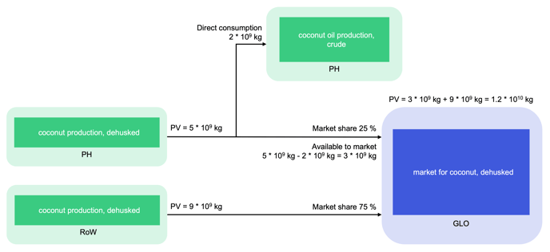

# 术语表 P

英文原题：P  
来源：[ecoinvent 官方原文](https://support.ecoinvent.org/glossary-p)  
原文快照：2026-10-13  
审核状态：AI 交叉审校通过

原站修改日期：2025-09-26





##

[参数](#zh-b0014)

[父数据集](#zh-b0016)

[PM10](#zh-b0018)

[PM2.5](#zh-b0020)

[过程](#zh-b0022)

[工艺用水](#zh-b0024)

[生成水](#zh-b0026)

[产品](#zh-b0028)

[产品含水量](#zh-b0030)

[生产组合](#zh-b0032)

[产量](#zh-b0034)

[属性](#zh-b0036)

### 参数 

表示数据集中使用的、由数据提供者定义的不同类型数值。新的 ecoSpold2 数据格式允许使用公式计算数据集中各流和其他实体的数量。例如，化学反应收率可以作为参数加入数据集。

### 父数据集 

子数据集引用的数据集；子数据集按规定范围从中继承字段值，即父数据集构成相关子数据集的基础。ecoinvent 第 3 版数据库只允许地理继承，即某些地区数据集（例如巴西大豆生产）可以建模为全球数据集的子数据集。子数据集中的数值可以设定为与父数据集的对应数值关联。父数据集中此类关联数值发生变化时，子数据集中的数值也会自动变化。

### PM10 

直径小于 10 µm 的颗粒物的简称。

### PM2.5 

直径小于 2.5 µm 的颗粒物的简称。

### 过程 

ecoinvent 第 2 版使用的术语，在第 3 版中被更通用的术语“活动”取代。过程指将输入转化为输出的一组相互关联或相互作用的活动（ISO 14040）。

### 工艺用水 

过程使用的水，不包括冷却水。在多数情况下，工艺用水与产品接触。这类水不包括过程所用输入中含有的水。

### 生成水 

某些化学反应可能产生这类水。

### 产品 

人类活动输出的货物或服务，具有正的市场价值或非市场价值。在 ecoinvent 第 2 版中，产品名称与活动名称相同；在第 3 版中，产品名称独立于活动名称。例如，在第 2 版中，“chloroacetic acid, at plant”（氯乙酸，出厂）既是活动名称，也是产品名称。同一数据集在第 3 版中名为“chloroacetic acid production”（氯乙酸生产），其生产的产品名为“chloroacetic acid”（氯乙酸）。

### 产品含水量 

这是来自系统中另一过程的流（技术圈流）。每种产品都具有含水量，因此可用于建立水流平衡。这对于水输送和处理过程（例如供水和废水处理）尤其重要。ecoinvent 第 3 版数据库通过“湿质量中的水质量”属性表示产品含水量。

### 生产组合 

一个地理区域内某特定产品的各供应商按产量加权得到的平均组合。

### 产量 

产量是在活动系统边界内生成的产品（参考产品，也可能包括副产品）的数量。对于处理活动，参考产品的产量表示在给定系统边界内处理的废物量。产量采用与产品相同的单位表示，例如 kg 或 kWh。  
  
所有转化数据集都包括给定地理区域内的产量数据。产量始终为年度数值。  
  
当同一地理区域内有多个活动生产同一产品时，各活动的产量仅代表该活动本身，即产量可以相加。  
  
产量用于确定市场组成。每个市场活动的输入都建模为来自其地理区域内的全部转化活动。这些转化活动将市场的参考产品作为输出，并按其可供应产量比例向市场供货（即市场产量 = 供货转化活动的总产量 − 消费转化活动通过活动链接直接消费的数量）。请参阅下图。  
  

### 属性 

每个具有质量的交换（基本流交换和中间交换均包括在内）都可以具有若干属性。例如，当前数据库中每种产品至少具有以下属性：湿质量、干质量、湿质量中的水质量、含水率、化石碳含量和非化石碳含量。





##

[Parameter](#en-b0014)

[Parent Dataset](#en-b0016)

[PM10](#en-b0018)

[PM2.5](#en-b0020)

[Process](#en-b0022)

[Process Water](#en-b0024)

[Produced Water](#en-b0026)

[Product](#en-b0028)

[Product Water Content](#en-b0030)

[Production Mix](#en-b0032)

[Production Volume](#en-b0034)

[Property](#en-b0036)

### Parameter 

Represents different types of values used in a dataset and defined by the data provider. The new ecoSpold2 data format allows the use of formulas to calculate the amounts of flows and other entities in the datasets. For example, the yield of chemical reaction can be inserted in the dataset as a parameter.

### Parent Dataset 

A dataset referred to by a child dataset as the dataset from which field values in the child dataset are to be inherited to the extent defined, i.e. parent datasets serve as basis of their associated child datasets. Only geographical inheritance is allowed in the ecoinvent version 3 database, i.e. some regional datasets (such as Brazilian soybean production) might be modeled as a child dataset of the global dataset. In child datasets values can be set to relate to the corresponding value in the parent dataset. When such a related value is changed in the parent dataset it is automatically changed in the child dataset as well.

### PM10 

Abbreviation for particulate matter with a diameter of less than 10 µm

### PM2.5 

Abbreviation for particulate matter with a diameter of less than 2.5 µm

### Process 

A term used in ecoinvent version 2 which was replaced in ecoinvent version 3 by the more generic term activity. Process represents set of interrelated or interacting activities that transforms inputs into outputs (ISO 14040).

### Process Water 

Water used by a process excluding cooling water. In most cases, process water is in contact with the product. This water does not include incorporated water in inputs used by the process.

### Produced Water 

This can occur in the case of some chemical reactions.

### Product 

Good or service output of a human activity with a positive either market or non-market value. While in ecoinvent version 2 the product name was identical with the activity name, in ecoinvent version 3 the product name is independent from the activity name. For example in ecoinvent version 2 “chloroacetic acid, at plant” is a name for both the activity and the product. The same dataset in ecoinvent version 3 is called “chloroacetic acid production” which produces the product called “chloroacetic acid.”

### Product Water Content 

This is the flow from another process in the system (technosphere flow). Every product has water content and therefore can be used to balance the water flows. This is especially important for water transport and treatment processes (e.g. water supply and waste water treatment). The product water content is presented in the ecoinvent version 3 database via the water in wet mass property.

### Production Mix 

The production-volume-weighted average of the suppliers of a specific product within a geographical area.

### Production Volume 

Production volume is the amount of a product (reference and potentially by-product) generated within the system boundaries of the activity. In treatment activities, the production volume of the reference product represents the amount of the waste treated within the given system boundaries. The production volume is expressed in the same unit as the product (for example, kg or kWh).  
  
All transforming datasets include data on the production volume in the given geographical area. Production volumes are always annual values.  
  
When more than one activity produces the same product within the same geographical area, the production volume of each activity reflects that activity alone, i.e., the production volumes are additive.  
  
Production volumes are used to determine the market compositions. In each market activity, the inputs are modeled as originating from all transforming activities within the geographical area of that market activity. These transforming activities produce the market reference product as an output and supply the market in proportion to their available production volume (i.e., the production volume of the market = total production volume of the supplying transforming activities – direct consumption by the consuming transforming activities via an activity link). See the graphic below for reference.  
  

### Property 

Every exchange (both elementary and intermediate) with a mass can have a number of properties. For example, every product currently present in the database has at least the following properties; wet mass, dry mass, water in wet mass, water content, carbon content, fossil and carbon content, non-fossil.




