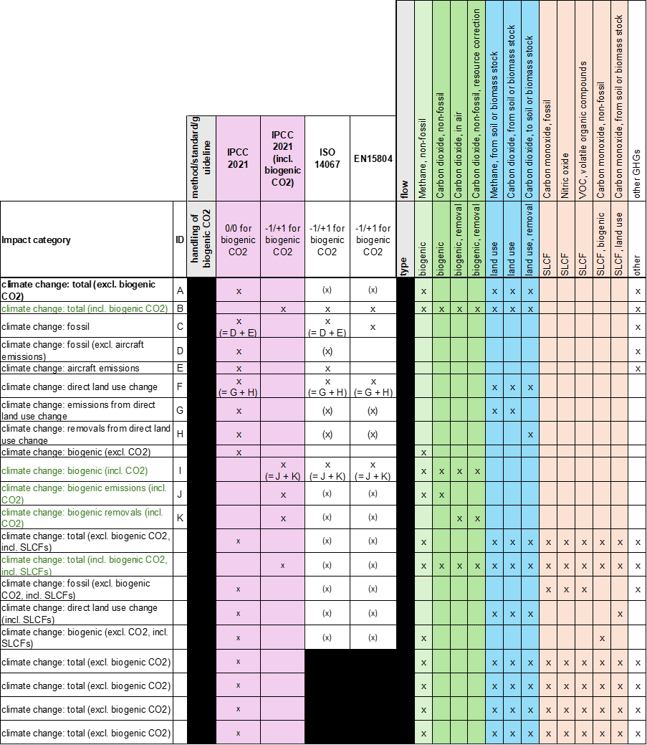
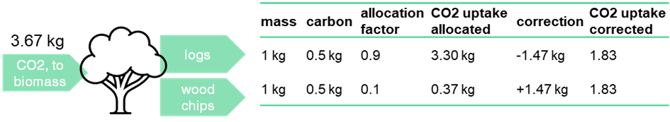

# IPCC 方法使用指南

英文原题：Guidance on IPCC Methods  
来源：[ecoinvent 官方原文](https://support.ecoinvent.org/guidance-on-ipcc-methods)  
原文快照：2026-10-13  
审核状态：AI 交叉审校通过

原站修改日期：2026-03-13





## ecoinvent 提供遵循 IPCC 2021 的生命周期影响评价（LCIA）结果值，也称“碳足迹”或“排放因子”。 

主要方法也直接称为“IPCC 2021”。此外，还引入了“IPCC 2021 (incl. biogenic CO2)”方法。该方法按某些标准的建议，以 -1/+1 表征生物源二氧化碳的吸收和释放。<strong>这两种方法相互补充，后者不应作为独立方法使用。</strong>实施细节见[LCIA 实施报告](../assets/08f95eab812e-LCIA-Implementation-v3.12.pdf)。<strong>本文重点介绍如何使用 ecoinvent 提供的不同影响类别结果值，以符合标准和指南要求。</strong>

### 可用影响类别和指标 

最常用的指标是 100 年全球变暖潜势（GWP100）。多数可用影响类别采用该指标量化（图 1）。主要影响类别为“climate change”（气候变化），其子类别按以下方式对影响进行分组：

- total（总量）：评价所有相关基本流。
- fossil（化石）：评价化石来源基本流。
- aircraft emissions（航空器排放）：评价航空器的化石来源排放。
- direct land use change（直接土地利用变化）：评价与土地利用变化相关的基本流。
- biogenic（生物源）：评价生物源／非化石来源基本流。

此外，“direct land use change”和“biogenic”子类别分别提供排放量和清除量。在适用时，影响类别还明确是否包含生物源二氧化碳（“excl./incl. biogenic CO2”）；“fossil”按定义排除“biogenic”，而建模中与土地利用变化有关的二氧化碳流与生物源流分开表示。最后，主要子类别还提供包含短寿命气候强迫因子（SLCF）的影响类别。这些因子包括一氧化碳、一氧化氮和挥发性有机化合物（VOC）。AR6 不再提供它们的度量指标，因此此处使用 IPCC 2013 实施中的 CF（详见[LCIA 实施报告](../assets/08f95eab812e-LCIA-Implementation-v3.12.pdf)）。

GWP100 以外的指标仅提供“total”子类别。这些指标为 20 年和 500 年全球变暖潜势（GWP20 和 GWP500），以及 50 年和 100 年全球温度变化潜势（GTP50 和 GTP100）。

<strong>图 1。</strong>可用影响类别、指标及其与标准的映射；(x) = 标准中未明确提及，但建议纳入分析。

### 与此前版本影响类别的映射 

由于引入“IPCC 2021 (incl. biogenic CO2)”，此前已有方法“IPCC 2021”的影响类别名称进行了更新。尤其是名称明确说明排除生物源碳，例如 v3.10 的“climate change”在 v3.11 中变为“climate change: total (excl. biogenic CO2)”。[此文件](../assets/4cc9323307d9-IPCC-mapping-3.11-3.10.xlsx)提供了新版（v3.11）与旧版（v3.10 及以前）实施中影响类别和指标的映射。

### 一般建议 

<strong>评价“气候变化”时，可称为“标准”指标的影响类别／指标组合是“climate change: total (excl. biogenic CO2)”／“GWP100”。</strong>不过，比较不同类别和指标通常有助于获得进一步认识。由联合国环境署主持的生命周期倡议，在其[首份 LCIA 指标全球指南报告](https://www.lifecycleinitiative.org/training-resources/global-guidance-lcia-indicators-v-1/)中发布了温室气体排放和气候变化影响的建议。这些建议针对 AR5/IPCC 2013，因为这是当时已有的报告。关于指标／时间范围的建议如下：

- 使用 GWP100 作为较短期气候变化影响类别的指标。
- 使用 GTP100 作为长期影响的代理指标，因为它是针对未来 100 年潜在温升的瞬时指标（GTP50 得出的结论与 GWP100 类似）。

此外，建议进行包含短寿命气候强迫因子（SLCF，在 AR5 中称为近期气候强迫因子 NTCF）的敏感性分析。

### 关于生物源二氧化碳以及标准和指南的建议 

<strong>首要建议是尽可能使用“IPCC 2021”，其中以 0/0 表征生物源二氧化碳。</strong>不过，ISO 14067 和 EN 15804 等某些标准和指南要求以 -1/+1 表征生物源二氧化碳的吸收和释放。ecoinvent 在“IPCC 2021 (incl. biogenic CO2)”方法中实施了这一要求，通过包含生物源二氧化碳的影响类别补充“IPCC 2021”。这些影响类别包括不含和包含 SLCF 的“climate change: total”，以及包含生物源二氧化碳的“climate change: biogenic”，后者既提供总量，也分别提供排放量和清除量，以提供更多信息和更高透明度。

“IPCC 2021”和“IPCC 2021 (incl. biogenic CO2)”中的影响类别可以映射到标准和指南（图 1）。遵循标准和指南还可能需要产品碳含量等其他碳信息，但这些信息不来自 LCIA 方法。我们在[ecoQuery 的“文件”（Files）部分](https://ecoquery.ecoinvent.org/3.11/cutoff/files)提供所有产品的碳含量清单。

<strong>包含生物源二氧化碳的结果值可能因分配而失真，并存在高估吸收量的风险。应谨慎使用这些结果值，尤其是负值；绝不能将其作为独立结果值使用。</strong>评价生物源碳吸收的另一种方法，是根据产品的非化石碳含量，直接核查产品中固定的生物源二氧化碳。可将其与排除和包含生物源二氧化碳的结果值之差比较；理论上，两者应相等。

<strong>用户对其应用和解释承担全部责任。</strong>

### 补充内容 

#### <strong>如何使用 IPCC 数据计算 LCIA 结果值</strong> 

“碳足迹”“碳核算”“排放因子”和“LCIA 结果值”在此均指相同内容，并依据联合国政府间气候变化专门委员会（IPCC）的出版物。该委员会定期发布评估报告（AR），其中包含全球变暖潜势（GWP）和全球温度变化潜势（GTP）的排放度量。这些数值在 ecoinvent 数据库的“IPCC”方法中作为表征因子（CF）实施。

例如，在 2021 年发布的 AR6 中，化石甲烷在“100 年全球变暖潜势（GWP100）”指标下的 CF 为 29.8 kg CO2 当量／kg 甲烷。这些数值作为 CF 应用于某影响类别（“climate change”）中的所有相关“基本流”（即温室气体排放），由此可以计算影响评价结果值。例如，碳足迹为 34 kg CO2 当量；用 LCIA 术语表达，即“climate change”影响类别的结果值为 34 kg CO2 当量。

实施细节见[LCIA 实施报告](../assets/08f95eab812e-LCIA-Implementation-v3.12.pdf)。

#### <strong>生物源碳建模挑战与碳分配修正</strong> 

ecoinvent 数据库中用于评价生物源二氧化碳的相关基本流为“Carbon dioxide, in air”（吸收）和“Carbon dioxide, non-fossil”（释放）。碳吸收发生于生物质生长过程，例如农业和林业过程。我们已核查这些过程中的生物源碳属性和碳平衡，确保“Carbon dioxide, in air”的数量对应于输出产品中储存的碳。此外，我们还核查了农业、林业和制浆造纸等相关部门中采用分配的过程的生物源碳平衡。这使自动碳分配修正得以实施（见下文）。不过，这并未应用于整个数据库，其他部门可能仍存在属性不完整和碳不平衡。因此，沿供应链越向下游，包含生物源二氧化碳的结果值失真的风险就越高。

#### <strong>碳分配修正</strong> 

基本流是碳平衡的一部分，通过经济分配分配给产品。这意味着碳吸收（“Carbon dioxide, in air”）也按经济分配处理。这可能导致平衡失真。假设某活动以 50:50 的比例生产原木和木片，但由于原木价格是木片的九倍，碳吸收按 90:10 分配，那么分配后的原木活动中碳吸收过多，而分配后的木片活动中碳吸收过少。基本流“Carbon dioxide, non-fossil, resource correction”用于修正失真结果与分配前数量之间的差异。





## ecoinvent offers Life Cycle Impact Assessment (LCIA) scores (or “carbon footprints” or “emission factors”) following IPCC 2021. 

The main method is also simply called “IPCC 2021”. Additionally, the method “IPCC 2021 (incl. biogenic CO2)” was introduced. It contains a characterization of biogenic carbon dioxide uptake and release characterized with -1/+1, as suggested in some standards. <strong>The two methods are complementary, and the latter is not meant to be used as a stand-alone method.</strong> Implementation details can be found in the [LCIA Implementation report](../assets/08f95eab812e-LCIA-Implementation-v3.12.pdf). <strong>The focus here is on how to use the scores for different impact categories that ecoinvent provides to be in line with standards and guidelines.</strong>

### Available Impact Categories and Indicators 

The indicator that is most often used is global warming potential 100 (GWP100). Most impact categories offered are quantified for this indicator (Figure 1). The main impact category is “climate change”, but sub-categories group impacts as follows:

- total (all relevant elementary flows assessed)
- fossil (fossil elementary flows assessed)
- aircraft emissions (fossil aircraft emissions assessed)
- direct land use change (land use change-related elementary flows assessed)
- biogenic (biogenic/non-fossil elementary flows assessed)

Additionally, emissions and removals are given separately for “direct land use change” and “biogenic” sub-categories. Furthermore, it is made explicit in impact categories whether biogenic carbon dioxide is included or not (“excl./incl. biogenic CO2”) where relevant (“fossil” by definition excludes “biogenic” and land use change-related carbon dioxide flows are separated from biogenic ones in modeling). Finally, for the main sub-categories there are impact categories available that include short-lived climate forcers (SLCFs). These are carbon monoxide, nitric oxide, and volatile organic compounds (VOCs). AR6 does not provide metrics for these anymore, which is why CFs from the IPCC 2013 implementation are used here (see [LCIA Implementation report](../assets/08f95eab812e-LCIA-Implementation-v3.12.pdf) for details).

Other indicators than GWP100 are only offered for the “total” sub-category. These indicators are global warming potential 20 and 500 (GWP20 and GWP500) and global temperature potential 50 and 100 (GTP50 and GTP100).

<strong>Figure 1.</strong> Available impact categories and indicators and mapping to standards; (x) = not explicitly mentioned in the standard but recommended to be included in the analysis.

### Mapping of Impact Categories to Previous Versions 

The impact category names for the previously existing method "IPCC 2021" were updated because of the introduction of “IPCC 2021 (incl. biogenic CO2)”. In particular, they were renamed to be more specific about the exclusion of biogenic carbon, for example, “climate change” in v3.10 is now “climate change: total (excl. biogenic CO2)” in v3.11. A mapping of impact categories and indicators from the new (v3.11) to the old (v3.10 and before) implementation is provided in [this file](../assets/4cc9323307d9-IPCC-mapping-3.11-3.10.xlsx).

### General Recommendations 

<strong>What could probably be termed the “standard” indicator for assessing “climate change” is the impact category/indicator combination “climate change: total (excl. biogenic CO2)”/“GWP100”.</strong> However, it usually makes sense to compare different categories and indicators for further insights. The Life Cycle Initiative, hosted by UN Environment, has published recommendations on greenhouse gas emissions and climate change impacts in their [first global guidance for LCIA indicators report](https://www.lifecycleinitiative.org/training-resources/global-guidance-lcia-indicators-v-1/). These recommendations relate to AR5/IPCC 2013, as this was the report available back then. The recommendations regarding indicators/time horizons are:

- Using GWP 100 as the indicator for the shorter-term climate change impact category.
- Using GTP100 as a proxy for long-term impacts because it is an instantaneous indicator targeting potential temperature rise 100 years in the future (because GTP50 leads to similar conclusions as GWP100).

Furthermore, it is recommended to perform a sensitivity analysis including short-lived climate forcers (SLCFs, called near-term climate forcers NTCFs in AR5).

### Recommendations Regarding Biogenic Carbon Dioxide and Standards and Guidelines 

<strong>First and foremost, we recommend using “IPCC 2021” where biogenic carbon dioxide is characterized with 0/0 whenever possible.</strong> However, some standards and guidelines—for example, the ISO 14067 and EN 15804 standards—demand characterizing biogenic carbon dioxide uptake and release with -1/+1. ecoinvent has implemented this in the “IPCC 2021 (incl. biogenic CO2)” method, which complements “IPCC 2021” with impact categories including biogenic carbon dioxide. These impact categories are “climate change: total” without and with SLCFs and “climate change: biogenic” including biogenic carbon dioxide for the total as well as the emissions and removals separately to provide more information and transparency.

Impact categories from “IPCC 2021” and “IPCC 2021 (incl. biogenic CO2)” can be mapped to standards and guidelines (Figure 1). Further carbon information like the carbon content of products might be needed to comply with standards and guidelines, but this information does not come from LCIA methods. We provide a list with carbon contents of all products in the [“Files” section in ecoQuery](https://ecoquery.ecoinvent.org/3.11/cutoff/files).

<strong>Scores including biogenic carbon dioxide are subject to potential distortions by allocation and there is the risk of overestimating uptake. They should be handled with care, especially if they are negative, and they should never be used as a stand-alone score.</strong> Another approach to assess biogenic uptake is to simply check the biogenic carbon dioxide bound in the product based on its non-fossil carbon content. This can be compared to the difference of the scores excluding and including biogenic carbon dioxide as – in theory – they should be equal.

<strong>Users assume full responsibility for their application and interpretation.</strong>

### Additional Content 

#### <strong>How IPCC Data Is Used to Calculate LCIA Scores</strong> 

“Carbon footprint”, “Carbon accounting”, “Emission factor”, and “LCIA scores” are all the same and rely on publications by the Intergovernmental Panel on Climate Change (IPCC) by the United Nations. The panel regularly releases Assessment Reports (ARs) containing emissions metrics for Global Warming Potential (GWP) and Global Temperature Change Potential (GTP). These numbers are implemented as characterization factors (CFs) in “IPCC” methods for the ecoinvent database.

To give an example: In AR6 released in 2021, fossil methane has a CF of 29.8 kg CO2-equivalents / kg methane for the indicator “global warming potential 100 years (GWP100)”. These numbers are applied as CFs to all relevant “elementary flows” (= greenhouse gas emissions) in an impact category (“climate change”) and an impact assessment score (or result) can be calculated. For example, a carbon footprint of 34 kg CO2-equivalents; or in LCIA terms: a score for the impact category “climate change” of 34 kg CO2-equivalents.

Implementation details can be found in the [LCIA Implementation report](../assets/08f95eab812e-LCIA-Implementation-v3.12.pdf).

#### <strong>Challenges in Modeling Biogenic Carbon and Allocation Correction</strong> 

The relevant elementary flows in the ecoinvent database for assessing biogenic carbon dioxide are “Carbon dioxide, in air” (uptake) and “Carbon dioxide, non-fossil” (releases). Carbon uptake happens in biomass growth processes, such as in agricultural and forestry processes. We have checked biogenic carbon properties and balances in these processes to ensure the amounts for “Carbon dioxide, in air” relate to what comes out as carbon stored in products. Furthermore, we have checked biogenic carbon balances of processes with allocation in relevant sectors, such as agriculture, forestry, and pulp and paper. This allows implementing automated carbon allocation correction (see below). However, this is not applied to the full database and other sectors might suffer from incomplete properties and carbon imbalances. Hence, the further down supply chains, the higher the risk that scores including biogenic carbon dioxide are distorted.

#### <strong>Carbon Allocation Correction</strong> 

Elementary flows are part of the carbon balance, and they are allocated to products by economic allocation. This means that the carbon uptake (“Carbon dioxide, in air”) also gets allocated by economic allocation. This can lead to distortions in the balance. If we assume an activity producing logs and wood chips is 50:50, but carbon uptake is allocated 90:10 because logs are nine times the price of wood chips, there will be too much carbon uptake in the allocated logs activity and too little in the allocated wood chips activity. The elementary flow “Carbon dioxide, non-fossil, resource correction” corrects the difference of the distorted result to the amount before allocation.




