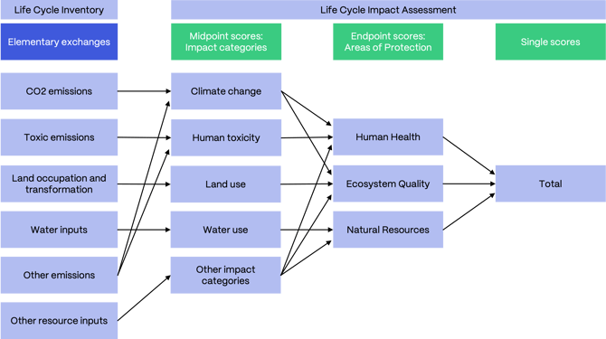

# 影响评价

英文原题：Impact Assessment  
来源：[ecoinvent 官方原文](https://support.ecoinvent.org/impact-assessment)  
原文快照：2026-10-13  
审核状态：AI 交叉审校通过，含审校注记

原站修改日期：2026-01-22


本页含原文疑点，需领域专家核实。请同时阅读文末审校注记。






## 对于 ecoinvent 数据库中的每个数据集，都可以使用生命周期影响评价（LCIA）方法评价其基本流交换列表（自然资源投入及向环境的排放）。 

2026 年 1 月 14 日

LCIA 方法示例包括“IPCC 2021”“EF v3.1”或“ReCiPe 2016”。这些方法的得分反映某项活动所造成的环境影响。影响评价方法可以：a）聚焦单一影响或环境足迹，例如碳足迹或水足迹；或 b）包含多个影响类别，例如“气候变化”“人体毒性”“土地利用”或“水资源使用”。

足迹和影响类别可以采用不同指标评价，例如碳足迹或“气候变化”影响类别中的“20 年全球变暖潜势（GWP20）”或“100 年全球变暖潜势（GWP100）”。每个指标均有单位，例如 kg CO2 当量。

将基本流（或交换）转换为一定 kg CO2 当量的系数称为“表征因子”（CF）。在“IPCC 2021”方法中，对于“100 年全球变暖潜势（GWP100）”指标，化石甲烷的 CF 为 29.8 kg CO2 当量/kg 甲烷。将 CF 应用于某影响类别中所有相关基本流，即可计算影响评价得分（或结果），例如 34 kg CO2 当量的碳足迹。对于以 CO2 当量等表示的排放，该得分有时也称“排放因子”。

某些包含多个影响类别的方法，例如“ReCiPe 2016”，还可以进一步汇总为损害类别或“保护领域”（AoP）。这些通常称为“人类健康”“生态系统质量”和“自然资源”（或类似名称）。最后，还可以将这些结果进一步汇总为加权总值。

### ecoinvent 中实施的方法 

我们为多种影响评价方法提供得分（或结果）。详情请参阅数据库概览文件（[v3.10 示例](../assets/cf8537648262-Database-Overview-for-ecoinvent-v3.10_29.04.24.xlsx)）和[LCIA 实施报告](../assets/957bf4cc0635-LCIA-implementation-3.11.pdf)。对于其他数据库版本，可在[ecoQuery](https://ecoquery.ecoinvent.org/)的“资源 &gt; 文件”（Resources &gt; Files）中找到可下载的 LCIA 实施报告：先选择数据库版本，再在“支持文档”（Supporting documents）下查找“ecoinvent 3.xx\_LCIA\_implementation.7z”文件。

方法实施包括将方法中的基本流映射到 ecoinvent 的基本流（例如将“Trichloromethane”映射到“Chloroform”，二者均为三氯甲烷）。我们已在[GitHub 发布这些映射](https://github.com/ecoinvent/lcia)。方法开发者、软件开发者、科学工作者及其他用户可将这些文件用于分析、审核或实施。我们希望这能提高透明度，促进协作，并最终提升 ecoinvent 数据库中方法实施的质量。

如果希望您的方法在 ecoinvent 数据库中实施，只需通过[ecoinvent LCIA 方法输入格式](https://github.com/ecoinvent/lcia/blob/master/data_formats/ecoinvent_lcia_method_input_format.md)提供该方法，或使用数据库概览文件中最新的[ecoinvent 基本流列表](../assets/cf8537648262-Database-Overview-for-ecoinvent-v3.10_29.04.24.xlsx)。

#### <strong>“碳足迹”——IPCC</strong> 

IPCC 是联合国政府间气候变化专门委员会。该委员会定期发布评估报告（AR），包含全球变暖潜势（GWP）和全球温度变化潜势（GTP）的排放度量值。这些数值在“IPCC”方法中实施。有关 IPCC 2021 的更多信息，可在[此处](https://www.ipcc.ch/report/ar6/wg1/downloads/report/IPCC_AR6_WGI_Chapter07.pdf)的 AR6 中查阅。

请参阅[《IPCC 方法使用指南》](guidance-on-ipcc-methods.md)。

#### CML 

CML 是荷兰莱顿大学环境科学研究所。CML 方法最初于 1992 年开发，并于 2016 年更新为当前版本。它是一种评价多个影响类别的中点方法。有关该方法的更多信息见[此处](https://www.universiteitleiden.nl/en/research/research-projects/science/cml-new-dutch-lca-guide)，表征因子见[此处](https://www.universiteitleiden.nl/en/research/research-output/science/cml-ia-characterisation-factors)。

#### 地壳稀缺性指标（Crustal Scarcity Indicator） 

地壳稀缺性指标由瑞典哥德堡查尔姆斯理工大学的 Rickard Arvidsson 及其同事于 2020 年开发。该方法依据地壳浓度评价矿产资源使用，并将其视为长期全球元素稀缺性的替代指标。有关该方法和最新表征因子的更多信息见[此处](https://doi.org/10.1007/s11367-020-01781-1)，表征因子见[此处](https://research.chalmers.se/publication/519861/file/519861_Fulltext.pdf)。

#### 累积能源需求（CED） 

累积能源需求（CED）基于 ecoinvent 于 1997 年为版本 1.01 发布的方法，评价一次能源使用。

更多信息请参阅[ecoinvent v2.2 方法实施报告](../assets/3bb9220ec182-201007_hischier_weidema_implementation_of_lcia_methods.pdf)。

#### 累积㶲需求（CExD） 

累积㶲需求（CExD）基于[Bösch 等（2007 年）](https://www.research-collection.ethz.ch/bitstream/handle/20.500.11850/3949/11367_2006_Article_282.pdf)的论文。它“评价能量需求的品质，并包括能源载体和非能源材料的㶲”。在此，㶲“计量形成某项资源所需的最小功，或将该资源的组成部分转变为其在自然环境中最常见状态时能够获得的最大功”。

#### 生态足迹（Ecological Footprint） 

生态足迹定义为某人口群体生产其所消耗资源，并吸收由化石燃料和核燃料消耗所产生部分废物所需的具有生物生产力的土地和水域。该方法于 2006 年开发，以“全球公顷”为单位，评价直接土地占用，以及与 CO2 排放固存和核能使用有关的间接土地占用。有关该方法的更多信息见[此处](https://www.sciencedirect.com/science/article/abs/pii/S0921800907002741)。

#### 生态稀缺性（Ecological Scarcity） 

生态稀缺性方法由瑞士联邦环境局（FOEN）于 1990 年针对瑞士开发，并于 2021 年更新为当前版本。它是一种“与目标的距离”方法，考虑瑞士当前情况及其政策目标（关于排放和资源使用），或瑞士支持的国际政策目标。该方法以生态点（“Umweltbelastungspunkte”，简称 UBP）评价多个影响类别，因此可以将结果相加得到总值。有关该方法的更多信息见[此处](https://www.bafu.admin.ch/bafu/en/home/topics/economy-consumption/economy-and-consumption-publications/publications-economy-and-consumption/eco-factors-switzerland.html)。

#### 生态系统损害潜势（Ecosystem Damage Potential） 

生态系统损害潜势方法由瑞士联邦理工学院（ETH）于 1997 年开发，评价土地占用和土地转化。有关该方法的更多信息见[此处](https://www.research-collection.ethz.ch/bitstream/handle/20.500.11850/3048/11367_2006_Article_2292.pdf?sequence=2)。

#### EF 

EF 代表环境足迹（Environmental Footprint），该方法由欧盟委员会维护。ecoinvent 实施了其 3.0 和 3.1 版本。它是一种评价多个影响类别的中点方法。有关该方法和表征因子的更多信息见[此处](https://eplca.jrc.ec.europa.eu/LCDN/EF_archive.xhtml)。

#### EF EN15804 

ecoinvent 开发了名为“[EN15804 截断分配模型（Allocation, cut-off, EN15804）](system-models.md)”的系统模型。该系统模型旨在：a）帮助环境产品声明（EPD）从业人员遵守 EN15804&A2:2019 标准；b）促进该标准各指标计算的协调一致。

ecoinvent 为 EN15804 截断分配模型（“Allocation, cut-off, EN15804”）提供 EN15804 影响评价方法，其依据为：a）欧盟委员会基于[EF 方法](#zh-b0030)提供的表征因子；b）提供 EPD 所需指标的 EN15804（和 ISO21930）指标。严格来说，后者并非影响评价指标，但为方便用户获取，也被纳入影响评价方法。

有关 EF v3.0 EN15804 方法及其表征因子的更多信息见[此处](https://eplca.jrc.ec.europa.eu/LCDN/EN15804.xhtml)。关于系统模型和方法实施的进一步文档，可在专门的[ecoQuery 报告](https://ecoquery.ecoinvent.org/3.11/cutoff/reports)中获取（登录 ecoQuery 后，位于“报告”（Reports）部分）。

重要说明：EN15804 影响评价方法仅适用于 EN15804 系统模型。

#### EPS 

EPS 代表环境优先策略（Environmental Priority Strategies）。该方法由瑞典能源署 FORMAS 开发，最初于 1990 年发布，并于 2020 年更新为当前版本。它是一种终点方法，评价排放以及能源、材料资源和土地使用所造成的经济损害。有关该方法的更多信息见[此处](https://www.ivl.se/english/ivl/publications/publications/eps-weighting-factors---version-2020d.html)，表征因子见[此处](https://www.ivl.se/download/18.694ca0617a1de98f472f9c/1628415088657/FULLTEXT01.pdf.)。

#### <strong>IMPACT World+ v2.1，足迹版</strong> 

IMPACT World+ 由多个机构共同开发：CIRAIG、密歇根大学、Quantis International、丹麦技术大学（DTU）和洛桑联邦理工学院（EPFL）。它是一种全球区域化 LCIA 方法，“在一致的 LCIA 框架中整合多项前沿进展，以及水和碳关注领域的损害。大多数区域影响类别已作空间区分，所有长期影响类别均进一步细分为较短期损害（排放后的前 100 年）和长期损害类别。”由于 ecoinvent 尚未提供区域化清单，因此按照方法开发者的建议，仅实施了该方法的精简“足迹”版。有关该方法的更多信息见[此处](https://www.impactworldplus.org/)，表征因子见[此处](https://zenodo.org/records/8200703)。

#### <strong>清单结果和指标（Inventory results and indicators）</strong> 

“Inventory results and indicators”是在 v2.0 中引入的“selected LCI results”和“selected LCI results, additional”的基础上建立的。部分“结果”或“指标”予以保留，部分新增，部分删除。其计算不基于 CF，而主要对 LCI 数值进行汇总或聚合，因此“Inventory results and indicators”并非“真正的”影响评价方法。除资源消耗和排放外，废物是第三个类别。

#### <strong>ReCiPe</strong> 

ReCiPe 于 2008 年由荷兰研究机构 RIVM（国家公共卫生与环境研究所）、奈梅亨拉德堡大学、莱顿大学和 Pré Consultants 开发，并于 2016 年更新为当前版本。它同时包含中点和终点方法，并考虑三种不同文化视角：个人主义（I）、等级主义（H）和平等主义（E）。该方法评价多个中点影响类别，以及终点层面的三个保护领域（人类健康、生态系统质量和自然资源）。有关该方法的更多信息见[此处](https://www.rivm.nl/bibliotheek/rapporten/2016-0104.pdf)，最新表征因子见[此处](https://www.rivm.nl/en/life-cycle-assessment-lca/downloads)。

#### <strong>TRACI</strong> 

TRACI 代表化学物质及其他环境影响的减缓与评价工具（Tool for the Reduction and Assessment of Chemical and other environmental impacts）。该方法由美国环境保护署（US EPA）发布，最初于 2002 年推出，并于 2012 年更新至 v2.1。它是一种评价多个影响类别的中点方法。有关该方法和最新表征因子的更多信息见[此处](https://www.epa.gov/chemical-research/tool-reduction-and-assessment-chemicals-and-other-environmental-impacts-traci)。

#### <strong>USEtox</strong> 

USEtox 由联合国环境规划署（UNEP）和环境毒理与化学学会（SETAC）开发，用于在生命周期影响评价和比较风险评价中评价化学品的归趋、暴露及效应。它在中点和终点层面评价人体毒性和淡水生态毒性影响类别，但 ecoinvent 仅实施中点结果。有关该方法的更多信息见[此处。](https://usetox.org/model/documentation)





## For each dataset in the ecoinvent database, the list of elementary exchanges (natural resource inputs and emissions to the environment) can be assessed with Life Cycle Impact Assessment (LCIA) methods. 

January 14th, 2026

Examples of LCIA methods are “IPCC 2021,” “EF v3.1,” or “ReCiPe 2016”. The scores of these methods give an indication of the environmental impact that is caused by an activity. Impact assessment methods can a) focus on a single impact or environmental footprint such as the carbon footprint or the water footprint, or b) include several impact categories such as “climate change,” “human toxicity,” “land use,” or “water use.”

Footprints and impact categories can be assessed with different indicators, for example “global warming potential 20 years (GWP20)” or “global warming potential 100 years (GWP100)” in case of the carbon footprint or the “climate change” impact category. Each indicator has a unit, for example, kg CO2-equivalents.

The factor converting an elementary flow (or exchange) into an amount of kg CO2-equivalents is called “characterization factor” (CF). In the “IPCC 2021” method, fossil methane has a CF of 29.8 kg CO2-equivalents / kg methane for the indicator “global warming potential 100 years (GWP100)”. Applying CFs to all relevant elementary flows in an impact category, an impact assessment score (or result) can be calculated, for example, a carbon footprint of 34 kg CO2-equivalents. In case of emissions such as CO2-equivalents, this score is sometimes also referred to as “emission factor.”

Some methods including several impact categories, for example, “ReCiPe 2016,” offer a further aggregation into damage categories or “Areas of Protection” (AoPs). These are usually called “human health,” “ecosystem quality,” and “natural resources” (or similar). Finally, these results can be further aggregated into a weighted total.

### Methods Implemented in ecoinvent 

We provide scores (or results) for several impact assessment methods. Details can be found in the database overview file ([v3.10 example](../assets/cf8537648262-Database-Overview-for-ecoinvent-v3.10_29.04.24.xlsx)) and [LCIA Implementation report](../assets/957bf4cc0635-LCIA-implementation-3.11.pdf). For other database versions, you can find the downloadable LCIA Implementation report [on ecoQuery](https://ecoquery.ecoinvent.org/) in Resources &gt; Files: select your database version, then look under "Supporting documents" for the file "ecoinvent 3.xx\_LCIA\_implementation.7z".

Implementing methods includes the mapping of elementary flows from methods onto elementary flows from ecoinvent (for example, “Trichloromethane” to “Chloroform”). We have published these [mappings on GitHub](https://github.com/ecoinvent/lcia). These files can be used for analysis, review, or implementation by method developers, software developers, scientists, and other users. We hope this will increase transparency, collaboration, and, ultimately, the quality of method implementation in the ecoinvent database.

If you would like to see your method implemented in the ecoinvent database, you can do so by simply providing the method via the [ecoinvent LCIA method input format](https://github.com/ecoinvent/lcia/blob/master/data_formats/ecoinvent_lcia_method_input_format.md) or by using the latest [ecoinvent elementary flow list](../assets/cf8537648262-Database-Overview-for-ecoinvent-v3.10_29.04.24.xlsx) in the database overview file.

#### <strong> “Carbon Footprint” - IPCC</strong> 

The IPCC is the Intergovernmental Panel on Climate Change by the United Nations. The panel regularly releases Assessment Reports (ARs) containing emissions metrics for Global Warming Potential (GWP) and Global Temperature Change Potential (GTP). These numbers are implemented in “IPCC” methods. More information about IPCC 2021 can be found in AR6 [here](https://www.ipcc.ch/report/ar6/wg1/downloads/report/IPCC_AR6_WGI_Chapter07.pdf).

See [Guidance on IPCC Methods](guidance-on-ipcc-methods.md).

#### CML 

CML is the Institute of Environmental Sciences of the University of Leiden in the Netherlands. The CML method was first developed in 1992 and updated to its current version in 2016. It is a midpoint method assessing several impact categories. More information about the method can be found [here](https://www.universiteitleiden.nl/en/research/research-projects/science/cml-new-dutch-lca-guide), and the characterization factors can be found [here](https://www.universiteitleiden.nl/en/research/research-output/science/cml-ia-characterisation-factors).

#### Crustal Scarcity Indicator 

The Crustal Scarcity Indicator was developed in 2020 by Rickard Arvidsson and colleagues at Chalmers University in Gothenburg, Sweden. The method assesses mineral resource use based on crustal concentrations, which is considered a proxy for long-term global elemental scarcity. More information about the method and the latest characterization factors can be found [here](https://doi.org/10.1007/s11367-020-01781-1), the characterization factors can be found [here](https://research.chalmers.se/publication/519861/file/519861_Fulltext.pdf).

#### Cumulative Energy Demand (CED) 

 Cumulative Energy Demand (CED) is based on the method published by ecoinvent for version 1.01 in 1997. It assesses primary energy usage.

  Find more information in the [ecoinvent v2.2 method implementation report](../assets/3bb9220ec182-201007_hischier_weidema_implementation_of_lcia_methods.pdf).

#### Cumulative Exergy Demand (CExD) 

Cumulative Exergy Demand (CExD) is based on the publication by [Bösch et al. 2007](https://www.research-collection.ethz.ch/bitstream/handle/20.500.11850/3949/11367_2006_Article_282.pdf). It “assesses the quality of energy demand and includes the exergy of energy carriers as well as of non-energetic materials”. Thereby, exergy “accounts for the minimal work necessary to form the resource or for the maximally obtainable amount of work when bringing the resource’s components to their most common state in the natural environment.”

#### Ecological Footprint 

Ecological Footprint is defined as the biologically productive land and water a population requires to produce the resources it consumes and to absorb part of the waste generated by fossil and nuclear fuel consumption. The method was developed in 2006 and it assesses the direct land occupation as well as the indirect land occupation related to the sequestration of CO2 emissions and nuclear energy use in the unit of “global hectares”. More information about the method can be found [here](https://www.sciencedirect.com/science/article/abs/pii/S0921800907002741).

#### Ecological Scarcity 

The Ecological Scarcity method was developed for Switzerland by the Federal Office for the Environment (FOEN) in 1990 and it was updated to its current version in 2021. It is a “distance to target” method considering the current situation and political targets (concerning emissions and resource use) for Switzerland (or by international policies and supported by Switzerland). The method assesses several impact categories in eco-points (“Umweltbelastungspunkte” or UBP), which is why results can be summed into a total. More information about the method can be found [here](https://www.bafu.admin.ch/bafu/en/home/topics/economy-consumption/economy-and-consumption-publications/publications-economy-and-consumption/eco-factors-switzerland.html).

#### Ecosystem Damage Potential 

The Ecosystem Damage Potential method was developed by the Swiss Federal Institute of Technology (ETH) in 1997. It assesses land occupation and transformation. More information about the method can be found [here](https://www.research-collection.ethz.ch/bitstream/handle/20.500.11850/3048/11367_2006_Article_2292.pdf?sequence=2).

#### EF 

EF stands for Environmental Footprint and the method is maintained by the European Commission. Versions 3.0 and 3.1 are implemented in ecoinvent. It is a midpoint method assessing several impact categories. More information about the method and the characterization factors can be found [here](https://eplca.jrc.ec.europa.eu/LCDN/EF_archive.xhtml).

#### EF EN15804 

ecoinvent has developed a system model called “[Allocation, cut-off, EN15804](system-models.md)”. The aim of this system model is a) to facilitate Environmental Product Declaration (EPD) practitioners to comply with the standard EN15804&A2:2019, and b) to contribute to harmonization in the calculation of the indicators of the standard.

ecoinvent provides EN15804 impact assessment methods for the “Allocation, cut-off, EN15804” system model based on a) characterization factors provided by the European Commission based on the [EF methods](#en-b0030), and b) EN15804 (and ISO21930) indicators, which provide the indicators required in EPDs. The latter are not impact assessment indicators in a strict sense but are included in an impact assessment method to be more easily accessible to the users.

More information about the EF v3.0 EN15804 method and the characterization factors can be found [here](https://eplca.jrc.ec.europa.eu/LCDN/EN15804.xhtml). Further documentation about the system model and the method implementation can be found in our dedicated [ecoQuery reports](https://ecoquery.ecoinvent.org/3.11/cutoff/reports) (if you log-in on ecoQuery under "Reports" section).

Important note: the EN15804 impact assessment methods are meant to be used only with the EN15804 system model.

#### EPS 

EPS stands for Environmental Priority Strategies. The method was developed by the Swedish Energy Agency, FORMAS. It was first released in 1990 and updated to its current version in 2020. It is an endpoint method assessing economic damage caused by emissions as well as the use of energy and material resources and land. More information about the method can be found [here](https://www.ivl.se/english/ivl/publications/publications/eps-weighting-factors---version-2020d.html), and the characterization factors can be found [here](https://www.ivl.se/download/18.694ca0617a1de98f472f9c/1628415088657/FULLTEXT01.pdf.).

#### <strong>IMPACT World+ v2.1, footprint version</strong> 

IMPACT World+ is developed by several institutions: CIRAIG, University of Michigan, Quantis International, Technical University of Denmark (DTU), and école Polytechnique de Lausanne (EPFL). It is a globally regionalized LCIA method, “integrating multiple state-of-the-art developments as well as damages on water and carbon areas of concern within a consistent LCIA framework. Most of the regional impact categories have been spatially differentiated and all long-term impact categories have been subdivided into shorter-term damage (the first 100 years after the emission) and long-term damage categories.” Since ecoinvent does not yet provide regionalized inventories, only a reduced “footprint” version of the method is implemented, following the suggestion of the method developers. More information about the method can be found [here](https://www.impactworldplus.org/), and the characterization factors can be found [here](https://zenodo.org/records/8200703).

#### <strong>Inventory results and indicators</strong> 

“Inventory results and indicators” builds on what was introduced in v2.0 as “selected LCI results” and “selected LCI results, additional”. Some “results” or “indicators” were kept, some added, some deleted. The calculation is not based on CFs but mainly summarizes or aggregates LCI values and hence “Inventory results and indicators” is not a “real” impact assessment method. Besides resource consumptions and emissions, waste is the third category.

#### <strong>ReCiPe </strong> 

ReCiPe was developed by the Dutch research institute of RIVM (National Institute for Public Health and the Environment), Radboud University Nijmegen, Leiden University, and Pré Consultants in 2008. It was updated to its current version in 2016. It is a midpoint and an endpoint method, and it considers three different cultural perspectives: individualist (I), hierarchist (H), and egalitarian (E). The method assesses several midpoint impact categories and the three areas of protection (human health, ecosystem quality, and natural resources) at the endpoint level. More information about the method can be found [here](https://www.rivm.nl/bibliotheek/rapporten/2016-0104.pdf), and the latest characterization factors are available [here](https://www.rivm.nl/en/life-cycle-assessment-lca/downloads).

#### <strong>TRACI </strong> 

TRACI stands for Tool for the Reduction and Assessment of Chemical and other environmental impacts. It is a method published by the U.S. Environmental Protection Agency (US EPA), originally released in 2002 and updated to v2.1 in 2012. It is a midpoint method assessing several impact categories. More information about the method and the latest characterization factors can be found [here](https://www.epa.gov/chemical-research/tool-reduction-and-assessment-chemicals-and-other-environmental-impacts-traci).

#### <strong>USEtox</strong> 

USEtox was developed by the United Nations Environment Programme (UNEP) and the Society of Environmental Toxicology and Chemistry (SETAC) to assess the fate, exposure, and effects of chemicals in Life Cycle Impact Assessment and Comparative Risk Assessment. It assesses human toxicity and freshwater ecotoxicity impact categories at midpoint and endpoint levels whereby only midpoint results are implemented in ecoinvent. More information about the method can be found [here.](https://usetox.org/model/documentation)





## 翻译与审校注记 

- **待专家复核 · b0020**：原文给出的数据库版本与年份搭配可能有误，译文暂按原文保留。 请依据 CED 原始文献及 ecoinvent 发布历史核对年份和版本。 [查看完整记录](../review/issues.md#issue-147)
- **待专家复核 · b0038**：原文将 FORMAS 与瑞典能源署并列为同一机构，该机构名称及 EPS 开发者归属可能有误。 请根据链接所指 EPS 原始报告核对开发者和资助机构名称后修订。 [查看完整记录](../review/issues.md#issue-148)
- **已处理／已说明 · b0019**：统一 cumulative 指标名称的站内用语。 已修正。 [查看完整记录](../review/issues.md#issue-149)
- **已处理／已说明 · b0020**：统一 cumulative 指标名称的站内用语。 已修正。 [查看完整记录](../review/issues.md#issue-150)
- **已处理／已说明 · b0022**：统一 cumulative 指标名称的站内用语。 已修正。 [查看完整记录](../review/issues.md#issue-151)
- **已处理／已说明 · b0023**：统一 cumulative 指标名称的站内用语。 已修正。 [查看完整记录](../review/issues.md#issue-152)
