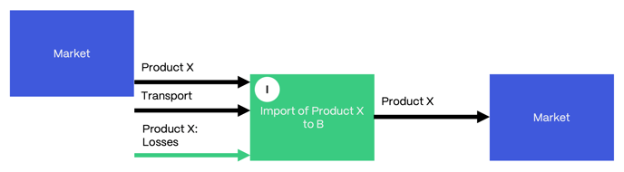
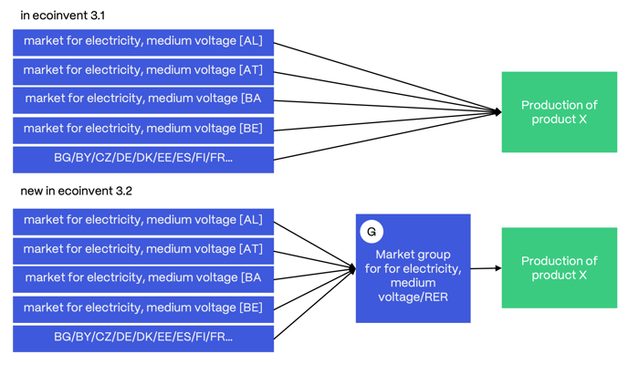
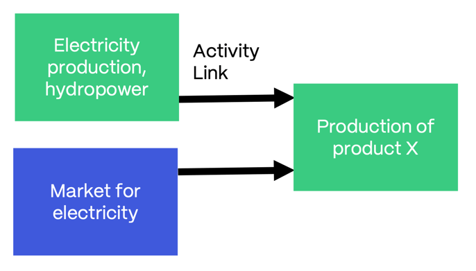

# 市场活动

英文原题：Market Activities  
来源：[ecoinvent 官方原文](https://support.ecoinvent.org/market-activities)  
原文快照：2026-10-13  
审核状态：AI 交叉审校通过，含审校注记

原站修改日期：2025-09-26


本页含原文疑点，需领域专家核实。请同时阅读文末审校注记。






## 市场活动表示产品在给定地区的消费组合，考虑生产者与消费者之间的贸易，并在需要时考虑产品运输过程中的损失。 

2023年10月24日

市场数据集不对产品进行转化，而只是将其从一个转化活动转移到另一个转化活动。

在归因型系统模型（即[Cut-off 系统模型](system-models.md)和[APOS 系统模型](system-models.md)）中，市场表示所选产品在相关地区的平均消费组合。在[Consequential 系统模型](system-models.md)中，市场表示边际消费组合，因此由采用最新技术水平的非受约束活动供货。

废物（待处理材料）的市场活动定义为处理组合，而非消费组合。市场由为所选产品提供处理的不同活动组成，例如填埋和焚烧。

<strong>地区定义和市场组</strong>

进口活动的图示。

市场数据集可以表示全球或当地情况。仅在全球交易的产品由全球（GLO）市场表示；在当地交易的产品则具有一个或多个当地市场，且通常另有一个世界其他地区（RoW）市场。

例如，香蕉在全球范围内交易，而混凝土等较重材料通常在生产地区消费。可能存在的邻国贸易通过进口活动建模。

### 进口和出口 

必要时对进口和出口建模，以更准确地表示地区实际情况。在 ecoinvent 数据库中，地区之间的贸易始终由进口活动表示。

硬煤就是此类产品的一个例子。欧洲硬煤供应中有相当一部分来自澳大利亚。进口数据集将硬煤从澳大利亚硬煤市场活动转移到欧洲硬煤市场活动。进口活动包含每年从澳大利亚转移到欧洲的硬煤数量、所需平均运输距离和运输方式，以及运输、装卸过程中的产品损失数据。因此，欧洲硬煤市场活动由欧洲所有硬煤生产活动及从其他市场进口到欧洲的全部进口活动供货。进口活动采用“… import from X”的名称。例如，地理区域为欧洲的“hard coal, import from Australia”（硬煤，从澳大利亚进口）活动模拟煤炭从澳大利亚转移到欧洲。

### 市场组 

市场组是完全由涉及同一产品、但覆盖不同地区的市场活动构成的市场数据集。因此，市场组的地理区域包含所有供货市场的地理区域。例如，欧洲（RER）的“market group for electricity, medium voltage”（中压电力市场组）汇集了波兰（PL）、奥地利（AT）等三十多个国家的中压电力市场。

这一功能在 3.2 版引入，以提高可读性。此前，用户会看到所有向消费者供电的欧洲单个市场；现在，用户只会看到“market group for electricity, medium voltage”/RER。

市场组的图示。

### 市场组成 

考虑地区和系统模型规则后，根据产量确定市场组成。可通过访问[链接后的单元过程](upr-lci-lcia.md)（位于[ecoQuery](https://ecoquery.ecoinvent.org/login)）获取份额。此外，ecoQuery 文件部分提供电子表格“market\_composition\_X.X.xlxs”，汇总所有[系统模型](system-models.md)的市场份额和产量。

在电力等某些情况下，通过直接在市场活动中编辑各生产活动对市场的贡献来生成市场组合（此功能在 3.4 版引入）。

电力相关链接：

- [如何对电力市场组合建模？（常见问题）](markets.md)
- [如何查看电力市场的技术组合？（常见问题）](markets.md)

城市固体废物市场相关链接：

 查看[《变更报告 | ecoinvent 3.5 至 ecoinvent 3.6（2019）》第 13 章](../assets/3f3332f5b42b-change_report_v3_6_20190912.pdf)

### 运输和产品损失 

市场活动考虑产品从生产者到消费者的平均运输距离和运输方式。运输信息由数据提供者设定；没有信息时，使用默认运输假设。全球和瑞士的默认运输假设可从[ecoQuery](https://ecoquery.ecoinvent.org/login)的报告部分下载。

市场中的运输量以每单位参考产品的吨公里（ton\*km）表示。所有产品均使用[湿质量属性](properties.md)计算运输量。

必要时，市场数据集也考虑生产者和消费者之间发生的损失。除交付给消费者的产品数量外，通过向市场输入产品本身来模拟损失。例如，在“market for strawberry”（草莓市场）中消费 1 kg“strawberry”（草莓），需要向市场输入 1.1 kg 该产品，因为运输中有 0.1 kg 草莓损失，即成为生物废物。

### 直接链接 

在 ecoinvent 数据库中，市场是同一地理区域内活动的默认供应者，但也可以通过产品生产活动与消费活动之间的直接链接另行指定。

当供应者已知时，设置直接链接。在这种情况下，不需要市场数据集作为这些生产和消费活动之间的桥梁。可能存在的运输和损失直接加入消费（转化）活动。直接链接用于不进行交易的服务或产品，例如不可移动的基础设施和中间产品。

### 示例 

能源密集型行业通常拥有发电厂，至少供应一部分自身用电。在这些情况下，行业知道其消费的电力有多少来自自有发电厂，以及采用何种技术，例如水电。

直接活动链接的图示，即产品生产活动与消费活动之间的直接链接。

<strong>编辑</strong>

<strong>Emilia Moreno Ruiz</strong>（主编），ecoinvent 协会，瑞士





## A market activity represents the consumption mix of a product for a given region, accounting for the trade between the producer and consumer, and, when needed, for product losses that occur during the product’s transportation. 

Oct 24th, 2023

A market dataset does not transform a product but rather simply transfers it from one transforming activity to another.

In the attributional system models (i.e., the [cut off system mode](system-models.md)l and the [APOS system model](system-models.md)), markets represent the average consumption mix of the selected product in the relevant region(s). In the [consequential system model](system-models.md), a market represents the marginal consumption mix; it is therefore supplied by unconstrained activities with an up-to-date technology level.

Market activities for waste (materials for treatment) are defined as treatment mixes rather than consumption mixes. The market is composed of the different activities that provide a treatment (e.g., landfill, incineration) for the selected product.

<strong>Regional Definition and Market Groups</strong>

A visual representation of an import activity.

Market datasets may refer to a global or local situation. Products that are traded only globally are represented by a global (GLO) market, while products that are traded locally are available in one or more local markets and often in an additional Rest-of-the-World (RoW) market.

For example, bananas are traded globally, while heavier materials, such as concrete, are often consumed in the producing region. Eventual trade with neighbouring countries is modeled with import activities.

### Imports and Exports 

Import and exports are modeled, where needed, to better represent the regional reality. In the ecoinvent database, trade between regions is always represented by an import activity.

Hard coal is an example of such a product. Europe receives a substantial portion of its hard coal supply from Australia. An import dataset transfers hard coal from the Australian market activity for hard coal to the European market activity for hard coal. The import activity contains data on the amounts of hard coal transferred annually from Australia to Europe, the average distances and modes of transport required and the product losses occurring during transport, loading and unloading. The European market activity for hard coal is thus supplied by all activities producing hard coal in Europe and by all imports from other markets to Europe. Import activities carry the name “… import from X.” For example, the activity “hard coal, import from Australia” in geography Europe models the transfer of coal from Australia to Europe.

### Market Groups 

A market group is a market dataset exclusively created by market activities that are concerned with the same product but cover different regions. Therefore, the geography of the market group contains the geography of all supplying markets. For example, the “market group for electricity, medium voltage” in Europe (RER) bundles markets for medium voltage electricity in more than thirty countries, including Poland (PL) and Austria (AT).

This feature was introduced in version 3.2 to facilitate readability. Previously, users would see all the individual European markets supplying electricity to the consumer; now, users see only the “market group for electricity, medium voltage”/RER.

A visual representation of a market group. 

### Market Composition 

After taking into consideration regions and system model rules, market composition is determined based on production volumes. The shares can be obtained by accessing the [linked unit process](upr-lci-lcia.md) in [ecoQuery](https://ecoquery.ecoinvent.org/login). Additionally, the spreadsheet “market\_composition\_X.X.xlxs” summarizing market shares and production volumes for all [system models](system-models.md) is available in the files section of ecoQuery.

In certain instances, such as electricity, market mixes are generated by directly editing the contribution of the producing activities to the markets in the market activity itself (feature introduced in version 3.4).

Relevant links on Electricity:

- [How are electricity market mixes modeled? (FAQ)](markets.md)
- [How can I see the technology mix of an electricity market? (FAQ)](markets.md)

Relevant links on municipal solid waste markets:

  See [Chapter 13 of the Report of Changes |ecoinvent 3.5 to ecoinvent 3.6 (2019)](../assets/3f3332f5b42b-change_report_v3_6_20190912.pdf)

### Transport and Product Losses 

Market activities account for the average transport distances and modalities of the product from producer to consumer. Transport information is set by the data provider; when information is not available, default transport assumptions are used. The global and Swiss default transport assumptions can be downloaded in the report section of [ecoQuery](https://ecoquery.ecoinvent.org/login).

Transport in the market is expressed in tonne-kilometres (ton\*km) per unit of the reference product. For all products, the [wet mass property](properties.md) is used to calculate the transport values.

Market datasets also account for losses occurring between producers and consumers, when relevant. Losses are modeled with an input of the product itself to the market, in addition to the amount of product delivered to the consumer. For example, the consumption of 1 kg of the product “strawberry” in the “market for strawberry” requires the input of 1.1 kg of the product to the market because 0.1 kg of strawberries are lost, i.e., become biowaste during transportation.

### Direct Links 

In the ecoinvent database, markets are the default suppliers for activities in the same geographical area, but this can be specified differently, using direct links between the producing and consuming activities of a product.

A direct link is set when the supplier is known. In this case, the market dataset is not needed as a bridge between these producing and consuming activities. Eventual transportation and losses are added directly in the consuming (transforming) activity in those cases. Direct links are used for services or products that are not traded (i.e., immobile infrastructure, intermediate products).

### Example 

Energy-intensive industries often own power plants to supply at least part of their own electricity consumption. In these cases, the industry knows how much of the electricity it consumes is supplied by its own plant and by which technology (e.g., hydropower).

A visual representation direct activity link, i.e. a direct link between the producing and consuming activities of a product.

<strong>Editors </strong>

<strong>Emilia Moreno Ruiz </strong>(Main Editor), ecoinvent Association, Switzerland





## 翻译与审校注记 

- **待专家复核 · b0019**：原文文件扩展名写成 xlxs，可能应为 xlsx；译文按要求保留原文件名。 请核对实际下载文件名后修订源文。 [查看完整记录](../review/issues.md#issue-154)
- **已处理／已说明 · b0019**：原译调整了两个链接的标签顺序；现恢复源文 HTML 结构次序，同时保持中文通顺。 已修正译稿并重新核对原文。 [查看完整记录](../review/issues.md#issue-155)
