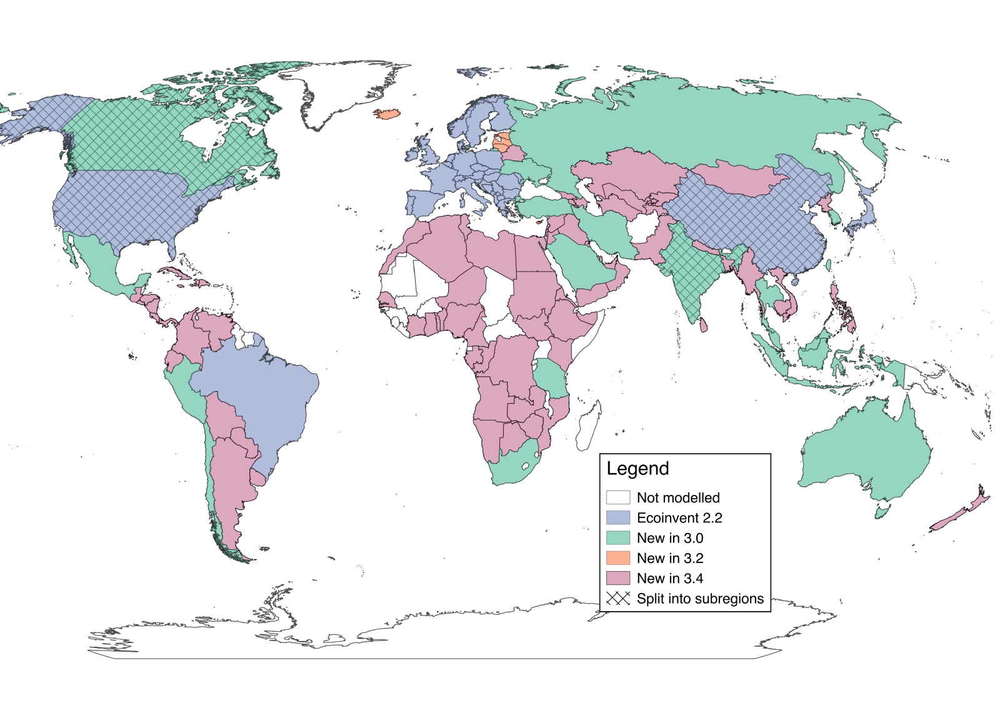
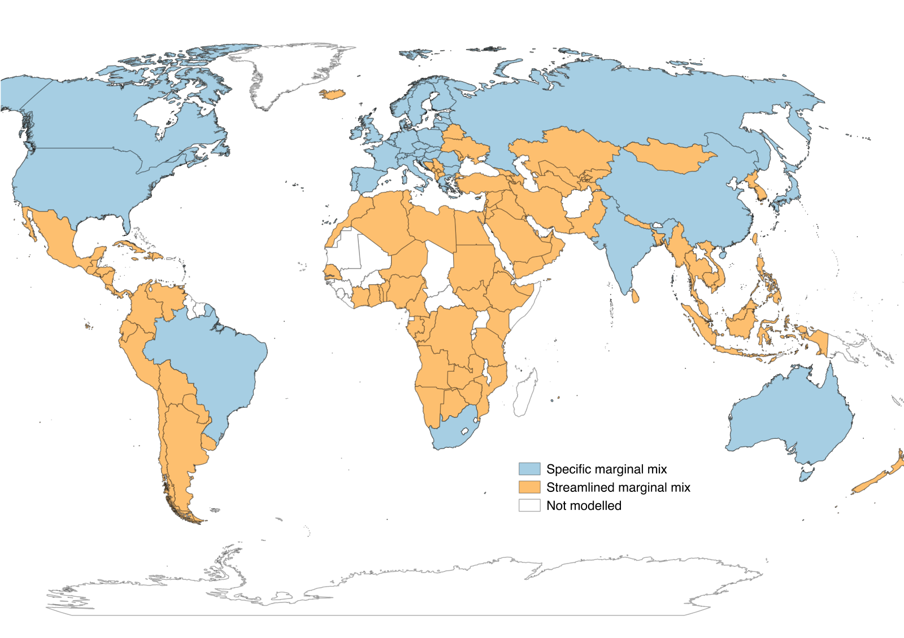
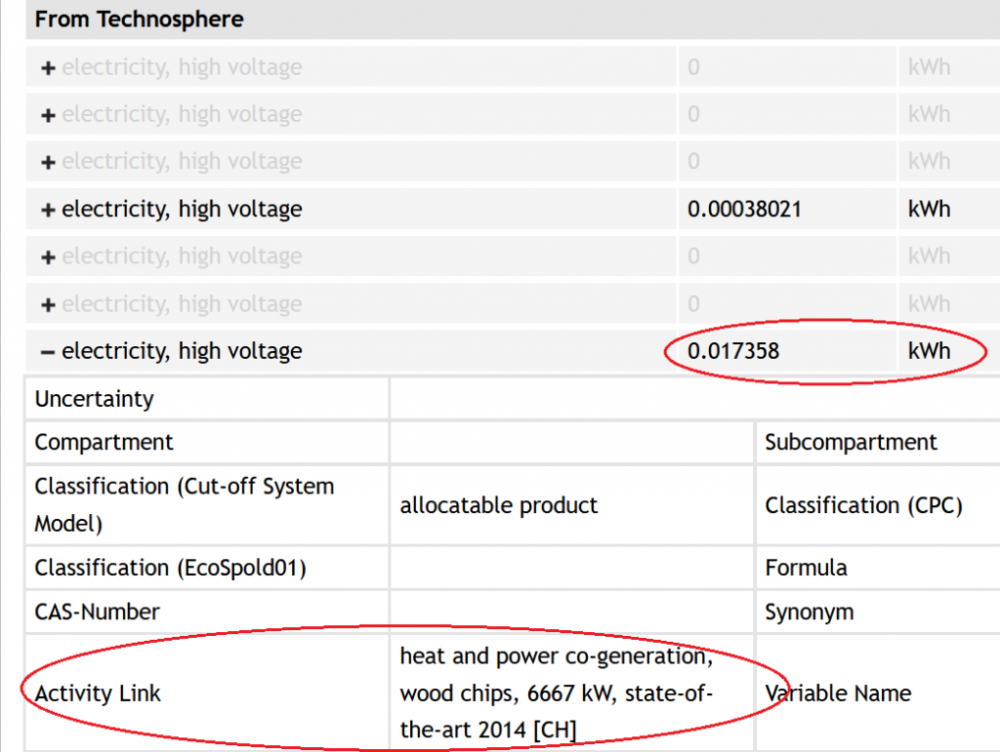
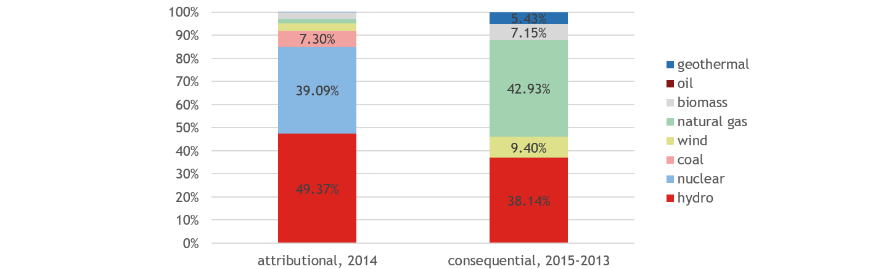

# 电力市场组合与电力市场的技术组合

英文原题：Electricity Market Mixes & Technology Mix of an Electricity Market  
来源：[ecoinvent 官方原文](https://support.ecoinvent.org/markets)  
原文快照：2026-10-13  
审核状态：AI 交叉审校通过，含审校注记

原站修改日期：2025-09-26





## 进一步了解市场、电力市场组合建模以及电力市场的技术组合 

2024年2月1日

### 什么是市场？ 

请在[此处](market-activities.md)进一步了解市场、市场组、市场中的运输和产品损失。

### 如何对电力市场组合建模？ 

电力市场数据集定期更新和扩展，以体现有关当前电力组合和未来预测电力组合的最新可用统计数据。此处说明所采用的方法及其与此前版本的差异。

#### Cut-off 和 APOS 系统模型 

在归因型系统模型中，从 v3.4 起，电力组合基于统计数据，并覆盖 IEA 统计中的全部<strong>142 个国家</strong>（主要数据来源：IEA, 2016）。通常使用数据库版本发布前三年的统计数据，例如 2020 年发布的 v.3.7.1 使用 2017 年数据。这是因为最终完整统计数据的发布存在这样的时滞。因此，各国具体市场组成覆盖了<strong>全球发电量的 100%（以统计所涵盖的范围为准）</strong>。

图 1：ecoinvent 各版本电力市场地理覆盖范围地图。不同颜色表示市场被加入数据库的版本。

#### Consequential 系统模型 

Consequential 系统模型包含<strong>40 个国家</strong>的未来电力市场组成，这些国家合计占全球能源产出的 76.5%。这些组合基于欧盟委员会（2016）、国际能源署（2016）等国内外主管机构的预测。新市场显著改进了 Consequential 系统模型，为后果型 LCA 的电力供应提供一致基础。

对于没有特定情景的国家（地图中标为橙色），采用<strong>世界其他地区</strong>（RoW）的边际电力组合。RoW 组合由 IEA（2016）“现行政策”情景的全球预测减去所有国家具体预测之和得到。由于预测来源多样，某些技术在 IEA 预测中的全球发电量，小于各国具体情景中同一技术发电量之和。在这种情况下，这些技术的发电量被视为零，不纳入 RoW 边际组合。

由于缺乏足够的一致数据，Consequential 市场组合的组成不考虑<strong>进口</strong>。此前版本也存在这一情况，因此这不意味着新数据质量下降，但仍是预测数据的局限。

图 2：ecoinvent 3.4 版后果型电力市场的地理覆盖范围地图。不同颜色表示采用特定（蓝色）或简化（橙色）边际电力组合的市场。请注意，智利虽然标为橙色，但具有特定边际组合。

### v3.4 引入的方法与此前版本有什么不同？ 

在 3.01 至 3.3 版中，电力组合由链接算法生成，如 ecoinvent 第 3 版《数据质量指南》第 4.3 节所述。各生产活动对市场的贡献根据发电活动中指定的产量计算。从 3.4 版起，不再适用这一规则，而是<strong>直接在市场活动本身中编辑生产活动对市场的贡献，以生成市场组合。</strong>

新方法可能产生与活动中指定产量不一致的市场份额。同样，在 Consequential 系统模型中，技术水平不再决定哪些活动向哪些市场供货。

### 如何查看电力市场的技术组合？ 

在任一系统模型的链接后电力市场数据集中，都可查看电力组合的组成，即发电、储能和进口对电力市场的贡献（见图）。您也可在[ecoQuery](https://ecoquery.ecoinvent.org/login)“文件”（Files）部分的“market composition\_X.X.xlsx”文件中查看任一链接后市场的组成。

图 1：ecoQuery 截图，数据集“market for electricity, high voltage, CH”，3.7.1 版，Cut-off 系统模型，2021 年 8 月。

不过，由于存在其他国家的进口，链接后数据集无法直接显示按技术划分的电力组合，例如 45% 水电、25% 核电。如需此类分类，请查阅[ecoQuery](https://ecoquery.ecoinvent.org)“文件”（Files）部分的电力分析文件“electricity\_analysis\_X.X\_Allocation, cut-off.xlsx”（3.6 版起）或“electricity\_market\_technologies\_vX.X.xlsx”（v3.4 和 v3.5）。

这些文件追溯复杂的进口链，详细列出所有直接或间接向电力市场供货的活动。按技术汇总该列表，即不考虑供货活动的地理来源，可得到 v3.3、v3.4 和 v3.5 各电力市场的技术组合（见“by\_technology”工作表）。

从 v3.6 起，提供了包含电力市场详细信息的新文件。其内容说明请参阅文件自身的“read me”工作表。

<strong>例如，</strong>下图展示了瑞士高压电力市场（v3.4）的当前平均组合（归因型、Cut-off 系统模型），以及 2015—2030 年长期边际电力组合（Consequential 系统模型）。

图 2：ecoinvent 3.4 版中按发电技术划分的瑞士归因型和后果型电力组合，2017 年 10 月。

各市场还考虑损失。请注意，除输电损失（通常低于 10%）外，还包括抽水蓄能电厂的损失。抽水蓄能电厂供应的电力由电力本身而非一次能源载体产生，因此不计入技术组合。由此，抽水蓄能容量较大的市场会呈现很高的损失。例如，乌拉圭的损失达到 38%。

#### 参考文献 

European Commission. (2016). <strong>EU Reference Scenario 2016（欧盟参考情景 2016）</strong>. <https://doi.org/10.2833/9127> Eurostat (2017) Energy Balances（能源平衡表，2017 年版）, http://ec.europa.eu/eurostat/web/energy/data/energy-balances

International Energy Agency, (2016), <strong>World Energy Outlook 2016（世界能源展望 2016）</strong>. Paris. <https://doi.org/10.1787/weo-2016-en>

ecoinvent 各版本电力市场地理覆盖范围地图





## Learn More About Markets, Electricity Market Mixes Modeling, and Technology Mix of an Electricity Market 

Feb 1st, 2024

### What is a Market? 

Learn more about markets, market groups and transport, and product losses in markets [here.](market-activities.md)

### How are Electricity Market Mixes Modeled? 

Electricity market datasets are regularly updated and expanded to represent the latest available statistical data on present and projected future electricity mixes. The applied methodology as well as differences compared to previous versions are explained here.

#### Cut-off & APOS System Model 

In the attributional system models, electricity mixes from v3.4 upwards are based on statistical data and are available for all <strong>142 countries</strong> which are part of the IEA statistics (primary data source: IEA, 2016). Usually, the statistics three years prior to the release year of the database version are used (e.g. 2017 for v.3.7.1 released in 2020). This is due to the final comprehensive statistics being published with this delay. That means, <strong>100% of (statistically represented) global electricity generation</strong> is covered through country-specific market compositions.

Figure 1: Map of geographical coverage of electricity markets in ecoinvent version. The colors differentiate markets by the database versioning which they were added.

#### Consequential System Model 

The consequential system model contains future electricity market compositions specific to <strong>40 countries</strong> which together represent 76.5% of the global energy output. These mixes are based on projections from (inter-)national authorities such as the European Commission (2016) and the international Energy Agency (2016). The new markets are a significant improvement of the consequential system model and provide a consistent basis for electricity supply in consequential LCA.

For countries where no specific scenario was available (marked orange in the map), the marginal electricity mix for the <strong>Rest of the World </strong>(RoW) applies. The RoW mix is calculated using the projections for the entire world from the “current policies” scenarios of the IEA (2016) minus the sum of all country specific projections. Given the variety of the projection sources, there are some technologies which’s global electricity production according to the IEA is smaller than the sum of all the country specific scenarios for the same technologies. In these cases, the electricity production from these technologies is considered to be zero and is not part of the RoW marginal mix.

<strong>Imports</strong> are not taken into account in the composition of the consequential market mix because of the insufficient availability of consistent data. As this was already the case in previous versions, this does not subtract from the quality of the new data but it remains a limitation of the projection data.

Figure 2: Map of geographical coverage of consequential electricity markets in ecoinvent version 3.4. The colors differentiate markets with a specific (blue) or streamlined (orange) marginal electricity mix. Note that Chile has a specific marginal mix, despite it being colored orange.

### How Does the Approach Introduced with v3.4 Differ From Previous Versions? 

In versions 3.01 to 3.3 electricity mixes were generated by the linking algorithm, as described in the Data Quality Guidelines of ecoinvent version 3, section 4.3. The contribution of producing activities to the markets was calculated based on the production volumes specified in the electricity producing activities. From version 3.4 onwards, this rule does not apply. Instead, <strong>market mixes are generated by directly editing the contribution of the producing activities to the markets in the market activity itself. </strong>

The new approach may yield market shares that are not consistent with the production volumes specified in activities. Similarly, the Technology Level is not anymore deciding on which activities contribute to which market in the consequential system model.

### How can I see the Technology Mix of an Electricity Market? 

The composition of electricity mixes, i.e. the contribution of electricity production, storage and imports to electricity markets, can be seen in the linked electricity market datasets of any system model (see Figure). You can also find the market composition of any linked market in the file “market composition\_X.X.xlsx” in the “Files” section of [ecoQuery.](https://ecoquery.ecoinvent.org/login)

Figure 1: Screen shot from ecoQuery, dataset “market for electricity, high voltage, CH”, version 3.7.1, cut-off system model, August, 2021.

However, due to imports from other countries the linked datasets do not allow to see the electricity mix by technology, for example 45% hydro power, 25% nuclear. For this type of breakdown please consult the electricity analysis files ” electricity\_analysis\_X.X\_Allocation, cut-off.xlsx ” (from 3.6 upwards) or “electricity\_market\_technologies\_vX.X.xlsx” (for v3.4 and v3.5) available in the “Files” section of [ecoQuery.](https://ecoquery.ecoinvent.org)

Tracing back the convoluted chains of imports these files show a detailed list of all activities which are directly or indirectly supplying an electricity market. Aggregating this list by technology, i.e. disregarding the geographical origin of supplying activities, results in the technology mix for each electricity market in v3.3, v3.4 and v3.5 (see tab “by\_technology”).

From v3.6 upwards a new file for detailed information on the electricity markets is available. Please see the “read me” tab in the file itself for an explanation of the content.

<strong>For example, </strong>the current average (attributional, cut-off system model) and the long-term marginal electricity mix 2015-2030 (consequential system model) mix of the high voltage electricity market in Switzerland (v3.4) are visualized in the below graphs.

Figure 2: Attributional and consequential electricity mix in Switzerland by generation technology as of ecoinvent version 3.4., October 2017.

Each market also accounts for losses. Note that in addition to the losses from transmission (which are commonly below 10%) this also includes losses occurring in pumped storage plants. Electricity supplied by pumped storage power plants is generated from electricity itself rather than from a primary energy carrier. It is therefore disregarded in the technology mixes. As a result, markets with a large pumped storage capacity show very high losses. For example, in Uruguay losses amount to 38%.

#### References 

European Commission. (2016). <strong>EU Reference Scenario 2016</strong>. <https://doi.org/10.2833/9127> Eurostat (2017) Energy Balances (2017 edition), http://ec.europa.eu/eurostat/web/energy/data/energy-balances

International Energy Agency, (2016), <strong>World Energy Outlook 2016</strong>. Paris. <https://doi.org/10.1787/weo-2016-en>

Map of geographical coverage of electricity markets in ecoinvent version





## 翻译与审校注记 

- **已处理／已说明 · b0012**：European Commission 指欧盟委员会，欧洲委员会容易被理解为 Council of Europe。 已修正译稿并重新核对原文。 [查看完整记录](../review/issues.md#issue-156)
