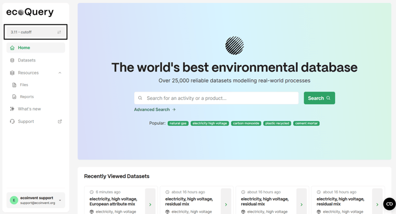
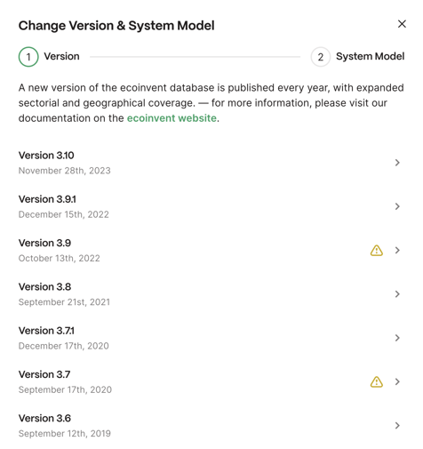
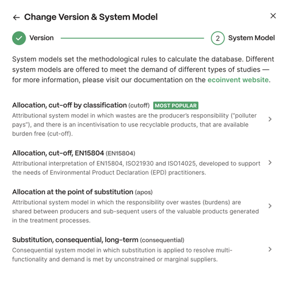

# 在 ecoQuery 中搜索数据集

英文原题：Searching for Datasets in ecoQuery  
来源：[ecoinvent 官方原文](https://support.ecoinvent.org/searching-for-datasets)  
原文快照：2026-10-13  
审核状态：AI 交叉审校通过

原站修改日期：2025-11-05





##

2025年11月5日

点击页面左上角的“版本－系统模型”（version - system model，如截图所示），选择要浏览的数据库版本和感兴趣的系统模型。

在随后弹出的窗口中，您可以选择“数据库发布版本”（Database Releases）中的[版本](releases-overview.md)和所需[系统模型](system-models.md)。

  
  
   
要搜索数据库，可在搜索框中输入所查找的  
活动／产品名称。您还可以使用右侧可用的筛选条件  
，进一步定制搜索：

- 部门（Sector）：根据 ISIC 编号和主要输出，将数据集分入由 ecoinvent 定义的各部门。
- 地理区域（Geography）：ecoinvent 中的每个活动都有[地理位置](geographies.md)。
- 活动类型（Activity type）：活动可以是[普通转化活动](activities-products.md)、[市场活动、进口活动或市场组](https://ecoinvent.org/the-ecoinvent-database/market-activities/)。
- ISIC 门类（ISIC section）：ISIC 分类所属的宽泛类别。

- ISIC 类别（ISIC class）：根据数据集的主要输出进行分类。ISIC 指联合国统计司制定的《所有经济活动的国际标准产业分类（ISIC）》第 4 次修订版，可在线查阅：<https://unstats.un.org/unsd/publication/SeriesM/seriesm_4rev4e.pdf>。

如需进一步获得数据库搜索支持，可参阅[数据库概览](../assets/30cb0c4dc3d6-Database-Overview-v3.12.xlsx)文件。这些文件可从相应[数据发布页面](releases-overview.md)的相关文档和文件部分下载，列出了对应系统模型和 ecoinvent 版本的全部可用数据集。数据库概览可帮助用户选择正确的活动和产品名称，从而在 ecoQuery 中找到相应数据集。

如需进一步理解数据，可查看数据库的[未指定系统模型（Undefined）](upr-lci-lcia.md)形式，即 ecoinvent 数据库的原始源数据。Undefined 形式展示链接和分配之前的数据集。要理解某个活动描述的物理过程，查看其未链接状态通常很有帮助。可通过“系统模型”（System model）下拉菜单访问数据库的 Undefined 形式。请注意，访客账户只能查阅各数据集的文档。





##

Nov 5th, 2025

Select the version of the database you want to browse and the system model you are interested in, by clicking “version - system model” (as depicted in the screenshot) on the top left of the page.

In the following pop-up window, you will be able to select the [version](releases-overview.md) "Database Releases" and the [system model](system-models.md) of your choice.

  
  
   
To search the database, you can use the search field and type the name of the   
activity/product you are looking for. You may also customize your search further,   
by adding one of the available filters on the right-hand side:

- Sector: datasets are classified into sectors (defined by ecoinvent) according to their ISIC number and their main output.
- Geography: each activity present in the ecoinvent has a [geographic location](geographies.md).
- Activity type: activities can be [ordinary transforming activity](activities-products.md), [market activity, import activity or market group](https://ecoinvent.org/the-ecoinvent-database/market-activities/).
- ISIC section: broad ISIC category to which the ISIC classification belongs.

- ISIC class: datasets are classified according to their main output. ISIC refers to the International Standard Industrial Classification of all Economic Activities (ISIC), Rev. 4 by the United Nations Statistics Division available online: <https://unstats.un.org/unsd/publication/SeriesM/seriesm_4rev4e.pdf>

For further support in searching the database, you can refer to the [database overview](../assets/30cb0c4dc3d6-Database-Overview-v3.12.xlsx) files which are available for download in the relevant documents & files section of the respective [data releases page](releases-overview.md). These files provide the list of all datasets available in the database for the respective system model and ecoinvent version. The database overview supports users in choosing the correct activity and product names to find the corresponding dataset in ecoQuery.

For further clarification, you can access the [Undefined](upr-lci-lcia.md) form of the database, which is the raw source data of the ecoinvent database. The Undefined form depicts datasets before linking and allocation. To understand the physical process described by an activity, it is often helpful to look at the dataset in its unlinked state. The Undefined form of the database is available via the dropdown menu “System model”. Please note that with a guest account you can only access the documentation of each dataset.




