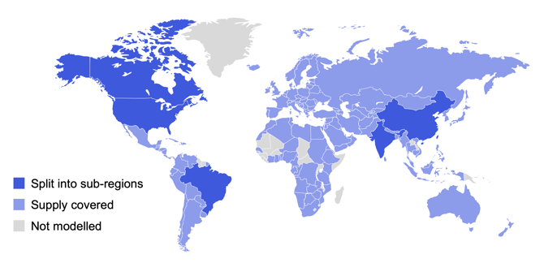
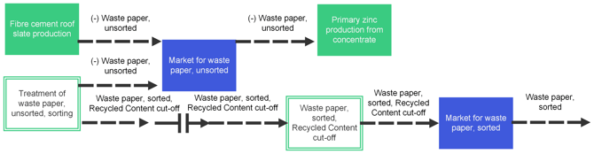
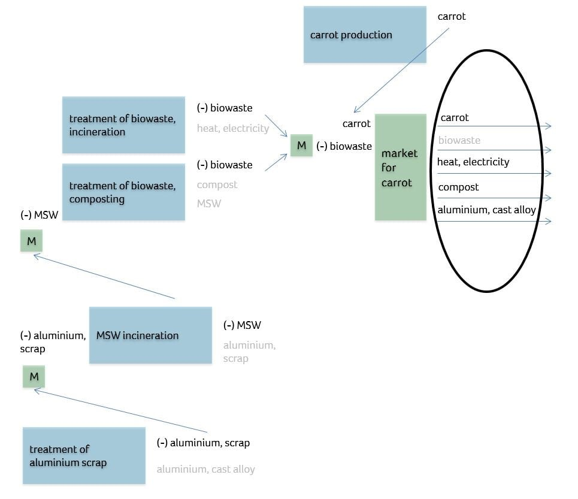
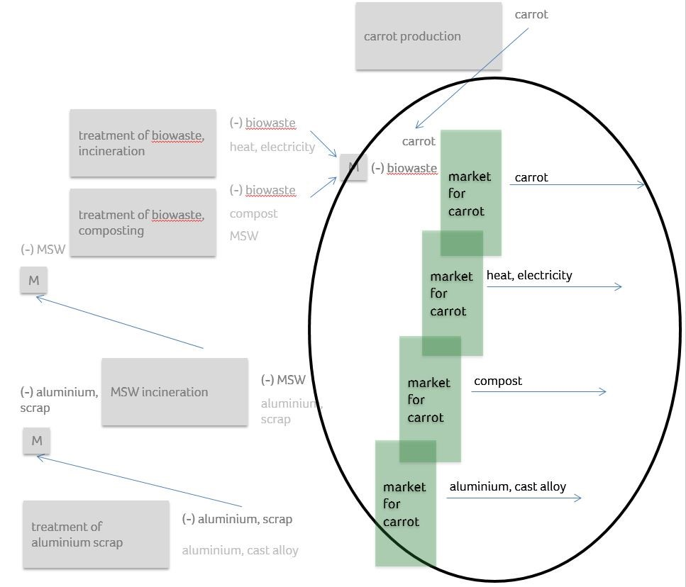

# 不同系统模型及其采用的关键概念

英文原题：About Different System Models and the Key Concepts Applied  
来源：[ecoinvent 官方原文](https://support.ecoinvent.org/system-models-1)  
原文快照：2026-10-13  
审核状态：AI 交叉审校通过，含审校注记

原站修改日期：2025-09-26


本页含原文疑点，需领域专家核实。请同时阅读文末审校注记。






##

2024 年 2 月 1 日

### 什么是系统模型？ 

系统模型规定从产品和服务[活动](activities-products.md)（未指定系统模型的单元过程（[UPR](upr-lci-lcia.md)））计算生命周期清单（LCI）的方法规则，并采用不同假设，确定供应关系（链接）及产品和服务生产者与消费者之间的影响分配（分配与替代）。

为满足不同类型研究的需求，提供多种系统模型，即“按分类截断的分配模型（Allocation, cut-off by classification）”“EN15804 截断分配模型（Allocation, cut-off, EN15804）”“替代点分配模型（Allocation at the point of substitution）”和“长期后果型替代模型（Substitution, consequential, long-term）”。

在[此处](system-models.md)了解更多。

### 如何选择适合我的系统模型？ 

所有[系统模型](system-models.md)均基于现实过程的同一组底层数据。不同类型研究适合采用不同建模选择。ecoinvent 不就何时使用哪种系统模型提出建议，因为我们认为只有用户自己了解其研究的约束条件。

不过，对于首次使用 LCI 数据库的用户，ecoinvent 建议在开始使用 ecoinvent 第 3 版时采用[截断系统模型](system-models.md)（“数据库基础知识：系统模型”）。对于首次使用者，这一模型可能更容易理解。

### 为什么参考产品的数量会变化？ 

在数据集的原始版本，即[未指定系统模型的 UPR](upr-lci-lcia.md)中，参考产品的数量并不总是 1。例如，数据集“cotton production, CN”的参考流为 1000kg 棉纤维。此外，该活动还产生一种可分配的副产品——棉籽。

当未指定系统模型的 UPR 中参考产品数量不为 1 时，应用系统模型会将其缩放为 1。所有交换的数量也随之相应缩放。但必须注意，其他交换的数量不一定也都除以 1000。从表中可以看出，生产 1000kg 棉纤维产生 335kg 二氧化碳排放，而在截断系统模型中，1 kg 瓦楞原纸（fluting medium）仅对应 0.269 kg 二氧化碳。这是因为该数据集还生产了副产品。因此，应用系统模型时，交换会根据相应系统模型的方法，在不同参考产品／副产品之间分配。

### APOS 系统模型：为什么我的再生铝中会有胡萝卜？ 

这些是所涉及的活动、其参考产品及副产品。

这是它们在 APOS 中的链接方式。

这是替代点，分配在此发生……

……并由此创建这些经分配的单一输出数据集。

#### 合并与重命名：APOS 链接（铝）的最后步骤。 

- 针对“aluminium, cast alloy”的单一输出 UPR“market for carrot”恢复其原名：“treatment of aluminium scrap”。
- 这里所述的同一过程已在所有产生城市固体废物（MSW）的供应链中发生；因此会生成相当多的“treatment of aluminium scrap”实例。
- 随后，将所有名称相同的活动合并。

#### 其他考虑因素 

- 与城市固体废物（MSW）类似，其他待处理材料（MFT）也产生这类废铝，并遵循上述相同的链接程序，最终合并为一个已链接的“treatment for aluminium scrap”UPR。
- 该 UPR 承担所有待处理材料（MFT）生产者的一部分环境负荷；这些材料在处理时会以副产品形式产生废铝。





##

Feb 1st, 2024

### What is a System Model? 

System models set the methodological rules to calculate the life cycle inventories (LCIs) of products and services [activities](activities-products.md) (Undefined Unit Processes ([UPR](upr-lci-lcia.md))) and apply different assumptions to determine the supply (linking) and the distribution of impacts between producers and consumers of products and services (allocation and substitution).

Different system models, namely, “Allocation, cut-off by classification,” “Allocation, cut-off, EN15804”, “Allocation at the point of substitution,” and “Substitution, consequential, long-term,” are offered to meet the demand of different types of studies.

Learn more [here](system-models.md).

### How Do I Choose the Right System Model for Me? 

All [system models](system-models.md) are based on the same underlying data of real-world processes. Different types of studies benefit from different modeling choices. ecoinvent does not provide recommendations on when to use one system model or another since we consider that only the users know the constraints of their study.

However, for users new to LCI databases, ecoinvent recommends using the [cut-off system model](system-models.md) 'Database Fundamentals System Models' when starting to work with ecoinvent version 3. This model can be easier to understand for first-time users.

### Why is the Amount of the Reference Product Changing? 

In the raw version of a dataset, the [undefined UPR](upr-lci-lcia.md), the amount of reference product is not always 1. For example, the dataset “cotton production, CN” has a reference flow of 1000kg of cotton fiber. Additionally, an allocatable by-product, cottonseed, results from this activity.

Whenever the amount of the reference product is not 1 in the undefined UPR, it is scaled to 1 when a system model is applied. With that, also the amounts of all exchanges are scaled accordingly. However, it must be noted that the amounts of the other exchanges are not necessarily divided by 1000 as well. It can be seen from the table that the production of 1000kg of cotton fibre results in carbon dioxide emissions of 335kg, while in the cut-off system model 1 kg of fluting medium is responsible for only 0.269 kg carbon dioxide. The reason is that this dataset has also produced a by-product. Hence, when applying a system model, the exchanges are being allocated between the different reference/by-products according to the methodology of the respective system model.

### APOS System Model: Why do I Have Carrots on My Recycled Aluminium? 

Those are the Involved Activities, their Reference Products, and By-Products

This is how they are linked in APOS

This is the Point of Substitution, where Allocation Applies…

…and those Single Output Allocated DS are created

#### Merging and Renaming: Final Steps of APOS Liking (for Alu) 

- The single output UPR «market for carrot» for «aluminium, cast alloy» is given its original name back: «treatment of aluminium scrap»
- The same process described here has happened in all supply chains where MSW was generated; quite a lot of instances of «treatment of aluminium scrap» will then be generated
- All those activities bearing the same name are then merged together.

#### Other Considerations 

- Similarly as MSW, other MFT are also generating this type of scrap, and will follow the same linking procedure described, merging in the end into one single «treatment for aluminium scrap» linked UPR.
- This UPR bears a share of the burdens of all producers of MFT that, when treated, generate alu scrap as by-product.





## 翻译与审校注记 

- **待专家复核 · b0012**：该段前后均讨论棉花生产，却突然将归一化产品称为瓦楞原纸，疑似原文误植。 请对照原图核实，应否改为棉纤维；当前译文保留原文产品名。 [查看完整记录](../review/issues.md#issue-161)
- **已处理／已说明 · b0020**：APOS 语境的 MFT 为 material for treatment（待处理材料），不是多功能处理；MSW 对应城市固体废物。 已修正缩写对应中文及生产者关系。 [查看完整记录](../review/issues.md#issue-162)
- **已处理／已说明 · b0023**：APOS 语境的 MFT 为 material for treatment（待处理材料），不是多功能处理；MSW 对应城市固体废物。 已修正缩写对应中文及生产者关系。 [查看完整记录](../review/issues.md#issue-163)
- **已处理／已说明 · b0024**：APOS 语境的 MFT 为 material for treatment（待处理材料），不是多功能处理；MSW 对应城市固体废物。 已修正缩写对应中文及生产者关系。 [查看完整记录](../review/issues.md#issue-164)
