# 系统模型

英文原题：System Models  
来源：[ecoinvent 官方原文](https://support.ecoinvent.org/system-models)  
原文快照：2026-10-13  
审核状态：AI 交叉审校通过，含审校注记

原站修改日期：2025-09-26


本页含原文疑点，需领域专家核实。请同时阅读文末审校注记。






## 本文详细介绍所提供的四种不同系统模型。 

2024 年 2 月 14 日

[关键概念](#zh-b0012)

[按分类截断的分配模型（Allocation, cut-off by classification）](#zh-b0020)

[EN15804 截断分配模型（Allocation, cut-off, EN15804）](#zh-b0044)

[替代点分配模型（APOS）](#zh-b0074)

[长期后果型替代模型（Substitution, consequential, long-term）](#zh-b0094)

系统模型规定从产品和服务[活动](activities-products.md)（未指定系统模型的单元过程[（UPR）](upr-lci-lcia.md)）计算生命周期清单（LCI）的方法规则，并采用不同假设，确定供应关系（链接）及产品和服务生产者与消费者之间的影响分配（分配与替代）。

为满足不同类型研究的需求，提供“[按分类截断的分配模型（Allocation, cut-off by classification）](#zh-b0020)”“[EN15804 截断分配模型（Allocation, cut-off, EN15804）](#zh-b0044)”“[替代点分配模型（Allocation at the point of substitution）](#zh-b0074)”和“[长期后果型替代模型（Substitution, consequential, long-term）](#zh-b0094)”等不同系统模型。按分类截断的分配模型与替代点分配模型仅在废物和可回收材料处理方式上不同。这一区别反映在所得影响得分中；除此之外，两者的影响得分相当接近。

系统模型的选择由用户负责。用户应了解所选系统模型的假设，确保其符合研究目标和范围。对于数据库新用户，ecoinvent 建议在开始使用 ecoinvent 第 3 版时采用截断系统模型。这一模型更便于首次使用者理解。截断系统模型沿用 ecoinvent 第 1 版和第 2 版的建模选择，因此也推荐希望与以往工作保持连续性的有经验用户采用。

### 关键概念 

#### 关键概念：过程细分、分配与替代 

#### 过程细分 

在应用分配和替代之前，可以先进行过程细分。这些活动定义多个参考产品，并依据不同物理特征将输入和排放划分至各产品。此做法适用于所有系统模型。

#### 分配 

分配是归因型方法中将多产品活动转化为单产品活动的方法，因此与按分类截断的分配模型和替代点分配模型有关。分配依据确定每项输入和排放划归参考产品及具有经济价值副产品的份额。ecoinvent 数据库主要采用经济分配（即依据价格分配），只有少数例外，例如能源采用基于㶲的分配。

#### 替代 

替代是后果型系统模型中将多产品活动转化为单产品活动的方法。替代将所有副产品移至输入端，并赋予负号（以保持质量平衡）。能够替代其他生产的副产品，为生产它们的活动带来环境收益（抵扣）。

### 按分类截断的分配模型 

“Allocation, cut-off by classification”系统模型，简称截断系统模型，基于再生材料含量法或截断法。在该模型中，废物由其生产者负责（“污染者付费”），而可回收产品在截断后不承担上游环境负荷，由此鼓励使用可回收产品。

#### 截断系统模型简介 

该方法的基本理念是：材料的初级（首次）生产始终分配给材料的初级使用者。若材料被回收利用，初级生产者不会因提供可回收材料而获得任何环境收益（抵扣）。因此，可回收材料不携带上游环境负荷进入回收过程，再生材料仅承担回收过程的影响。例如，再生纸仅承担废纸收集以及将废纸转化为再生纸的回收过程影响，不承担纸张初级生产所需的林业活动及加工的任何环境负荷。

截断系统模型区分废物与可回收物。与可回收物类似，废物生产者不会因回收利用或再利用废物处理所得产品而获得任何环境收益（抵扣）。例如，城市固体废物焚烧产生的热可用于住宅或办公室供暖，因而具有价值。但焚烧完全分配至废物处理，因此其环境负荷归于废物生产者，所产热则不承担这些环境负荷。

这种副产品分配方法也用于 ecoinvent 第 1 版和第 2 版，当时它是唯一可用的系统模型。

#### <strong>产品分类</strong> 

在截断系统模型中，数据库所有中间交换（即来自[技术圈](glossary-t.md)的流）均归入 3 个类别之一：可分配产品、可回收物或废物。这一分类决定交换在分配过程中的处理方式。分类针对产品层级，而非单个活动层级：整个数据库中，同一种中间交换可能在多个活动中多次被使用和生产，但各交换（由名称明确识别）的分类在整个数据库中保持一致。

产品名称可能暗示其类别，但分类并不总是显而易见。例如，废纸可能归类为可回收材料，但为表述清楚，其名称仍包含“废”字。所有产品及其分类的完整清单可在[ecoinvent 网站](https://ecoinvent.org/the-ecoinvent-database/)获取，数据集也包含其产品分类。分类基于数据提供方的视角及 ecoinvent 专家和编辑的判断，并根据产品在 ecoinvent 数据库中的用途和去向作出选择。

<strong>  
可分配产品</strong>  
大多数生产的商品属于此类。可分配产品是普通产品或副产品，具有经济价值，因此参与分配。热和电力属于可分配产品的例子。

<strong>可回收材料</strong>  
没有经济价值或经济价值很低的材料，可作为回收活动的输入或资源，因此存在收集需求。例如金属废料和废纸。

<strong>废物产品</strong>   
废物产品没有经济价值，若无补偿，也没有人愿意收集。因此，生产者通常必须付费处置这些材料，即消费材料处置服务。例如废水、受化学污染的土壤和放射性废物。

按分类处理副产品

总体而言，截断系统模型使可回收材料在处理过程开始处被截断，后续用途可获得不承担上游环境负荷的材料。废物处理完全分配给废物生产者，废物处理所得的全部有价值副产品在废物处理中被截断，可在不承担这些环境负荷的情况下使用。若某活动生产多个产品，普通副产品则通过产品间分配处理。

下文更详细地介绍该系统模型如何处理副产品。  
  
<strong>废物产品的处理</strong>   
废物副产品必须处理，处理环境负荷完全分配给产生废物的活动。因此，废物作为负输入链接至该活动，表示活动需要废物处置服务。不同处理过程随后提供废物处置服务，其输入和排放增加产生废物活动的环境负荷。

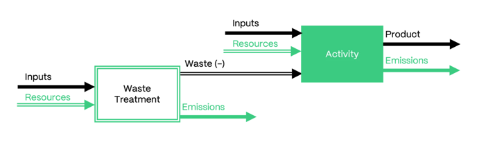

废物处理过程产生的任何非废物副产品（即并非其他废物产品）均被截断，不为生产活动带来环境收益（抵扣）。因此，截断点位于废物处理结束处，意味着所得产品在数据库中可作为不承担这些上游环境负荷的输入供其他活动使用。

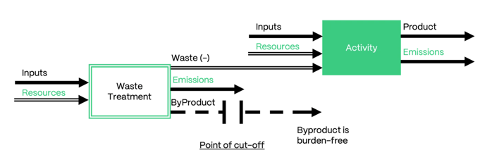

<strong>可回收材料的处理</strong>

可回收材料通过称为“product name, recycled content cut-off”的特殊数据集，从其生产活动中截断。这些数据集没有输入或排放，因此不承担环境负荷。在生产活动中，材料与废物一样记录为负输入；但该材料不链接至任何处理活动，而仅链接至这个空过程。

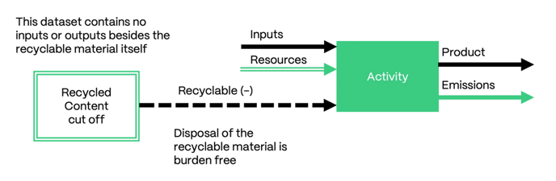

因此，截断法在生产端较为简单。截断点位于产生可回收材料的活动结束处。二次使用周期从生产者处收取材料开始，运至加工地点构成供应链的起始环节。在该系统模型中，需要可回收材料作为输入的过程（如回收过程）从其市场获得产品，而市场链接至不承担环境负荷的再生材料含量截断数据集。

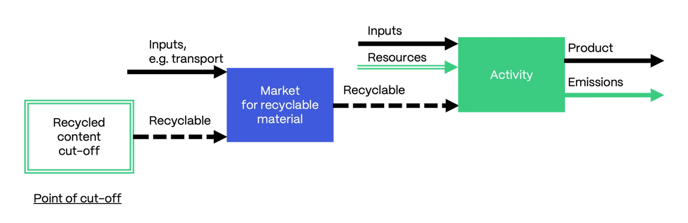

<strong>特殊情况：回收链</strong>

回收过程可能跨越多个相互链接的单元过程。通常，截断仅发生在起始处。不过，回收过程中有时会产生不同形态的回收产品，以下例子可最好地说明这一情况。废玻璃首先经过加工和破碎，成为可回收材料碎玻璃，随后可制成玻璃瓶。在此例中，废玻璃和碎玻璃均视为可回收材料，因此其他生产者产生这两种材料时，其副产品均被截断。但对于回收，系统模型保持回收链完整，因此碎玻璃虽然是可回收材料，仍具有非空供应链。碎玻璃供应链一直追溯到二次使用周期起始处，即废玻璃收集；废玻璃与碎玻璃之间不发生截断。

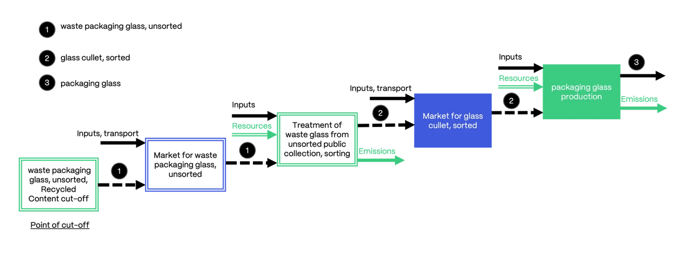

ecoinvent 数据库第 3.7.1 版中的回收链示例。

<strong>  
可分配产品的处理</strong>

在废物和可回收材料处理后，活动产生的所有剩余可分配副产品进行分配。此过程使用数据集作者在数据集中定义的分配因子。由于废物及大多数可回收材料（回收链内仍保留为产品的材料除外）此时已移至活动输入端，它们被视为与其他输入类似，并在活动的不同联产品之间分配。

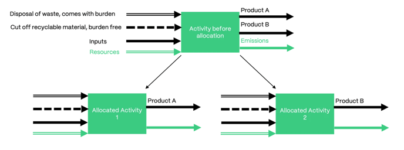

### <strong>EN15804 截断分配模型（Allocation, cut-off, EN15804）</strong> 

“Allocation, cut-off, EN15804”系统模型为满足环境产品声明（EPD）实践者的需求而开发。该模型符合对 EN15804、ISO21930 和 ISO14025 的归因型解释，提供上述标准所要求的全部生命周期清单（LCI）指标，并遵循欧盟委员会规定的废物终止状态（end-of-waste）判定标准。

#### <strong>EN15804 截断分配系统模型简介</strong> 

“Allocation, cut-off, EN15804”系统模型遵循截断法的基本原则。交换分为可分配产品、可回收物和废物，分类决定其在分配中的去向。与截断系统模型类似，依据“污染者付费”原则，废物生产者承担废物处理的环境负荷，再生产品使用者获得不承担这些上游环境负荷的产品。

EN15804 截断分配模型与按分类截断的分配模型的主要区别在于：

- 初级系统与次级系统之间的截断点
- EPD 所需清单指标的计算

#### 初级系统与次级系统之间的截断点 

初级系统与次级系统之间的截断点符合 EN15804&A2:2019 标准的废物终止状态（end-of-waste）判定标准。根据该标准，当回收产品有市场，且满足特定用途的技术要求以及适用于该产品的法律和标准时，产品达到废物终止状态。遵循这一指导，部分供应链的截断点已调整，以符合废物终止状态判定标准。在这些情况下，必要时也修改产品分类，使之与新截断点一致。图 1 和图 2 展示了按分类截断的分配模型中废纸处理的截断点，以及它在 EN15804 截断分配模型中的变化。  
  

图 1：初级系统（废物生产者）与次级系统（再生材料使用者）的系统边界。在按分类截断的分配系统模型中，未分选废纸处理（treatment of waste paper, unsorted）供应链的截断点位于未分选废纸（waste paper, unsorted）产生之后。

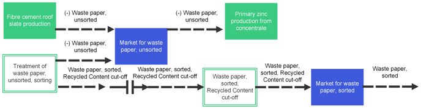

图 2：初级系统（废物生产者）与次级系统（再生材料使用者）的系统边界。在 EN15804 截断分配系统模型中，同一供应链的截断点位于分选活动之后。

材料达到废物终止状态后可能仍需进一步加工，这部分不属于初级系统。例如，精炼厂或重熔厂的回收活动位于废物终止状态之后。

#### <strong>EPD 所需清单指标的计算</strong> 

EN15804 截断分配系统模型提供 EPD 所要求的全部生命周期清单（LCI）指标。这些指标描述资源使用、废物类别和输出流，并提供生物源碳含量信息。下列清单概述该系统模型包含的 LCI 指标：

- 再生材料的使用
- 可再生与不可再生二次燃料
- 用于回收利用的材料
- 用于能量回收的材料
- 输出能源（电力、热）
- 回收能源
- 用作原材料的可再生与不可再生一次能源资源使用量
- 可再生与不可再生一次能源使用量，不包括用作原材料的可再生一次能源资源
- 可再生与不可再生一次能源资源总使用量
- 净淡水使用量

- 已处置的危险废物与非危险废物
- 已处置的中低放射性废物
- 已处置的高放射性废物
- 产品及配套包装中的生物源碳含量

这些指标采用基本流交换或属性建模，具体取决于指标是过程特征（如再生材料使用量）还是产品特征（如生物源碳）。指标计算考虑前段定义的截断点。例如，资源输出流根据“达到废物终止状态时离开系统边界”的数量计算。

以下示例展示未分选废纸处理（treatment of waste paper, unsorted）供应链中计算“用于回收利用的材料”（MFR）和“再生材料使用量”（SM）两项指标时考虑的流。已分选废纸（waste paper, sorted）、脱墨纸浆（deinked pulp）和湿浆（wet lap）在经过处理活动后达到废物终止状态。两项指标均在这一截断点计算。

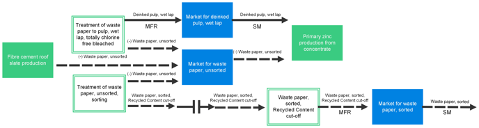

### <strong>替代点分配模型（APOS）</strong> 

“Allocation at the point of substitution”系统模型也称 APOS 系统模型。它采用归因型方法，将废物责任（环境负荷）在生产者与后续使用者之间分担；后者通过使用处理过程所产生的有价值产品而从这些过程中获益。

APOS 系统模型曾称为“Allocation, ecoinvent default”。该名称在 ecoinvent 第 3.2 版发布时更改。

#### <strong>APOS 系统模型简介</strong> 

替代点分配（APOS）系统模型通过扩展产品系统，避免处理系统内部的分配。有些活动（如收集城市固体废物并运至处置场）发生于处理系统内部，为这些单独步骤确定适当分配因子（如收入）可能很困难。APOS 的设计旨在总体上避免这类分配，改为将处理系统的有价值副产品与产生待处理材料（即废物）的活动一同分配。在前景系统中，由于具体研究的范围限制，这种产品系统扩展通常无法实现。

#### <strong>产品分类</strong> 

在 APOS 系统模型中，产品分为待处理材料（mft）和非待处理材料（non-mft）。待处理材料是通常需要处理的产品（即废物），或需要经过处理才对后续加工步骤具有价值的产品（即可回收材料）。非待处理材料是使用前无需进一步加工的有价值产品。

#### <strong>按分类处理副产品</strong> 

<strong>  
非待处理材料的处理</strong>

若活动的所有参考产品和副产品均为 non-mft，则依据分配因子分配输入和排放。

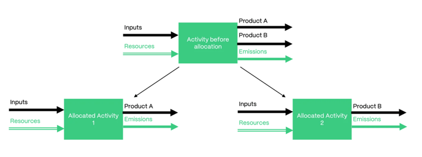

<strong>  
待处理材料的处理</strong>

该方法的基本理念是避免在寿命终结环节，即处理活动内部进行分配。为此，每个产生需要进一步处理才具有价值的产品（如废物）的活动，与该产品所需的全部处理活动一起，被视为同一个系统。随后，将生产活动和处理活动的交换分配至该系统中所有不同的有价值副产品（来自生产活动和处理活动）。因此，替代点位于产生有价值产品的处理（或回收）活动之后，下游供应链中的第一个活动。

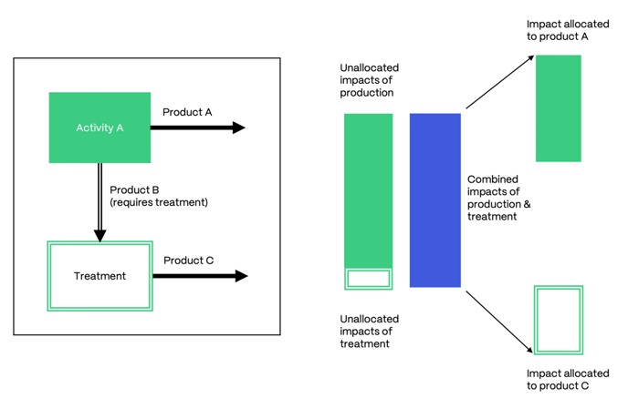

APOS 系统模型中扩展分配系统的示意图。生产过程和处理过程的影响合并，并分配至产品 A 和处理副产品 C。改编自 Wernet G., Bauer C., Steubing B., Reinhard J., Moreno Ruiz E., Weidema, B. (2016) The ecoinvent database version 3 (part I): overview and methodology（ecoinvent 数据库第 3 版（第一部分）：概况与方法）. [International Journal of Life Cycle Assessment](https://link.springer.com/article/10.1007/s11367-016-1087-8)。

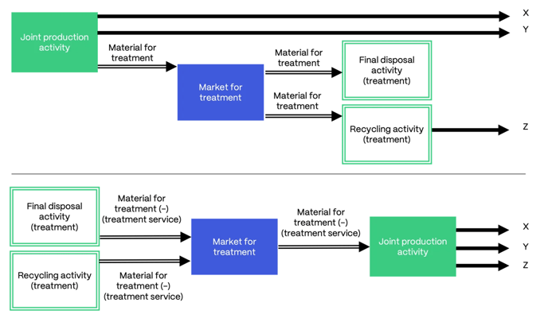

#### <strong>示例</strong> 

假设有两个活动：“polyethylene pipe production”（聚乙烯管生产）和“wooden door production”（木门生产）。两者均产生相同副产品“waste polyethylene”（废聚乙烯），它属于 mft。聚乙烯有若干代表其寿命终结的活动，包括焚烧。焚烧产生“electricity”（电力）和“heat”（热）两种副产品，它们均为有价值产品，归类为 non-mft。

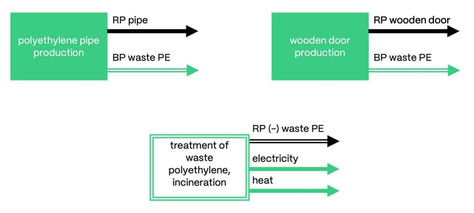计算 APOS 系统模型时，mft 移至输入端，并赋予负号（以保持质量平衡）。产品供应至各自的市场，再由市场满足需求。因此，废聚乙烯（PE）焚烧活动供应废 PE 市场，该市场进一步满足管材和木门生产的处理需求。

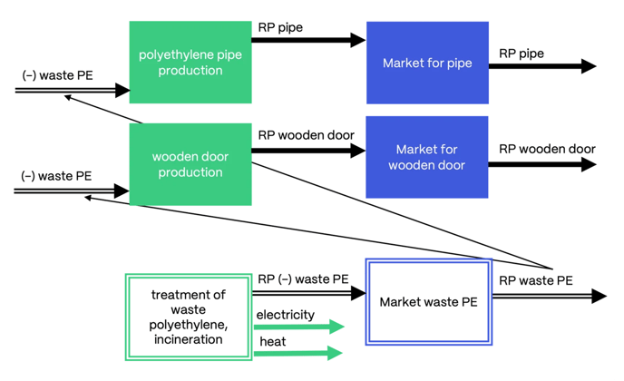

下一步，处理活动的 non-mft 副产品成为产生 mft 活动的副产品：电力和热（有价值／可销售产品）移至管材和木门生产的输出端。

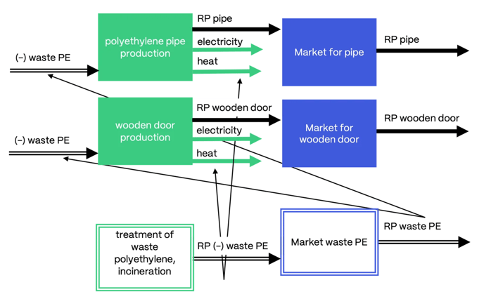

该活动随后表现为“常规”的联合生产，因此对全部有价值产品应用分配（例如管材／电力／热，以及木门／电力／热）。

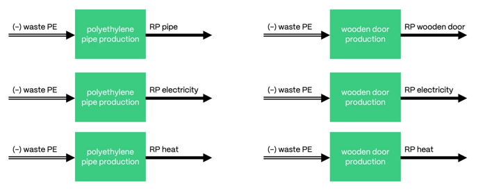

分配后，以此方式创建且生产同一产品的全部活动，合并为一个沿用原 mft 处理名称的活动（如 treatment of waste polyethylene, incineration）。这些活动包含 non-mft 副产品转移到的活动的输入和排放。因此，生产电力的“treatment of waste polyethylene, incineration”将包含例如管材生产和木门生产的输入和排放。管材、木门、电力和热仍供应至各自市场。

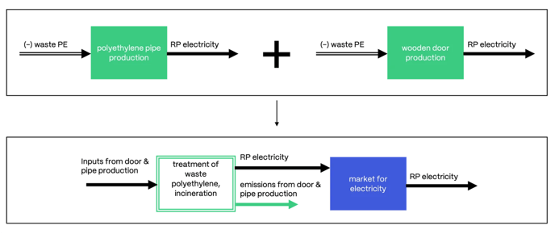

由此，该活动现在携带来自不同活动的许多不同交换，这对多个行业均产生的废物尤其相关。例如，废聚乙烯也是某些农业活动的副产品，表示废弃塑料地膜；因此，焚烧活动还可能包含灌溉等输入及硝酸盐等排放。这种扩展也适用于处理链。若多个处理活动相互链接，该链沿途的所有 non-mft 副产品均经历上述相同过程。

### <strong>长期后果型替代模型（Substitution, consequential, long-term）</strong> 

“Substitution, consequential, long-term”系统模型也称后果型系统模型。该模型采用不同的基本假设，评价现有系统发生变化的后果。它通过替代，将副产品所替换供应链的避免环境负荷作为环境收益（抵扣）计入产生这些副产品的过程。

#### <strong>后果型系统模型简介</strong> 

后果型系统模型采用不同的基本假设，评价现有系统发生变化的后果。该模型可用于前瞻性研究及预测未来变化。其关键概念是应用替代解决多功能性，以及仅使用边际供应。

在后果型系统模型中，所有副产品均移至输入端并赋予负号，以保持质量平衡。由于不进行分配，活动承担全部输入和排放的影响。能够替代其他生产的副产品为生产它们的活动带来环境收益（抵扣），因为它们替代了原本将作为参考产品生产的部分产品。例如，焚烧过程所产电力向电网供能，取代了原本由其他来源（如化石燃料燃烧）生产的能源。

#### <strong>边际供应</strong> 

不受约束供应商或边际供应商可通过增加供应满足需求增长。只要至少有一个活动将某产品作为参考产品生产，该产品的供应就不受约束。在后果型思维中，这表示开展该活动在经济上合理，因为市场会吸收其供应。

受约束供应商无法通过增加供应满足需求增长。仅作为副产品生产的产品受到约束。副产品并非活动的经济驱动力，因此为满足需求而增加生产在经济上不合理。

供应也可能受到技术水平约束。在 ecoinvent 数据库中，每个活动均指定一个技术水平：

- 过时技术已不再使用。
- 旧技术正退出使用（经济竞争力较低的技术）。
- 当前技术介于现代技术和旧技术之间。
- 现代技术是当前新增产能时采用的技术（经济竞争力最强的技术）。
- 新技术在技术上优于现代技术，但由于尚不具备经济竞争力，还未普遍采用。

只有最新的技术被视为不受约束。

因此，边际供应由至少一个采用最新技术水平的活动所生产的参考产品构成。

#### <strong>示例</strong> 

21 世纪初，液晶显示器（LCD）的图像质量达到与阴极射线管（CRT）相同的水平，并开始主导市场（[来源](https://onlinelibrary.wiley.com/doi/abs/10.1889/1.2785199)）。因此，在后果型系统模型中，CRT 的技术水平设为“旧”，显示器生产和使用（运行）的新增需求仅由 LCD 显示器满足。

#### <strong>电力中的边际供应</strong> 

第 3.4 版引入了后果型系统模型专用的电力市场。边际组合表示需求增长对新发电技术建设和运行的后果。这些组合分别针对 40 个国家，合计占全球能源产出的 77%。组合基于欧盟委员会（2016）和国际能源署（2016）等国际或国家机构的预测。

在[此处](https://www.dora.lib4ri.ch/psi/islandora/object/psi:24716)进一步了解后果型组合的创建方式。

#### <strong>替代与受约束市场的处理</strong> 

如果没有不受约束供应商，市场就受到约束，因此供应并非完全有弹性。需求增长不会通过供应增加来满足，而是通过减少消费来满足。供应减少时，边际消费者将减少该产品需求。

#### <strong>示例</strong> 

氢氧化钠仅作为氯生产的副产品生产，因此其市场受到约束。为求解该系统，需要识别边际消费。氢氧化钠用作中和剂，可以容易地被其他物质（如纯碱）替代。

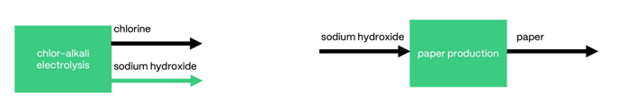

氢氧化钠生产者因减少边际消费而获得环境收益（抵扣）。这意味着氯生产因提供氢氧化钠、进而避免纯碱生产（替代）而获得环境收益。另一方面，需要氢氧化钠的活动会触发纯碱生产，因此承担其影响。

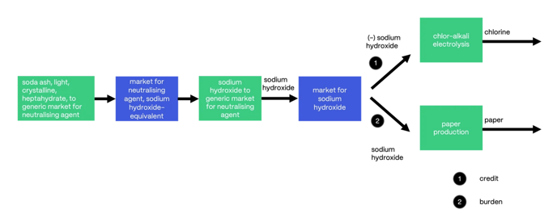





## Four different system models are offered and explained in detail in this article. 

Feb 14th, 2024

[Key Concepts](#en-b0012)

[Allocation, cut-off by classification](#en-b0020)

[Allocation, cut-off, EN15804](#en-b0044)

[Allocation at the point of substitution](#en-b0074)

[Substitution, consequential, long-term](#en-b0094)

System models set the methodological rules to calculate the life cycle inventories (LCIs) of products and service [activities](activities-products.md) (Undefined Unit Processes [(UPR)](upr-lci-lcia.md)), and apply different assumptions to determine the supply (linking) and the distribution of impacts between producers and consumers of products and services (allocation and substitution).

Different system models, namely, “[Allocation, cut-off by classification](#en-b0020)”, “[Allocation, cut-off, EN15804](#en-b0044)”, “[Allocation at the point of substitution](#en-b0074)” and “[Substitution, consequential, long-term](#en-b0094)”, are offered to meet the demand of different types of studies. “Allocation, cut-off by classification” and “Allocation at the point of substitution” differ solely in the way they treat waste and recyclable materials. This factor is reflected in the resulting impact scores, which are otherwise quite similar.

The choice of system model is the responsibility of the user. Users should understand the assumptions of the system model they choose to ensure that it serves the goal and scope of their study. For users new to the database, ecoinvent recommends using the cut-off system model when starting to work with ecoinvent version 3. This model is easier to understand for first-time users. The cut-off system model applies the same modeling choices as ecoinvent versions 1 and 2 and is therefore also recommended for experienced users looking for continuity with their previous work.

### Key Concepts 

#### Key Concepts: Subdivision, Allocation, and Substitution 

#### Subdivision 

Before allocation and substitution is applied, subdivision can come to place. In those activities, more than one reference product is defined, and inputs and emissions are split among products based on various physical characteristics. This is applied for all system models.

#### Allocation 

Allocation is the method applied in the attributional approach to convert multi-product activities into single-product activities. It is therefore relevant for “Allocation, cut-off by classification” and “Allocation at the point of substitution.” The allocation key determines the share of each input and emission assigned to the reference product and to the by-products that have economic value. The ecoinvent database relies on economic allocation (i.e., allocation based on price) with few exceptions, such as for energy, for which allocation is based on exergy.

#### Substitution 

Substitution is the method applied to convert multi-product activities into single-product activities in the consequential system model. Substitution moves all by-products to the input side with a negative sign (to maintain mass balance). By-products that can substitute other productions provide credits to the activity producing them.

### Allocation cut-off by Classification 

The system model “Allocation, cut-off by classification,” or the cut-off system model, is based on the recycled content, or cut-off, approach. In this system model, wastes are the producer’s responsibility (“polluter pays”), and there is an incentivization to use recyclable products, that are available burden free (cut-off).

#### Introduction to the cut-off System Model 

The underlying philosophy of this approach is that primary (first) production of materials is always allocated to the primary user of a material. If a material is recycled, the primary producer does not receive any credit for the provision of any recyclable materials. As a consequence, recyclable materials are available burden-free to recycling processes, and secondary (recycled) materials bear only the impacts of the recycling processes. For example, recycled paper only bears the impacts of waste paper collection and the recycling process of turning waste paper into recycled paper. It is free of any burdens of the forestry activities and processing required for the primary production of the paper.

The cut-off system model distinguishes between waste and recyclables.  Similar to recyclables, producers of waste do not receive any credit for recycling or reuse of products resulting from any waste treatment. For example, heat from the incineration of municipal solid waste can be used to heat houses or offices and therefore has value. Nevertheless, the incineration is allocated completely to the treatment of the waste; therefore, the burden is assigned to the waste producer while the heat comes burden-free.

This approach to by-product allocation was also used in ecoinvent versions 1 and 2, where it was the only available system model.

#### <strong>Classification of Products</strong> 

In the cut-off system model, all intermediate exchanges (i.e., flows from the [technosphere](glossary-t.md)) in the database are classified into one of 3 categories: allocatable, recyclable, or waste. This classification determines how such exchanges will be handled during allocation. The classification is at the product level, not the individual activity level: throughout the database, an intermediate exchange can be used and produced many times in many activities, but the classification of each (identified clearly by name) is consistent throughout the entire database.

A product name may imply a certain category, but classification is not always obvious. For example, waste paper may be classified as a recyclable material, yet the name contains the term waste for clarity. A full list of all products and their classifications is available on [the ecoinvent website](https://ecoinvent.org/the-ecoinvent-database/), and the datasets contain classifications of their products. The classifications are based on the perspective of the data provider and the judgment of the ecoinvent experts and editors. The choice is made based on the use and fate of the product within the ecoinvent database.

<strong>  
Allocatable Products </strong>  
Most goods produced fall into this category. Allocatable products are ordinary (by-)products; they have economic value and therefore are included in the allocation. Examples of allocatable products include heat and electricity.

<strong>Recyclable Materials</strong>   
Materials with no or little economic value can serve as the input or resource for a recycling activity; therefore, interest in their collection exists. Examples include metal scraps and waste paper.

<strong>Waste Products</strong>   
Waste products are materials with no economic value and no interest in their collection without compensation. The producer therefore generally has to pay to dispose of these materials; thus, he consumes the service of disposing of these materials. Examples are wastewater, chemically polluted soil, and radioactive waste.

Handling of By-Products by Classification 

The cut-off system model has, broadly speaking, the effect that recyclable materials are cut off at the beginning of the treatment processes, becoming available burden-free for following uses. The treatment of waste is completely allocated to the waste producer, and all valuable by-products of waste treatment are cut off in the waste treatment and become available burden-free. Ordinary by-products are handled by allocation among products if an activity produces more than one product.

The following sections describe in more detail what happens to by-products in this system model.  
  
<strong>Handling of Waste Products</strong>   
Waste by-products have to be treated, and the treatment burden is allocated completely to the waste-producing activity. Therefore, wastes are linked as a negative input to the activity, representing the fact that the activity requires the service of waste disposal. Waste disposal is then provided by different treatment processes, which have inputs and emissions that add to the burden of the waste-producing activity. 

Any non-waste by-products of a waste treatment process (i.e., not other waste products) are cut off and do not provide credit to the production activity. The cut-off point is therefore the end of the waste treatment, which means that the resulting products are available in the database and can be used as burden-free inputs in other activities.

<strong>Handling of Recyclable Materials </strong>

Recyclable materials are cut off from their production activities through the use of special datasets, denoted as “product name, recycled content cut-off”. These datasets have no inputs or emissions and are therefore burden-free. In a production activity, the material is recorded as a negative input, as in the case of waste; however, the material is not linked to any treatment activity but simply to the empty process.

Thus, the cut-off approach is simple on the producing side. The cut-off point is at the end of the activity producing the recyclable material. The secondary use cycle begins with pick-up of the material from the producer, and transport to the processing site is the beginning of the supply chain. In the system model, a process requesting a recyclable material as an input, e.g., a recycling process, receives the product from its market, which links to the burden-free recycled content cut-off dataset.

<strong>Special Case: Recycling Chains </strong>

Recycling processes can occur over several linked unit processes. Often, the cut-off simply occurs at the beginning. However, recycling products are sometimes produced in different forms during a recycling process. This case is best explained with an example. Waste glass is first treated by processing it and breaking it down into glass cullets, which are recyclable materials that can be turned into glass bottles. In this example, both waste glass and glass cullets are considered recyclable materials, so other producers producing either of them will have these by-products cut off. For recycling, however, the system model maintains the recycling chain, so glass cullets will have a non-empty supply chain despite being a recyclable material. The glass cullet supply chain will lead all the way to the beginning of the secondary use cycle, with the collection of waste glass, and there is no cut-off between waste glass and glass cullets.

An example for a recycling chain as present in version 3.7.1. of the ecoinvent database.

<strong>  
Handling of Allocatable Products </strong>

After the handling of waste and recyclable materials, allocation occurs for all remaining allocatable by-products produced within the activity. This process uses the allocation factors defined in the dataset by the dataset author. As waste and most recyclable materials (except those within recycling chains, where they remain as products) are at this point moved to the input side of the activity, they will be considered similar to other inputs and allocated over the different co-products of the activity.

### <strong>Allocation, cut-off, EN15804 </strong> 

The system model "Allocation, cut-off, EN15804" has been developed to support the needs of Environmental Product Declaration (EPD) practitioners. The system model is compliant with an attributional interpretation of EN15804, ISO21930, and ISO14025. It provides all Life Cycle Inventory (LCI) indicators required by the aforementioned standards and adheres to the end-of-waste criteria set by the European Commission.

#### <strong>Introduction to the Allocation, cut-off, EN15804 System Model </strong> 

The "Allocation, cut-off, EN15804 system model" follows the underlying principles of the cut-off approach. The classification of exchanges into allocatable, recyclable, and waste determines the fate of the exchanges during allocation. Similar to the cut-off system model, producers of waste bear the burden of the waste treatment, based on the “polluter pays” principle. Consumers of recycled products receive them burden-free.

The key differences of the Allocation, cut-off, EN15804 to the Allocation, cut-off by classification system model are

- The cut-off point between the primary and secondary system
- The calculation of the inventory indicators required in EPDs

#### Cut-off Point Between the Primary and Secondary System 

The cut-off point between the primary and secondary system complies with the end-of-waste criteria of the standard EN15804&A2:2019. Based on the standard, a product reaches its end-of-waste state when there is a market for the recovered product and when the recovered product fulfills the technical requirements for the specific purposes and meets the legislation and standards applicable to the product. Following this guidance, the cut-off point in some supply chains has been adjusted to align with the end-of-waste criteria. In these cases, the product classifications have been modified, when necessary, to align with the new cut-off point. Figures 1 and 2 show an example of the cut-off point for the treatment of waste paper in the “Allocation, cut-off by classification” and how the cut-off point is modified in “Allocation, cut-off, EN15804”.   
  

Figure 1. System boundaries of primary (producer of waste) and secondary system (consumer of recycled material). In the "Allocation, cut-off by classification system model", the cut-off point in the supply chain of treatment of waste paper, unsorted is located after the production of waste paper, unsorted. 

Figure 2. System boundaries of primary (producer of waste) and secondary system (consumer of recycled material). In the "Allocation, cut-off, EN15804 system model", the cut-off point in the same supply chain is located after the sorting activity.

Further processing that may be required after the material has reached its end-of-waste state does not belong to the primary system. For example, recycling activities at the refiner or the remelter are beyond the end-of-waste.

#### <strong>Calculation of the Inventory Indicators Required in EPDs </strong> 

The “Allocation, cut-off, EN15804 system model” provides all Life Cycle Inventory (LCI) indicators required in EPDs. The indicators describe resource use, waste categories, and output flows, and provide information on biogenic carbon content. The list below provides an overview of the LCI indicators included in the system model:

- Use of secondary material
- Renewable and non-renewable secondary fuels
- Materials for recycling
- Materials for energy recovery
- Exported energy (electricity, heat)
- Recovered energy
- Use of renewable and non-renewable primary energy resources used as raw materials
- Use of renewable and non-renewable primary energy excluding renewable primary energy resources used as raw materials
- Total use of renewable and non-renewable primary energy resources
- Use of net freshwater

- Hazardous and non-hazardous waste disposed
- Intermediate and low-level radioactive waste disposed
- High-level radioactive waste disposed
- Biogenic carbon content in product and in accompanying packaging

To model these indicators, elementary exchanges and properties have been used, depending on whether the indicator is a characteristic respectively of the process (e.g. use of secondary material) or the product (e.g. biogenic carbon). The indicators are calculated considering the cut-off point defined in the previous paragraph. For example, the resource output flows are calculated on the amounts “leaving the system boundary when they have reached their end-of-waste state.”

The following example shows the flows that are considered in the calculation of the two indicators, materials for recycling (MFR) and use of secondary material (SM), in the supply chain of treatment of waste paper, unsorted. The products waste paper, sorted and deinked pulp, and wet lap have reached the end-of-waste state after being submitted to the treatment activities. Both indicators are calculated at this point of cut-off.

### <strong>Allocation at the Point of Substitution</strong> 

The system model “Allocation at the point of substitution” is also known as the APOS system model. It follows an attributional approach in which the responsibility over wastes (burdens) is shared between producers and subsequent users benefiting from the treatment processes by using valuable products generated in these.

The APOS system model was previously called “Allocation, ecoinvent default”. The name was changed with the release of ecoinvent version 3.2.

#### <strong>Introduction to the APOS System Model</strong> 

The Allocation at the point of substitution (APOS) system model uses expansion of product systems to avoid allocation within treatment systems. Some activities, e.g., collecting municipal solid waste and driving it to a disposal site, occur within treatment systems, and finding appropriate allocation factors, such as revenues, for these individual steps can be challenging. APOS was designed to avoid such allocations in general, instead allocating the valuable by-products of treatment systems together with the activity that produced the material for treatment (i.e. waste). Such an expansion of the product system is often impossible in foreground systems due to the scope of a given study.

#### <strong>Classification of Products</strong> 

In the APOS system, model products are classified as material for treatment (mft) or material not for treatment (non-mft). A material for treatment is a product that requires treatment in general, i.e. waste, or to become valuable for a subsequent processing step, i.e., recyclable material. A non-mft is a valuable product that does not require any further processing before use.

#### <strong>Handling of By-Products by Classification</strong> 

<strong>  
Handling of Materials not for Treatment</strong>

In an activity where all reference products and by-products are non-mft, inputs and emissions are allocated based on the allocation factors.

<strong>  
Handling of Materials for Treatment</strong>

The underlying philosophy of this approach is that allocation within end-of-life, i.e., within treatment activities, should be avoided. To do so, each activity that produces a product that requires further treatment before becoming valuable (e.g., waste) is considered together with all treatment activities required for that product in a single system. The exchanges of the producing activity and those of the treatment activities are then allocated to all the different valuable by-products in the system (from both producing and treatment activities). The point of substitution lies therefore in the first activity in the downstream supply chain after a treatment (or recycling) activity that produces a valuable product.

A visual representation of the expanded allocation system in the APOS system model. The impacts of the production and treatment process are combined and allocated to product A and the treatment by-product C. Adapted from Wernet G., Bauer C., Steubing B., Reinhard J., Moreno Ruiz E., Weidema, B. (2016) The ecoinvent database version 3 (part I): overview and methodology. [International Journal of Life Cycle Assessment](https://link.springer.com/article/10.1007/s11367-016-1087-8).

#### <strong>Example</strong> 

Let us consider a situation where we have two activities: “polyethylene pipe production” and “wooden door production”. Both activities produce the same by-product, “waste polyethylene,” which is an mft. A number of activities representing the end-of-life of polyethylene exist, including incineration. Incineration produces two by-products, “electricity” and “heat,” which are both valuable products classified as non-mft.

During the calculation of the APOS system model, mft moves to the input side with a negative sign (to maintain the mass balance). Products supply their respective markets, which then meet the demand. The activity for waste PE incineration will therefore supply the market for waste PE, which will in turn meet the demand for treatment of both pipe and door production.

In the following step, the non-mft by-products of the treating activities become by-products of the activities producing the mft: electricity and heat (valuable/marketable products) move to the output side of pipe and door production.

The activity then behaves as a “conventional” joint production. Allocation will therefore apply to all valuable products (e.g., pipe/electricity/heat & door/electricity/heat).

After allocation, all activities created in this way and producing the same product are merged into a single activity carrying the name of the original mft treatment (e.g., treatment of waste polyethylene, incineration). These activities have inputs and emissions from the activities to which the non-mft by-products were moved. Thus, the “treatment of waste polyethylene, incineration,” producing electricity, will have inputs and emissions of, for example, the pipe production, and the door production. The products pipe, door, electricity, and heat still feed their respective markets.

In summary, this activity now carries many different exchanges from different activities, which is particularly relevant for waste produced in many different industries. Waste polyethylene, for example, is also a by-product of certain agricultural activities, as it represents the waste of plastic mulch film; the incineration activities might therefore also include inputs, such as irrigation, and emissions, such as nitrate. This expansion also operates over treatment chains. If there are multiple treatment activities linked together, all non-mft by-products along that chain will undergo the same process described above.

### <strong>Substitution, Consequential, Long-term</strong> 

The system model “Substitution, consequential, long-term” is also known as the consequential system model. This model uses different basic assumptions to assess the consequences of a change in an existing system. It applies substitution to credit processes with the avoided burdens from supply chains that are replaced by the by-products generated within them.

#### <strong>Introduction to the Consequential System Model</strong> 

The consequential system model uses different basic assumptions to assess the consequences of a change in an existing system. The model can be used for perspective studies and prediction of future changes. The key concepts of the consequential system model are the application of substitution to resolve multi-functionality and the use of only marginal supply.

In the consequential system model, all by-products are moved to the input side with a negative sign to maintain the mass balance. As no allocation is applied, the activity is burdened with the impact of all its inputs and emissions. By-products that can substitute other production bring credit to the activity producing them, as they displace part of the product that would have otherwise been produced as a reference product. For example, the production of electricity from incineration processes feeds energy to the grid that would have otherwise been produced by other sources, such as the combustion of fossil fuels.

#### <strong>Marginal Supply</strong> 

An unconstrained or marginal supplier can meet an increase in demand by increasing supply. The supply of a product is unconstrained as long as there is at least one activity producing it as a reference product. In consequential thinking, that means that conducting that activity makes economic sense as the market will absorb the supply.

A constrained supplier cannot meet an increase in demand by increasing supply. Products that are produced only as by-products are constrained. By-products are not the economic drivers of an activity; therefore, it does not make economic sense to increase production to meet demand.

Supply can also be constrained due to technological level. In the ecoinvent database, each activity is assigned a technological level:

- Outdated technologies are no longer used.
- Old technologies are taken out of use (less economically competitive technology).
- Current technologies are between modern and old.
- Modern technologies are currently used when installing new capacity (most economically competitive technology).
- New technologies are technically superior to modern technologies but are not yet commonly installed as they are not yet economically competitive.

Only the most up-to-date technologies are considered unconstrained.

The marginal supply therefore comprises products that are reference products of at least one activity that has an up-to-date technology level.

#### <strong>Example</strong> 

In the early 2000s, liquid crystal displays (LCDs) reached the same image quality as cathode-ray tubes (CRTs) and started dominating the market ([source](https://onlinelibrary.wiley.com/doi/abs/10.1889/1.2785199)). In the consequential system model, the technological level of CRTs is therefore set to old, and increases in the production and use (operation) of screens will be met by LCD screens only.

#### <strong>Marginal Supply in Electricity</strong> 

In version 3.4, a specific electricity market for the consequential system model was introduced. The marginal mixes represent the consequence of an increase in demand on the construction and operation of new electricity generating technologies. The mixes are specific to 40 countries, which together represent 77% of the global energy output. These mixes are based on projections from (inter-)national authorities such as the European Commission (2016) and the International Energy Agency (2016).

Read more about how the consequential mixes have been created [here](https://www.dora.lib4ri.ch/psi/islandora/object/psi:24716).

#### <strong>Handling of a Substitution and Constrained Markets</strong> 

A market is constrained if there is no unconstrained supplier; the supply is therefore not fully elastic. Thus, an increase in demand will not be met by an increase in supply but rather by a reduction in consumption. The marginal consumer will demand less of the product in case of reduced supply.

#### <strong>Example</strong> 

Sodium hydroxide is produced only as a by-product of chlorine production; the market is therefore constrained. To solve the system, the marginal consumption needs to be identified. Sodium hydroxide is used as a neutralizing agent and can easily be substituted by another substance, such as soda ash.

The producer of sodium hydroxide receives credit for reducing marginal consumption. This means that chlorine production receives credit for providing sodium hydroxide and therefore avoiding the production of soda ash (substitution). On the other hand, activities that demand sodium hydroxide trigger the production of soda ash and are therefore burdened by its impacts.





## 翻译与审校注记 

- **待专家复核 · b0065**：原文将可再生与不可再生指标合写，但排除项仅写可再生原材料能源，可能未完整表述非可再生指标定义。 保持原文措辞，请专家对照 EN15804 指标定义核实。 [查看完整记录](../review/issues.md#issue-160)
