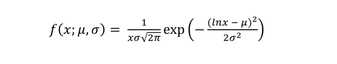
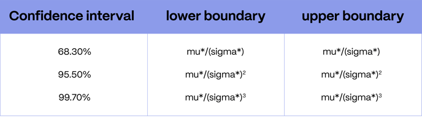
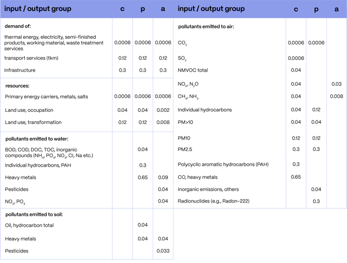
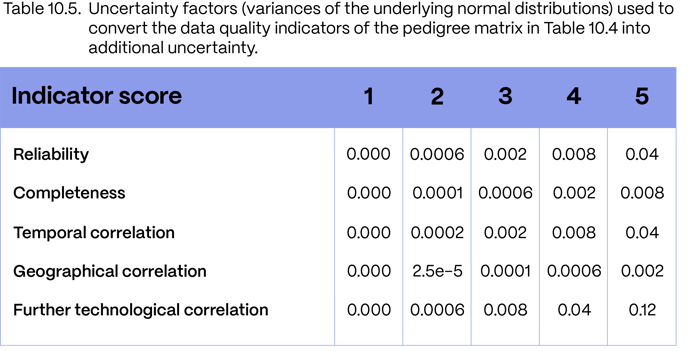
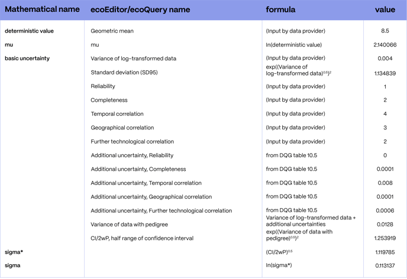
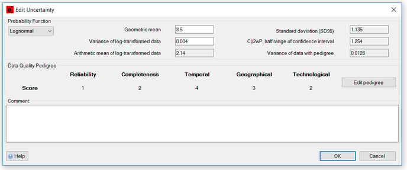

# 不确定性

英文原题：Uncertainties  
来源：[ecoinvent 官方原文](https://support.ecoinvent.org/uncertainties)  
原文快照：2026-10-13  
审核状态：AI 交叉审校通过，含审校注记

原站修改日期：2025-09-26


本页含原文疑点，需领域专家核实。请同时阅读文末审校注记。






##

对数正态分布是 ecoinvent 中最常用于描述不确定性的分布。它的优点是没有负值域，因此不会在蒙特卡洛模拟中意外产生环境收益（抵扣）。

对数正态分布不如正态分布直观，常使新用户感到困惑。作为入门读物，我们推荐 Eckhard Limper 等发表于 BioScience，2001 年 5 月，第 51 卷第 5 期的“[Log-normal Distributions across the Sciences: Keys and Clues（各科学领域中的对数正态分布：关键与线索）](http://stat.ethz.ch/~stahel/lognormal/bioscience.pdf)”。

#### 对数正态分布的定义和基本性质 

当样本值的对数服从正态分布时，该变量服从对数正态分布。对数正态分布的概率密度函数（PDF）为：

其中 x 为随机变量，mu 和 sigma 分别是 ln(x) 分布（有时称为“底层正态分布”）的中位数和标准差。x 的中位数及原文所称的“标准差”分别记为 mu\* 和 sigma\*，可通过以下方程求得：

mu\* = exp(mu)

sigma\* = exp(sigma)

sigma\* 可用于计算置信区间：

对于对数正态分布，中位数等于几何平均值，即 exp(mu)。算术平均值略高于几何平均值，为 exp(mu + sigma2/2)。众数（最可能的值）则较低，为 exp(mu – sigma2)。标准差越大，偏斜程度越大，这三个量之间的差距也越大。

#### 从 ecoinvent 数据到对数正态分布 PDF 

确定对数正态分布的参数，需要数据提供者给出三个输入：<strong>确定值</strong>、<strong>基础不确定性</strong>和<strong>数据质量谱系矩阵</strong>。

从<strong>确定值</strong>得到 mu 很直接：将该值视为等于 mu\*。在 ecoEditor 和 ecoQuery 中，mu 称为“对数变换数据的算术平均值”（Arithmetic mean of log-transformed data）。这些工具也将确定值称为“几何平均值”（Geometric mean）。mu = ln(确定值)。

接下来选择<strong>基础不确定性</strong>。该值反映出即使“完美”的数据也存在不确定性，例如随时间发生波动、测量存在误差等。《数据质量指南》表 10.3 根据所建模交换和过程的类型提供相应数值。在 ecoEditor 和 ecoQuery 中，该值称为“对数变换数据的方差”（Variance of log-transformed data）。“标准差（SD95）”（Standard deviation (SD95)）字段等于 exp((Variance of log-transformed data)0.5)2；该值不用于后续计算的任何其他步骤。

然后，为可靠性、完整性、时间相关性、地理相关性和进一步的技术相关性这 5 个指标分别选择 1 至 5 的评分。这些评分被转换为附加不确定性，用于反映交换数量可能来自可靠性低于一手数据收集的来源。数值可能较陈旧、来自不同技术或世界其他地区，或者基于估算而非计算或测量。《数据质量指南》表 10.5 展示了谱系评分与附加不确定性之间的关系。

将基础不确定性与这五项附加不确定性贡献相加。其和称为“含谱系信息数据的方差”（Variance of data with pedigree）。最后，“CI/2wP，置信区间的半宽度”（CI/2wP, half range of confidence interval）计算为：

exp((Variance of log-transformed data)0.5)2，对应 sigma\* 的平方。

#### 数值示例 

#### 相应的 ecoEditor 不确定性窗口 

 请查阅[Excel 文件](../assets/497e8c271bba-excel-example_FAQ_uncertainty_ecoinvent.xlsx)获取详细示例。





##

The lognormal is the most common distribution chosen to describe the uncertainty in ecoinvent. It has the advantage of not being defined in the negative domain, so credits do not accidentally happen during a Monte Carlo simulation.

The lognormal is not as intuitive as the normal distribution and is often confusing to new users. As a primer, we recommend “[Log-normal Distributions across the Sciences: Keys and Clues](http://stat.ethz.ch/~stahel/lognormal/bioscience.pdf)” by Eckhard Limper et al, in BioScience, May 2001, Vol. 51, No.5.

#### Definition and Basic Properties of the Lognormal Distribution 

A variable is lognormally distributed when the logarithm of the sample is normally distributed. The probability density function (PDF) of the lognormal is:

where x is the random variable, mu and sigma are the median and standard deviation of the distribution of ln(x) (sometimes called "the underlying normal distribution"). The median and standard deviation of x, noted mu\* and sigma\*, can be obtained through the following equations:

mu\* = exp(mu)

sigma\* = exp(sigma)

The quantity sigma\* is useful to calculate intervals of confidence:

In the lognormal distribution, the median corresponds to the geometric mean, and is found at exp(mu). The arithmetic mean is found slightly higher than the geometric mean, at exp(mu + sigma2/2). The mode (the most likely value) is found at a lower value, exp(mu – sigma2). The larger the standard deviation, the larger is the skewedness and the further apart those three quantities will be.

#### From ecoinvent to the Lognormal PDF 

Three inputs are necessary from the data provider to determine the parameters of the lognormal distribution: the <strong>deterministic value</strong>, the <strong>basic uncertainty</strong> and the <strong>pedigree matrix</strong>.

Going from the <strong>deterministic value</strong> to mu is straightforward: this value is taken as equal to mu\*. In ecoEditor and ecoQuery, mu is called “Arithmetic mean of log-transformed data”. The deterministic value is also called “Geometric mean” in those tools. mu = ln(deterministic value).

Then, the <strong>basic uncertainty </strong>is chosen. This value reflects the fact that even “perfect” data is uncertain: there are fluctuations over time, errors in measurements, etc. Table 10.3 of the Data Quality Guidelines provides for values, depending on the type of exchange and process modeled. In ecoEditor and ecoQuery, this value is called “Variance of log-transformed data”. The field “Standard deviation (SD95)” is equal to exp((Variance of log-transformed data)0.5)2, a value that is not used anywhere in the rest of the calculation.

Then, a score from 1 to 5 is selected for 5 indicators: reliability, completeness, temporal correlation, geographical correlation, further technological correlation.  These scores are transformed into additional uncertainty in order to reflect that the amount of an exchange might come from sources that are not as reliable as primary data collection.  The values can be older, from a different technology, another part of the world, or based on estimates rather than calculation or measurement.  Table 10.5 of the Data Quality Guidelines shows the relationship between the pedigree scores and the additional uncertainty.

The basic uncertainty is added to the five additional contributions to the uncertainty. This sum is called “Variance of data with pedigree”. Finally, the “CI/2wP, half range of confidence interval” is calculated as

exp((Variance of log-transformed data)0.5)2, corresponding to the square of sigma\*.

#### A Numeric Example 

#### Corresponding ecoEditor Uncertainty Window 

  Consult the [Excel file](../assets/497e8c271bba-excel-example_FAQ_uncertainty_ecoinvent.xlsx) for a detailed example.





## 翻译与审校注记 

- **待专家复核 · b0006**：sigma* = exp(sigma) 是几何标准差，而非 x 的算术标准差。正态分布的 mu 同时为均值和中位数，原文用中位数并不改变公式。译文明确保留原文“标准差”措辞，避免误指算术标准差。 技术编辑应将原文 standard deviation of x 明确为 geometric standard deviation，并核对图中符号。 [查看完整记录](../review/issues.md#issue-165)
- **待专家复核 · b0017**：上一块已将基础与谱系贡献之和称为 Variance of data with pedigree，但此处置信区间公式仍写 Variance of log-transformed data。需确认公式应使用总方差还是基础方差；保留原文符号和表达。 对照附件数值示例确认含谱系置信区间所用方差字段，并核实原文纯文本的指数排版。 [查看完整记录](../review/issues.md#issue-166)
- **已处理／已说明 · b0014**：恢复原公式中的字段名，保持公式与软件字段可直接核对。 已修正译稿并重新核对原文。 [查看完整记录](../review/issues.md#issue-167)
- **已处理／已说明 · b0017**：恢复原公式中的字段名，保持公式与软件字段可直接核对。 已修正译稿并重新核对原文。 [查看完整记录](../review/issues.md#issue-168)
