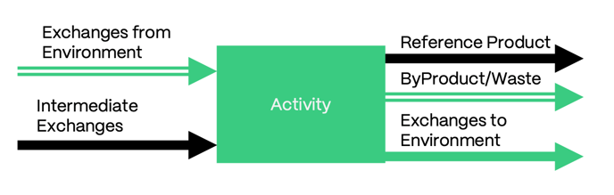
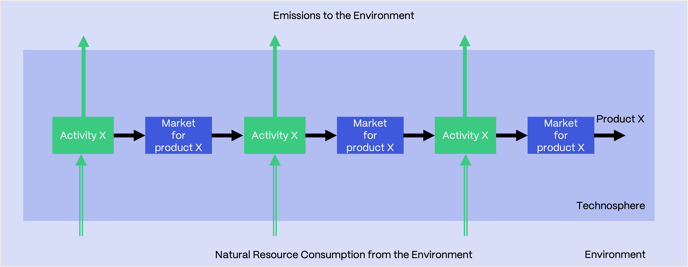
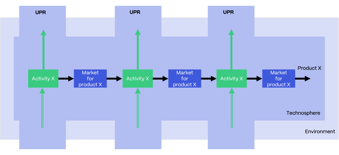
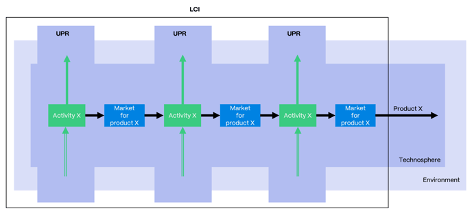
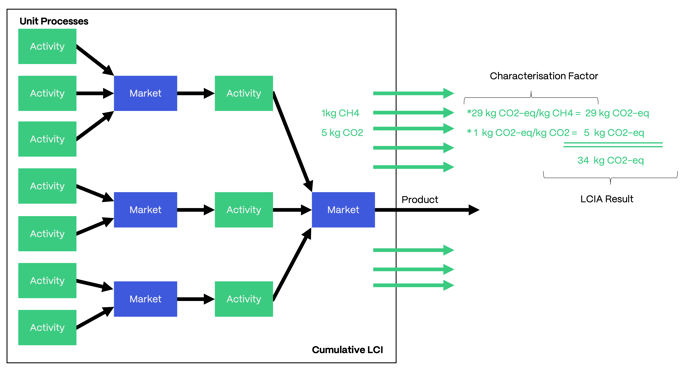
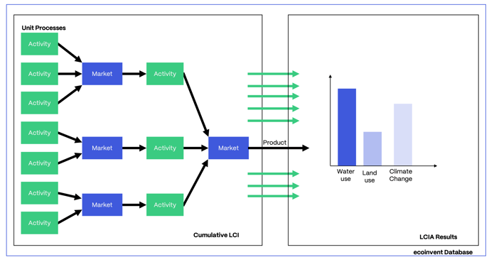

# UPR、LCI 与 LCIA

英文原题：UPR, LCI and LCIA  
来源：[ecoinvent 官方原文](https://support.ecoinvent.org/upr-lci-lcia)  
原文快照：2026-10-13  
审核状态：AI 交叉审校通过，含审校注记

原站修改日期：2025-09-26


本页含原文疑点，需领域专家核实。请同时阅读文末审校注记。






## 本文介绍单元过程（UPR）、累积生命周期清单（LCI）和生命周期影响评价（LCIA）的详细信息。 

2024 年 2 月 14 日

[单元过程（UPR）](#zh-b0011)

[累积生命周期清单（LCI）](#zh-b0016)

[生命周期影响评价（LCIA）](#zh-b0020)

单元过程（UPR）

数据库的基本构成单元是各个人类活动过程，以及它们与环境的交换（基本流交换）和与技术圈的交换（中间交换）。

在 ecoinvent 数据库中，这些称为单元过程（UPR），也称从大门到大门的清单。这些过程既不与供应链中的后续过程纵向汇总，也不与提供相同中间输出的过程横向汇总。因此，供应链中发生的每个过程都形成独立单元，并具有单独的生命周期清单。

尽管如此，活动通常以国家层级报告，对同一国家中采用同一技术的不同生产者的信息取平均值，为用户提供有意义的背景数据。同样，UPR 很少单独表示仅供后续过程用作中间产品的产品生产。

#### 未指定系统模型的 UPR 与已链接 UPR 

UPR 提供未指定系统模型和已链接两种形式。

<strong>未指定系统模型</strong>的 UPR 展示数据提供方编制的数据。它们是未链接（未确定供应商）的多产品（多输出）活动，也是应用特定系统模型建模选择的起点。

在系统模型中，通过将交换链接至其供应商来确定活动的供应链。应用过程细分和分配，生成<strong>已链接</strong>的单产品 UPR（参见[系统模型](system-models.md)栏目）。

<strong>注意：</strong>在 [ecoQuery](https://ecoquery.ecoinvent.org/login) 中，可访问这两种 UPR 形式。查看数据集的“交换”（Exchanges）栏目即可获得已链接 UPR。未指定系统模型的 UPR 可通过“系统模型”（System model）下拉菜单获取。这些信息仅供许可证持有者访问。访客至少可以查看一般文档。

### 累积生命周期清单（LCI） 

为构建价值链并计算产品环境影响，各个 UPR 被链接成供应链（系统）。

若同类自然资源消耗或排放发生于供应链不同阶段，其数量将进行汇总。由此得到与最终产品从摇篮到工厂大门的生命周期相关的、从环境中获取的自然资源和排入环境的排放的完整清单。若需要废物寿命终结处理或处置过程，则生命周期范围为从摇篮到坟墓。

与产品生命周期相关的基本流交换汇总清单称为累积生命周期清单（LCI）。

### <strong>生命周期影响评价（LCIA）</strong> 

累积的基本流交换清单尚不能说明这些自然资源输入和环境排放造成的环境影响。

这时就需要使用[生命周期影响评价](impact-assessment.md)（LCIA）方法。它们以所谓表征因子（CF）的形式，量化基本流交换所对应损害或收益的类型及大小。例如，甲烷（CH4）是一种温室气体，其气候变化影响以 kg CO2 当量（CO2-eq）的全球变暖潜势衡量。此处影响评价认为，在全球变暖方面，甲烷在大气中的效应是 CO2 的二十九倍。因此，1kg CH4 排放量乘以表征因子 29，得到 29kg CO2 当量的全球变暖潜势。

基本流交换可能对一个或多个[影响类别](impact-assessment.md)产生贡献，例如“气候变化”“人体毒性”“土地利用”或“用水”。将全部交换匹配至相应的全部表征因子并相乘后，得到产品的 LCIA 得分。

作为背景数据库，ecoinvent 重点编制基本构成单元 UPR，表示各个人类活动单元过程及其与环境的交换，再将这些 UPR 组合成供应链，形成 LCI。不过，数据库也包含 LCIA 得分数据。这些得分通过应用已有 LCIA 方法计算，例如政府间气候变化专门委员会（IPCC）的全球变暖潜势方法。

在 [ecoQuery](https://ecoquery.ecoinvent.org/login) 的文件栏目中下载 LCIA 实施文件，可查看 ecoinvent 数据库提供哪些 LCIA 方法及使用哪些表征因子。





## Details on Unit Process (UPR), Cumulative Life Cycle Inventory (LCI), and Life Cycle Impact Assessment (LCIA) are covered in this article. 

Feb, 14th 2024

[Unit Process (UPR)](#en-b0011)

[Cumulative Life Cycle Inventory (LCI)](#en-b0016)

[Life Cycle Impact Assessment (LCIA)](#en-b0020)

Unit Process (UPR)

The basic building blocks of the database are individual processes of human activities and their exchanges with the environment (elementary exchanges) and with the Technosphere (intermediate exchanges).

In the ecoinvent database, these are called unit processes (UPR), also known as gate-to-gate inventories. These processes are neither vertically aggregated with subsequent processes in a supply chain nor horizontally aggregated with processes delivering the same intermediate outputs. Hence, every process that occurs along a supply chain forms its own unit, for which a separate life cycle inventory is available.

Nevertheless, activities are most often reported at the national level, averaging information from different producers using the same technology in the same country to deliver meaningful background data to the user. Similarly, UPR would rarely represent the production of products that are exclusively used as intermediate products for a subsequent process.

#### Undefined and Linked UPRs 

UPRs are available in undefined and linked forms.

<strong>Undefined</strong> UPRs show the data as compiled by the data provider. Undefined UPRs are unlinked (no suppliers determined) multi-product (multi-output) activities. This is the starting point on which system model-specific modeling choices are applied.

In system models, the supply chain of the activity is determined by linking the exchanges to their suppliers. Subdivision and allocation are applied to produce <strong>linked</strong> single-product UPRs (see [system models](system-models.md) section).

<strong>Note:</strong> in [ecoQuery](https://ecoquery.ecoinvent.org/login), you can access both forms of UPR. Linked UPRs are available simply by consulting the “Exchanges” section of a dataset. The Undefined UPRs are available via the dropdown menu “System model”. These types of information are available only to licensees. As a guest, you can at least consult the general documentation.

### Cumulative Life Cycle Inventory (LCI) 

In order to generate value chains and calculate environmental impacts of products, the individual UPRs are linked into supply chains (systems).

Where natural resource consumption or emissions of the same type occur at different stages of a supply chain, their amounts are aggregated. This results in a comprehensive list of the natural resources taken from and the emissions released to the environment associated with the life cycle of the final product, from cradle to the factory gate. Where end-of-life treatment or disposal processes of wastes are required, the life cycle ranges from cradle to grave.

The aggregated list of elementary exchanges associated with the life cycle of a product is called the cumulative life cycle inventory (LCI).

### <strong>Life Cycle Impact Assessment (LCIA)</strong> 

The cumulative list of elementary exchanges does not yet provide information about the environmental impact caused by these natural resource inputs and emissions to the environment.

This is where [Life Cycle Impact Assessment](impact-assessment.md) (LCIA) methods come into play. They quantify what and how much damage or benefit is associated with an elementary exchange in the form of so-called characterisation factors (CFs). For example, methane (CH4) is a greenhouse gas that has an impact on climate change measured as global warming potential in kg CO2-equivalent (CO2-eq). The impact assessment considers that the effects of methane in the atmosphere are twenty-nine times higher as those of CO2 when it comes to global warming. Therefore, the emission of 1kg of CH4 is multiplied by the CF of 29, resulting in a global warming potential of 29kg CO2-equivalents.

Elementary exchanges may contribute to one or more [impact categories](impact-assessment.md), such as “climate change,” “human toxicity,” “land use,” or “water use.” Once all exchanges have been matched and multiplied with all their CFs, the result is the LCIA score of a product.

As a background database, the focus of ecoinvent is on the compilation of the basic building blocks, UPRs, representing the individual unit processes of human activities and their exchanges with the environment, and the combination of these UPRs in supply chains to form LCIs. Nevertheless, the database also contains data on LCIA scores. These are calculated by applying already developed LCIA methods, such as the global warming potential of the Intergovernmental Panel on Climate Change (IPCC).

Download the LCIA implementation file in the file section of [ecoQuery](https://ecoquery.ecoinvent.org/login) to see what LCIA methods are available in the ecoinvent database and which CFs apply.





## 翻译与审校注记 

- **待专家复核 · b0022**：原文示例未指定影响评价方法、时间范围或甲烷来源类别；甲烷表征因子并非通用常数。 保留原文示例数值；专家可补核原文所用方法和评价时距，避免将 29 用于所有 LCIA 方法。 [查看完整记录](../review/issues.md#issue-169)
