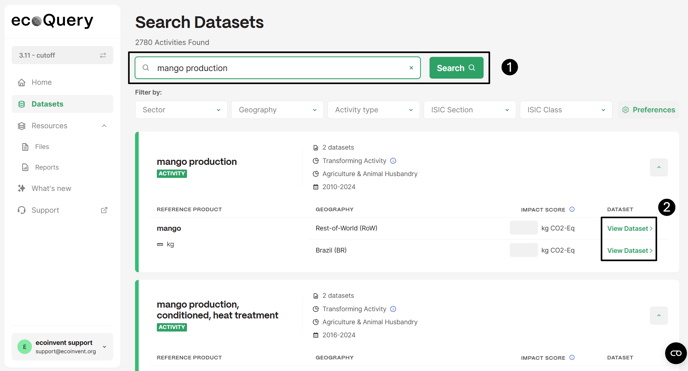

# 在 ecoQuery 中查看数据集

英文原题：Viewing Datasets in ecoQuery  
来源：[ecoinvent 官方原文](https://support.ecoinvent.org/viewing-datasets-in-ecoquery)  
原文快照：2026-10-13  
审核状态：AI 交叉审校通过，含审校注记

原站修改日期：2025-09-26





## 在搜索栏输入数据集名称后，点击“详情”（Details），即可访问数据集文档、交换、消费活动、LCI 结果、影响评价以及不同导出选项。 

2025 年 2 月 12 日

根据所用视图，您可在各个数据集中找到以下栏目：

- <strong>文档（Documentation）：</strong>包含数据集元数据，包括一般说明、技术说明、系统边界等。
- <strong>交换（Exchanges）：</strong>包含数据集与技术圈和生物圈的实际交换。点击每项交换旁的三个点，即可查看以下信息：分类（截断分类和 CPC 分类）、说明、数据质量、不确定性、产量及属性。
- <strong>消费活动（Consuming activities）：</strong>列出消费您正在查看的活动所提供产品的活动。
- <strong>LCI 结果（LCI results）：</strong>该栏目列出所选数据集在所选系统模型下的累积[生命周期清单（LCI）](upr-lci-lcia.md)。
- <strong>影响评价（Impact assessment）</strong>：该栏目列出 ecoinvent 数据库实施的 LCIA 方法的结果。
- <strong>导出（Exports）：</strong>该栏目可下载已链接 UPR、LCI 和 LCIA 的 ecoSpold2 文件。此外，还可下载所显示信息的 PDF 版本。在搜索栏输入数据集名称后，点击“详情”（Details）即可访问该数据集。





## Once you have entered a dataset name in the search bar, by clicking - Details - you will have access to the dataset Documentation, Exchanges, Consuming Activities, LCI results, Impact assessment, and different Export options. 

Feb 12th, 2025

For each dataset and depending on the view, you can find the following sections:

- <strong>Documentation:</strong> Contains the meta-data of the dataset, including general and technology comment, system boundaries, etc.
- <strong>Exchanges:</strong> Contains the actual exchanges of the dataset with the technosphere and biosphere. For each exchange, by clicking on the three dots next to it, the following information is available: Classification (cut-off and CPC classification), Comment, Data Quality, Uncertainty Production Volume, and Properties.
- <strong>Consuming activities:</strong> List of activities which consume the activity which you are looking at.
- <strong>LCI results:</strong> This section lists the cumulative [LCI](upr-lci-lcia.md) (Life Cycle Inventory) of the selected dataset, for the selected system model.
- <strong>Impact assessment</strong>: This section lists the results for the LCIA methods implemented in the ecoinvent database.
- <strong>Exports:</strong> In this section, the ecoSpold2 files of the linked UPR, LCI, and LCIA can be downloaded. Additionally, the PDF version of the shown information can be downloaded. Once you have entered a dataset name in the search bar, by clicking 'Details' you will have access to the dataset.





## 翻译与审校注记 

- **已处理／已说明 · b0006**：统一指南规定的产量术语。 已将生产量改为产量。 [查看完整记录](../review/issues.md#issue-170)
